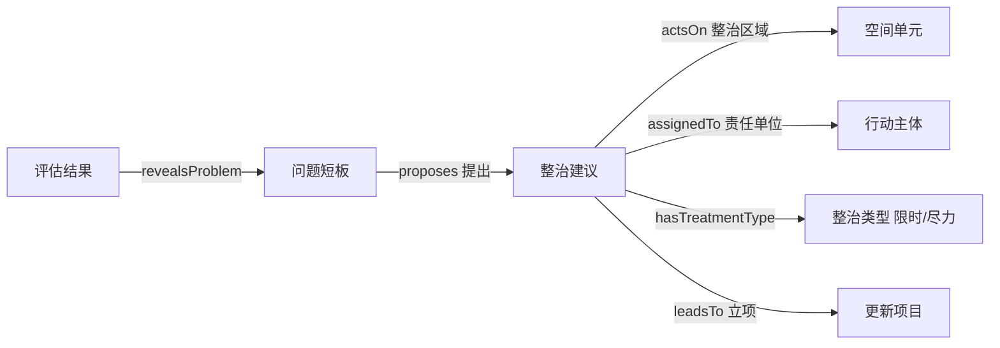

# 样本成果「问题清单 / 整治清单」→ 本体改动影响范围草案（v1）

> **日期**：2026-10-09　**状态**：待大王勾选  
> **依据材料**：`01-资料/样本成果/城市体检报告案例/城区维度体检成果参考.doc`、`街区维度体检成果参考.docx`（抽取件见 `01-资料/样本成果/_extracted/`）  
> **性质**：样本件为**地方交付物**，无标准条款号，以下一切引用均标【地方实操·无条款号】，**只作结构逻辑参考，不得当标准依据**（项目规则 1）。  
> **用法**：本文档为**改动方案集**，非执行记录。大王在 §五 勾选表中圈定采纳项，老奴据勾选结果执行；未勾选项一律不动。  
> **执行前置**：任何勾选项落地前，先 `cp` 备份至 `_bak_20261009/`（遵守既有约定）。

---

## 〇、先说清楚：样本市两张清单暴露的四个事实

在提改动之前，先把从原文读出来的**硬事实**摆出来，改动才有依据。

| 编号  | 事实                                                                                                             | 出处                  | 对我们的意义                                             |
| --- | -------------------------------------------------------------------------------------------------------------- | ------------------- | -------------------------------------------------- |
| F-1 | 「问题清单」在两级维度**口径不同**：城区=14 行**仅不达标指标**；街区=12 行**全指标台账**（含"问题评价值 0"的正常项）                                         | 城区表4；街区表1/4/7/10/13 | "问题清单"是**报表视图**，不是实体类；同名清单语义随维度变                   |
| F-2 | 「整治清单」是问题与更新之间的**中介层**：字段含 整治建议 / 整治区域 / 整治类型 / 责任单位                                                           | 城区表5                | 我方 `Problem --triggers--> RenewalProject` **缺这一环** |
| F-3 | `Problem` 是**实例级、绑定空间单元**：同一指标（22 中学服务半径覆盖率）在 5 个街道的问题评价值各不同（5 个街道取值互不相同，均为 0–1 的小数）          | 街区表3/6/9/12/16      | 支撑 `Problem` 增 `locatedIn`                         |
| F-4 | 严重程度是**0–1 连续值**，非三档枚举（实测为 0–1 之间的小数序列，非离散枚举）                                 | 街区表3 等「问题评价值」列      | 与借用同事的 `severity`（轻微/中等/严重）**冲突**                  |
| F-5 | 分类轴**随维度变**：城区一级分类 5 类（生态宜居/历史文化保护利用/产城融合职住平衡/安全韧性/智慧高效）；街区一级分类 3 类（功能完善/整洁有序/特色活力）。且同一轴在表4 叫「一级分类」、表5 叫「问题领域」 | 城区表2/表4/表5；街区表3     | 我方只有 `Dimension`，**缺一级分类轴**                        |
| F-6 | 评价是**两步法 + 分类聚合**：①与参考标准比 → ②与去年比升降 → 一级分类按比重（门槛 80/60/40%）定优/良/中/差                                            | 城区「2.指标评价（2）(3)」    | `EvaluationRule` 族需补时序比较与聚合两种规则                    |
| F-7 | 责任单位实操称谓 = 住建局 / 文体广旅局 / 发改委 / 消防救援队                                                                           | 城区表5                | 即我方 `Actor` 实例，术语需对齐                               |

---

## 一、改动分组总览（速览表）

| 组 | 改动主题                  | 项数 | 性质          | 老奴建议                  |
| - | --------------------- | -- | ----------- | --------------------- |
| A | **中介层**：新增「整治建议」类及其关系 | 6  | 新增（结构性）     | **推荐全部采纳**            |
| B | **`Problem` 字段补强**    | 4  | 新增 + 1 项破坏性 | 推荐 B1/B2/B4，B3 需先答 Q1 |
| C | **分类轴与评价规则**          | 5  | 新增（结构性）     | C1 推荐；C2–C5 缓办待核      |
| D | **下游文档同步**            | 4  | 被动同步        | 随 A/B/C 采纳项连带执行       |
| E | **明确不做**（防误改）         | 5  | 不改          | 记录在案                  |

---

## 二、A 组 · 中介层（推荐全部采纳）

> **改动理由**：样本市结构为 `指标评价不足 → 问题清单 → 整治建议（带区域/类型/责任单位）→ 后续立项`。我方闭环 `Problem --triggers--> RenewalProject` 是**跳跃**的，缺"建议"这一落地环节。补上后，`triggers` 才有真实主语。

| 编号 | 改动项                                                                                                                                     | 类型          | 依据                                 | 影响文件                                                  | 风险                                                    | 工作量 |
| -- | --------------------------------------------------------------------------------------------------------------------------------------- | ----------- | ---------------------------------- | ----------------------------------------------------- | ----------------------------------------------------- | --- |
| A1 | 新增&#x7C7B;**「整治建议 `RemediationSuggestion`」**（置于 `Problem` 与 `RenewalProject` 之间）                                                        | 新增类         | F-2，城区表5                           | `类与层级.md`（§一 顶层类 15 个 / §三 主干闭环）、`属性与关系.md`、`概念清单.md` | 中：与同事 `PolicyIntervention`（概念映射）的边界须写清，避免同义异名         | 中   |
| A2 | 新增对象属性 **`proposes`**（`Problem` → `RemediationSuggestion`，基数 1..n）                                                                      | 新增关系        | F-2                                | `属性与关系.md` §一                                         | 低                                                     | 小   |
| A3 | 新增对象属性 **`leadsTo`**（`RemediationSuggestion` → `RenewalProject`，基数 0..n）；原 `triggers` 语义收窄为「问题→建议」，或保留 `Problem → RenewalProject` 作直通路径 | 新增关系 + 语义调整 | F-2                                | `属性与关系.md` §一；`类与层级.md` §三                            | **中高**：`triggers` 是主干核心关系，改语义会动到 §四约束与后续 `.sparql` 模板 | 中   |
| A4 | 新增对象属性 **`actsOn`** 值域扩展至支持 `RemediationSuggestion`（整治区域）                                                                               | 关系定义域扩展     | F-2，城区表5「整治区域」                     | `属性与关系.md` §一                                         | 中：整治区域常为"火车站附近""青年路两侧"等**非标准空间单元**，见 E-3              | 小   |
| A5 | 新增对象属性 **`assignedTo`**（`RemediationSuggestion` → `Actor`，责任单位）                                                                         | 新增关系        | F-7，城区表5「责任单位」                     | `属性与关系.md` §一                                         | 低                                                     | 小   |
| A6 | 新增数据属性 **`treatmentType`**（整治类型）：枚举「限时解决 / 尽力解决」，可多选                                                                                    | 新增属性        | 城区表2「是否完成情况（限时解决＋尽力解决）」列、表5「整治类型」列 | `属性与关系.md` §二/§三                                      | 中：**枚举判定规则未明**【待核】——同一建议同时标两值的含义（并列？主次？）样本件未解释        | 小   |

---

## 三、B 组 · `Problem` 字段补强

| 编号 | 改动项                                                                                                                            | 类型                           | 依据                          | 影响文件                                                        | 风险                                         | 工作量 |
| -- | ------------------------------------------------------------------------------------------------------------------------------ | ---------------------------- | --------------------------- | ----------------------------------------------------------- | ------------------------------------------ | --- |
| B1 | 新增数据属性 **`problemDescription`**（问题分析 / 存在问题，字符串）                                                                               | 新增属性                         | F-1，城区表4「问题分析」列、街区表1「存在问题」列 | `属性与关系.md` §二                                               | 低                                          | 小   |
| B2 | 新增对象属性 **`locatedIn`** 定义域扩展至 `Problem`（`Problem` → `SpatialUnit`）                                                             | 关系定义域扩展                      | F-3                         | `属性与关系.md` §一；§四 `locatedIn` 传递性约束需重述（`Problem` 不参与传递，仅作归属） | 中：`locatedIn` 是全本体复用度最高的关系，扩定义域须同步 §四 约束说明 | 小   |
| B3 | **`severity` 数值化**：`Problem.severity` 由枚举（轻微/中等/严重）改为数值 [0,1]；原三档降为**档位映射**（如 0<X≤0.2 轻微 / 0.2<X≤0.6 中等 / X>0.6 严重，**档位边界待定**） | **破坏性变更**                    | F-4                         | `属性与关系.md` §三-2、§三-3 约束；`概念清单.md` §九                        | **高**：与借用同事的枚举口径冲突；须先答 **Q1**              | 中   |
| B4 | 新增对象属性 **`derivedFrom`**（`Problem` → `AssessmentResult`，问题由哪条评估结果导出，基数 1..1）                                                   | 新增关系（`revealsProblem` 的正向补充） | F-1（问题=不达标指标 ⟹ 1:1 挂靠）      | `属性与关系.md` §一                                               | 低                                          | 小   |

> **B4 的取舍说明**：现已有逆向的 `revealsProblem`（`AssessmentResult` → `Problem`）。是否再建正向 `derivedFrom`，取决于后续是否要做"从问题反查指标值"的 SPARQL——建议建，成本极低。

---

## 四、C 组 · 分类轴与评价规则（建议缓办，待核）

| 编号 | 改动项                                                                                                                       | 类型   | 依据               | 风险                                                                               | 老奴建议                                                                     |
| -- | ------------------------------------------------------------------------------------------------------------------------- | ---- | ---------------- | -------------------------------------------------------------------------------- | ------------------------------------------------------------------------ |
| C1 | 新增&#x7C7B;**「指标分类 `IndicatorCategory`」**（一级分类）+ 对象属性 `inCategory`（`Indicator` → `IndicatorCategory`）；与 `Dimension` 并列为两根轴 | 新增类  | F-5              | 中：需明确一级分类的**权威来源**——我方 55 项是否也有官方一级分类？**答案未知【待核】**，若我方口径有官版分类，应改用官版而非样本市的 5 类/3 类 | **采纳**（但取值须待我方口径核定）                                                      |
| C2 | `AssessmentResult.grade` 枚举由「达标/基本达标/不达标」扩展/并存为四档「很好/较好/一般/不足」                                                            | 枚举变更 | F-6，城区「2.指标评价」   | **高**：与现有口径冲突，且四档来源为样本市地方自述【地方实操】，不见于我方标准                                         | **缓办**，先答 **Q2**                                                         |
| C3 | `EvaluationRule` 增子类 **`YearOnYearRule`**（同比升降规则：与去年值比较，提升/降低一档，无去年值视为优于）                                                 | 新增类  | F-6 第一步+第二步      | 中：依赖 `TemporalTrend`，二者边界须写清                                                     | 缓办（可先入 §2.9.3 备注）                                                        |
| C4 | 新增类 **`CategoryAggregationRule`**（分类聚合规则：很好+较好占比门槛 80/60/40% → 优/良/中/差）                                                   | 新增类  | F-6（3），城区表3      | 中：阈值 80/60/40 为样本市地方口径【地方实操】                                                      | 缓办                                                                       |
| C5 | 新增数据属性 **`referenceValue`**（参考标准值）+ **`ratingBand`**（四档评分区间）                                                              | 新增属性 | F-6，城区表2「参考标准值」列 | 低–中                                                                              | 缓办（与既有 A2 建议合并，见 `05-产出/报告/样本市2025体检成果研究_内容梳理与意义分析-v1-20260930.md` §四 A2） |

C1:体检指标官方子类依据：住房1-4为安全耐久，5-8为功能完备；

小区（社区）9-13为设施完善、14-16为环境宜居、17-18为管理健全；

街区19-22为功能完善、23为整洁有序、24-26为特色活力；

城区27-31为生态宜居、32-36为历史文化保护利用、37-40为产城融合职住平衡、41-49为安全韧性、50-53为智慧高效；

问题整治（54、55）无子类

C2、C3、C4、C5暂不执行

---

## 五、勾选表（大王在此圈定）

> 用法：将 `[ ]` 改为 `[x]` 表示采纳；或在"意见"栏批注。

### A 组 · 中介层

- [ ] **A1** 新增类「整治建议 `RemediationSuggestion`」　意见：采纳
- [ ] **A2** 新增关系 `proposes`（Problem → RemediationSuggestion）　意见：采纳
- [ ] **A3** 新增关系 `leadsTo`（RS → RenewalProject），调整 `triggers` 语义　意见：采纳
- [ ] **A4** `actsOn` 值域扩展至 RemediationSuggestion（整治区域）　意见：采纳
- [ ] **A5** 新增关系 `assignedTo`（RS → Actor，责任单位）　意见：采纳
- [ ] **A6** 新增属性 `treatmentType`（限时解决/尽力解决）　意见：采纳

### B 组 · Problem 字段

- [ ] **B1** 新增属性 `problemDescription`　意见：采纳
- [ ] **B2** `locatedIn` 定义域扩展至 `Problem`　意见：采纳
- [ ] **B3** `severity` 数值化 [0,1]（破坏性，需先答 Q1）　意见：见“六、前置待决口径"
- [ ] **B4** 新增关系 `derivedFrom`（Problem → AssessmentResult）　意见：采纳

### C 组 · 分类与评价

- [ ] **C1** 新增类 `IndicatorCategory` + `inCategory`　意见：见“四、C 组 · 分类轴与评价规则”批注
- [ ] **C2** `grade` 四档口径（需先答 Q2）　意见：见“四、C 组 · 分类轴与评价规则”批注
- [ ] **C3** 新增 `YearOnYearRule`（同比升降）　意见：见“四、C 组 · 分类轴与评价规则”批注
- [ ] **C4** 新增 `CategoryAggregationRule`（分类聚合定级）　意见：见“四、C 组 · 分类轴与评价规则”批注
- [ ] **C5** 新增 `referenceValue` + `ratingBand`　意见：见“四、C 组 · 分类轴与评价规则”批注

### D 组 · 下游同步（随采纳项连带）

- [ ] **D1** `02-术语与概念/概念清单.md` 新增术语条目（规则 3 强制，采纳 A1/A6/C1 则必做）　意见：采纳
- [ ] **D2** `04-指标映射/指标映射表.md` 复核指标 54（体检问题）、55（更新项目）的 `computedFrom` 值域是否需纳入新类　意见：采纳
- [ ] **D3** `04-指标映射/55项基础指标_录入模板.md` 是否追加「问题描述 / 整治类型」相关列（**建议不加**，录入模板是填报口径，不受地方成果影响）　意见：采纳
- [ ] **D4** `03-本体模型/类与层级.md` §三 主干闭环 Mermaid 图更新　意见：采纳

### E 组 · 明确不做（防误改，仅登记）

- [ ] **E1** 不新增「问题清单」类 —— 清单是**报表视图**（F-1），非实体
- [ ] **E2** 不新增「整治清单」类 —— 同上，是 `Problem` + `RemediationSuggestion` 的报表
- [ ] **E3** 不改 `IndicatorCategory` 之外的"街道"层级 —— 样本市用行政区街道落地街区维度，属**地方口径**【地方实操】，我方五级主轴不动
- [ ] **E4** 不改 `Actor` 类结构 —— 仅做术语对齐（"责任单位" = `Actor` 的实操称谓），类不增删
- [ ] **E5** 不改 `ProblemIndicatorMapping` 的加权设计 —— 样本市是 1:1 硬绑定（问题=不达标指标），与同事 AHP 加权映射**两种范式**，本期不动，留作专题

---

## 六、前置待决口径（不答则相关项无法执行）

| 编号     | 待决问题                                                                      | 卡住哪些项 | 备选                                                                                     |
| ------ | ------------------------------------------------------------------------- | ----- | -------------------------------------------------------------------------------------- |
| **Q1** | `severity` 用**数值 [0,1]** 还是保留**三档枚举**？                                    | B3    | ① 数值化，三档降为档位映射（推荐，样本市实证支持）；② 保留枚举，另设 `problemScore` 数值属性并存；③ 不动                         |
| **Q2** | `AssessmentResult.grade` 用我方**三档**（达标/基本达标/不达标）还是兼容样本市**四档**（很好/较好/一般/不足）？ | C2    | ① 维持我方三档；② 双轨（`grade` + `localGrade`）；③ 改四档（**不建议**，四档无我方标准来源）                         |
| **Q3** | 「整治建议 `RemediationSuggestion`」与同事「治理处方 `PolicyIntervention`」的关系？          | A1    | ① 等价、统一用 `RemediationSuggestion`（我方主干术语，推荐）；② 保留两个类、互设 `sameAs`；③ 不建类、仅作 `Problem` 的属性 |

Q1：采用数值化

Q2：维持当前；

Q3：统一用我方主干术语

---

## 七、若全采纳：执行顺序与回滚

**建议顺序**（先上游后下游，遵守 AGENTS.md 工作流约束 4-1）：

1. 备份 → `_bak_20261009/`（`类与层级.md` / `属性与关系.md` / `概念清单.md` 三件）
2. `概念清单.md` 先入新术语（规则 3：新增概念先入术语清单）
3. `类与层级.md` 改类结构（§一 顶层类表、§三 主干闭环图、§四 待决清单）
4. `属性与关系.md` 同步属性与关系 + §四 约束
5. `04-指标映射/` 复核（D2）
6. 校验：`diff` 对备份、CRLF=0、表列数一致

**回滚**：`_bak_20261009/` 原件直接覆盖即可，单次操作范围限于上述三件 md。

---

## 八、风险登记

| 编号  | 风险                                                 | 等级 | 缓解                                                         |
| --- | -------------------------------------------------- | -- | ---------------------------------------------------------- |
| R-1 | 样本件是**地方交付物**，字段/分类/阈值均无标准条款号                      | 高  | 一切取值标【地方实操】，**不进"标准依据"字段**；写入本体后统一带 `sourceType = 地方实操` 标注 |
| R-2 | **同名清单口径不一**（F-1）：城区"问题清单"是不达标子集，街区是全指标台账          | 中  | 本体不建"清单"类；若未来需建视图，须区分 `ProblemList` / `IndicatorLedger`    |
| R-3 | `triggers` 语义调整（A3）波及 §四 约束与后续 `.sparql` 模板        | 中高 | 保留 `Problem → RenewalProject` 直通路径作兼容                      |
| R-4 | 整治区域粒度不一（"全市" ↔ "火车站附近"），非标准空间单元                   | 中  | 短期以 `locationDescription` 字符串兜底；长期待空间单元体系定稿                |
| R-5 | 坐标式"修一处带一片"：A/B/C 三组共 15 项改动若一次性落地，`类与层级.md` 变动面较大 | 中  | 按组分批执行，每组落一次备份 + 一次校验                                      |

---

*草案完 · v1 · 2026-10-09*
