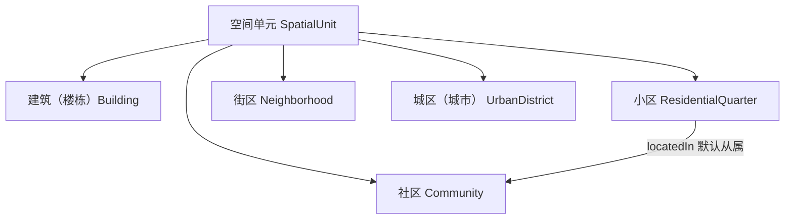
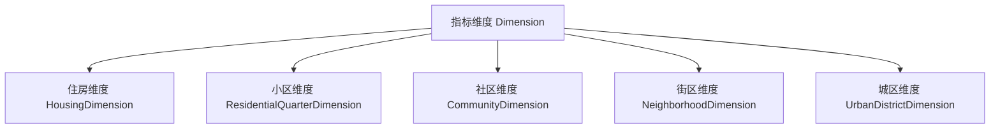
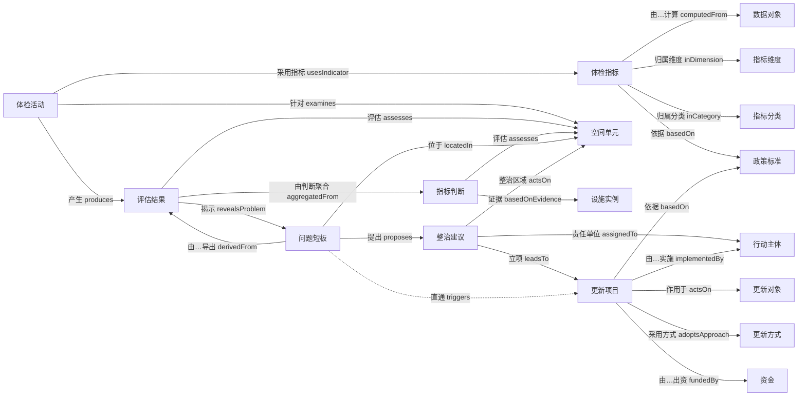
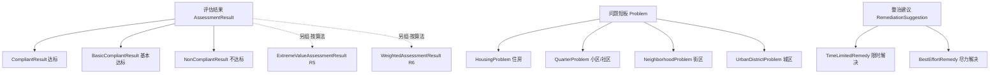

# 类与层级

> **状态：基于调研 v1（2026-09 深度调研成果）建模稿**。  
> 结构性变更须先改本文件，再同步 `属性与关系.md` 与 `04-指标映射/`。  
> 📎 **全量类清单**：107 个类（按语义域分组、带实例数与指标引用数）的完整列表见本文档 **§附录 A**（由 `_gen_class_list.py` 从 `.ttl` 自动生成，可重跑）。正文为**分层叙述**，类分散在 §一 与 §2.1–§2.10，单看容易漏；**要看全请直接翻附录 A**。
> **编号说明**：本文出现的 `A6` / `D2` / `Q1`–`Q3` 等，属 `样本成果_本体改动影响范围草案-v1-20261009.md` 的历史编号（已冻结），**不是项目任务编号**（任务编号为 `W-xx`）。跨文档引用请写「草案 D2」；全项目编号总表见 [`项目总纲.md`](../项目总纲.md) 附录 A。

## 〇、技术路线（把关重要）

- **当前形态**：轻量文本本体 —— 以 Markdown + YAML 片段表达类、属性、关系、约束，便于人工评审与 git 版本管理。
- **后续目标（导出管线）**：
  - `城市体检-更新本体.ttl` —— OWL / Turtle 序列化（类 = `owl:Class`，子类 = `rdfs:subClassOf`，对象属性 = `owl:ObjectProperty`，数据属性 = `owl:DatatypeProperty`）。
  - `城市体检-更新约束.shacl` —— SHACL 形状，承载 `locatedIn` 传递性、触发链基数、`measures` 层级匹配、`computedFrom` 基数、`threshold` 绑定 `PolicyStandard` 版本等约束。
  - `常用查询.sparql` —— 体检验改闭环回溯查询模板（如「某城区 2025 体检 → 问题短板 → 更新项目」）。
- **命名空间（占位，待定）**：`https://ontology.cset-digital.cn/urban-renewal#`【待核命名空间】。所有 URI 名见各表「URI 名」列。
- **OWL 对齐约定**：类 → `rdfs:Class`；子类 → `rdfs:subClassOf`；对象属性 → `owl:ObjectProperty`（标注逆属性 / 传递性 / 函数性）；数据属性 → `owl:DatatypeProperty`；枚举 → `owl:oneOf`。本文件所有条目均按此约定书写，便于机械转换。

## 一、顶层类（17 个，含新增 Dimension、DataObject、RemediationSuggestion、IndicatorCategory、IndicatorJudgement）

> 📌 新增 `IndicatorJudgement`（指标判断）后，类总数由 **107 → 108**；**附录 A 待重跑 `_gen_class_list.py` 后同步**（本期不动附录 A 的统计数字，避免手改失真）。
> 📌 **2026-11-17 W-B01（大王批复）**：主干闭环加 9 个子类（Problem 维度分型 4 + AssessmentResult 等级三档 3 + RemediationSuggestion 二分 2），概念类 108 → **117**。均单继承 `subClassOf`、不新增属性、不碰 `rdfs:domain`（规避类型爆炸硬教训①）。详见 §三「W-B01 子类」段。

| 类    | 英文                   | URI 名                 | 说明                                                 | 来源                                         | 状态        |
| ---- | -------------------- | --------------------- | -------------------------------------------------- | ------------------------------------------ | --------- |
| 空间单元 | Spatial Unit         | `SpatialUnit`         | 承载体检与更新的空间载体，按五级维度组织                               | 建科〔2023〕75号 附件「城市体检基础指标体系」层级划分             | 建模稿       |
| 指标维度 | Indicator Dimension  | `Dimension`           | 体检指标归属的维度（五级），指标分类主轴                               | 建科〔2023〕75号；建办科〔2026〕16号 附件1（55 项基础指标沿用五级） | 建模稿       |
| 指标分类 | Indicator Category   | `IndicatorCategory`   | 指标的一级分类轴，与 `Dimension` **并行的独立轴**（跨维度，2026-10-09 新增） | 2026-10-09 大王批注（我方 55 项口径）；样本市表4/表5 为结构参照【地方实操】 | 建模稿（本轮新增） |
| 体检指标 | Indicator            | `Indicator`           | 度量项，分基础 / 推荐 / 特色；由 1..n 数据对象派生                    | 建办科〔2026〕16号 附件1（55 项基础指标）                 | 建模稿       |
| 数据对象 | Data Object          | `DataObject`          | 指标计算依赖的基础数据项，具独立定义/采集层级/来源；本期 `dataSource` 不绑定 CIM | 建办科〔2026〕16号附件1（指标计算方法栏列明基础数据项）            | 建模稿（本轮新增） |
| 体检活动 | Examination Activity | `ExaminationActivity` | 一次体检评估工作（年度 / 批次）                                  | 建科〔2023〕75号（城市体检评估机制）                      | 建模稿       |
| 评估结果 | Assessment Result    | `AssessmentResult`    | 指标值 + 达标判定 + 等级（**聚合层**：一条 = 一个指标在一个汇总单元上的计数结果）；**子类两组**（单继承 `subClassOf`，非多domain，规避类型爆炸硬教训①）：① **按算法** `ExtremeValueAssessmentResult`（R5 极值/周期）、`WeightedAssessmentResult`（R6 加权/复合）；② **按等级**（W-B01 2026-11-17）`CompliantResult`（达标）、`BasicCompliantResult`（基本达标）、`NonCompliantResult`（不达标）。两组**正交、非互斥非完备**，同一实例可同时属两组各一类 | 建科〔2023〕75号（评估工作要求）；W-B01（2026-11-17 大王批复） | 建模稿       |
| 指标判断 | Indicator Judgement  | `IndicatorJudgement`  | **对象级判定**（一条 = 一个指标在一个具体单元上的判断）：未配建 / 配建不达标 / 达标；由判断**聚合**成评估结果（2026-11-08 新增） | 建科〔2023〕75号 评估机制；指标 14 拆解实证（大王 2026-11-08 口径） | 建模稿（本轮新增） |
| 问题短板 | Problem              | `Problem`             | 由评估结果导出的不足项，触发更新；**子类**（W-B01 2026-11-17，Q12=③ 按维度一等分型）：`HousingProblem`（住房）、`QuarterProblem`（小区/社区）、`NeighborhoodProblem`（街区）、`UrbanDistrictProblem`（城区）。严重度 `severity` 保留为属性、不做子类（避免类爆炸） | （主干闭环需要；依据体检问题清单机制）；W-B01 批复（2026-11-17） | 建模稿       |
| 整治建议 | Remediation Suggestion | `RemediationSuggestion` | 问题短板与更新项目之间的**中介层**：整治建议 / 整治区域 / 整治类型 / 责任单位（2026-10-09 新增）；**子类**（W-B01 2026-11-17）：`TimeLimitedRemedy`（限时解决）、`BestEffortRemedy`（尽力解决）——二者择一互斥（大王 2026-11-20 定） | 样本市城区成果表5「整治清单」【地方实操】；概念映射同事 `PolicyIntervention`（统一用我方术语）；W-B01 批复（2026-11-17） | 建模稿（本轮新增） |
| 更新对象 | Renewal Object       | `RenewalObject`       | 被更新的实体（语义角色，不并空间单元）                                | 城市更新行动范畴（国办发〔2020〕23号 等）                   | 建模稿       |
| 更新项目 | Renewal Project      | `RenewalProject`      | 具体实施的项目                                            | 城市更新项目库机制（建科〔2023〕75号 生成更新项目库）             | 建模稿       |
| 更新方式 | Renewal Approach     | `RenewalApproach`     | 改造 / 提升 / 重建等路径                                    | 城市更新政策（建科〔2021〕63号「留改拆」）                   | 建模稿       |
| 行动主体 | Actor                | `Actor`               | 政府、实施主体、产权人、居民、社会资本                                | 城市更新 / 老旧小区改造实施机制                          | 建模稿       |
| 资金   | Fund                 | `Fund`                | 资金来源与投资额                                           | 中央财政示范（财办建〔2024〕24号 / 〔2025〕11号）           | 建模稿       |
| 政策标准 | Policy Standard      | `PolicyStandard`      | 依据文件（标准 / 导则 / 政策 / 条例）                            | 现行有效文件总清单（77 件）                            | 建模稿       |
| 时间周期 | Time Period          | `TimePeriod`          | 年度、时序、工期                                           | （通用时间维度）                                   | 建模稿       |

## 二、关键子类与层级树

### 2.1 空间单元 `SpatialUnit`（五级维度主轴）



> ⚠️ **层级口径（已决议 2026-09-20）**：本本体按概念清单取**五级维度**（住房 / 小区 / 社区 / 街区 / 城区（城市）），与住建部建科〔2023〕75号 附件口径一致。小区默认 `locatedIn` 社区（1..1），社区→街区→城区经 `locatedIn` 传递包含。不再将"小区"与"社区"合并。

> 各子类对应 `Dimension`：**建筑（`Building`）** → 住房维度、小区 → 小区维度、社区 → 社区维度、街区 → 街区维度、城区(城市) → 城区维度（见 2.2）。指标 `measures` 指向此处空间层级（见 `属性与关系.md`）。
>
> **第 5 级命名调整（2026-09-28 大王批注）**：第 5 级空间单元实体由「住房 `Housing`」改为「建筑（楼栋）`Building`」——本体检研究中的「住房」= **建筑性质为住宅的 `Building`**（由数据属性 `buildingNature` = 住宅 判定），「住房」不再单列类。

### 2.2 指标维度 `Dimension`（五级，独立成类）



- 来源：建科〔2023〕75号 附件「城市体检基础指标体系」按住房 / 小区 / 社区 / 街区 / 城区划分维度；建办科〔2026〕16号 附件1（55 项基础指标）沿用该五级框架。
- 指标通过 `inDimension`（见 `属性与关系.md`）归属到此处维度。

### 2.3 更新对象 `RenewalObject`（语义角色，不并空间单元）

> 决议：更新对象是「被更新的内容类别」语义角色，作用于空间单元（`actsOn` 关系跨 `RenewalObject` / `SpatialUnit`），**不与 `SpatialUnit` 合并**。

- 老旧小区 `OldResidentialQuarter` —— 国办发〔2020〕23号 定义
- 城中村 `UrbanVillage` —— 国办发〔2023〕25号
- 老旧街区 `OldBlock` —— 城市更新行动范畴
  - 老旧商业街区 `OldCommercialBlock` —— `OldBlock` 子类（指标 24）
  - 老旧生活街区 `OldResidentialBlock` —— `OldBlock` 子类（指标 26）
- 老旧厂区 `OldIndustrialArea` —— 城市更新行动范畴
- 市政基础设施 `Infrastructure` —— 城市更新行动范畴（管网 / 管廊等）
- 完整社区 `CompleteCommunity` —— 建科规〔2020〕7号（更新语境下作为建设目标）

> 扩展性：新增更新类型 = 加一个 `RenewalObject` 子类，零成本，不影响主干（如"既有建筑改造"可建 `ExistingBuildingRenewal actsOn Building`）。

### 2.4 更新方式 `RenewalApproach`

- 保留改造提升 `Retrofit`
- 整治提升 `Renovation`
- 拆除重建 `Reconstruction` —— 阈值：拆除比例 ≤ 20%、拆建比 ≤ 2（建科〔2021〕63号「留改拆」管控）
- 微改造 `MicroRenewal`

> 命名来自城市更新政策口径（建科〔2021〕63号「留改拆」原则 + 各地方实践）。

### 2.5 行动主体 `Actor`

- 政府 / 主管部门 `Government`
- 实施主体 `Implementer`
- 产权人 `RightsHolder`
- 居民 `Resident`
- 社会资本 `SocialCapital`

### 2.6 资金 `Fund`

- 中央财政转移支付 `CentralTransfer` —— 财办建〔2024〕24号（首批 15 城）、财办建〔2025〕11号（第二批 20 城）
- 地方财政 `LocalFiscal`
- 社会资本 `SocialCapitalFund` —— 市场化参与（城市更新鼓励社会资本）

### 2.7 政策标准 `PolicyStandard`（按文件类型分，实例见总清单）

- 国家标准 `NationalStandard` —— GB 55038-2025 等（强制性）
- 行业标准 `IndustryStandard` —— CJJ / JGJ 系列
- 团体标准 `AssociationStandard` —— T/CACP 0001-2025、T/CAIEC 125-2025 等
- 政策文件 `PolicyDocument` —— 建科〔2023〕75号、国办发〔2020〕23号 等
- 技术导则 `TechnicalGuide` —— 建办科〔2025〕46号《城市更新规划编制导则》等
- 地方条例 `LocalRegulation` —— 深圳 / 上海 / 北京 等约 27 部

> 实例文件与现行状态见 `results/现行有效文件总清单.md`（77 件）。


### 2.8 数据对象 `DataObject`（指标构成要素，本轮新增）

> 决议（2026-09-20）：指标非原子量，由 1..n 个 `DataObject` 经 `formula` 派生；`DataObject` 具独立定义 / 采集层级 / 来源，是底层数据落点。  
> **本期不绑定 CIM**：`dataSource` 为通用数据来源属性（统计年报 / 部门填报 / **系统对接**），不预设 CIM 命名空间分支——后期数据统一管理是否由 CIM 承担尚未定，待数据治理架构确定后再扩展。  
> **决议（2026-09-24 大王批注）**：`DataObject` 分三类——实体对象 / 基础量 / 复用主体实体。能复用的复用，不重复建类。  
> **决议（2026-09-28 大王批注）**：① 「用地」独立成类 `Land`，下分居住用地 / 建设用地等子类，原「居住用地面积」「建设用地面积」两个基础量降为该类 `landArea` 属性的聚合量；② 不建「新建建筑」对象——是否"新建"由「建筑 `Building`」的 `建成年代` / `建设阶段` 属性判定，原「新开工建筑总面积」降为该类 `floorArea` 的求和量。  
> **决议（2026-09-28 追加批注）**：③ `SpatialUnit` 第 5 级空间单元由「住房 `Housing`」改为「建筑（楼栋）`Building`」——"住房"= 具住宅用途属性的 `Building`；`Building` 由 §2.8.2 实体对象**改列 §2.8.1 复用类**（不再是新建 DataObject）。④ `OldBlock` 细化子类：老旧商业街区 `OldCommercialBlock`、老旧生活街区 `OldResidentialBlock`（对应指标 24、26）。  
> **决议（2026-09-28 大王批注·第三次）**：⑤ **不建「高层民用建筑 `HighRiseBuilding`」对象**——由 `Building` 属性（**建筑性质 `buildingNature`**、**层数 `floorCount`**）筛选判定（指标 52）；同时将上轮新增的 `buildingUsage`（建筑用途）**统一更名为 `buildingNature`（建筑性质）**，一条属性同时支撑"住房"与"高层民用建筑"两个判定。  
> **决议（2026-09-28 大王批注·第四次）**：⑥ **`HistoricalBuilding`（历史文化街区 / 历史建筑）保持独立实体**——按**保护对象**语义，**不并入** `SpatialUnit.Building`、**不作其子类**、**不由属性筛选**；指标 32、33 的数据对象类型维持「实体对象」（与指标 52「高层民用建筑」由属性筛选的处理**相反**：前者带保护身份认定，后者纯物理属性判定）；其与建筑本体为"一体两面"，经对象属性 `physicalCarrier` 关联 `SpatialUnit`（见 `属性与关系.md`）。

> **决议（2026-09-29 大王批注·第五次，F1）**：`DataObject` 定位为**角色类**（role class）——不是"具体一类实体"，而是"被指标引用的输入项"这一**角色**。既含 §2.8.2 新建实体对象、§2.8.3 基础量，也兼容 §2.8.1 **复用实体**（`SpatialUnit` / `RenewalObject` / `Problem` / `RenewalProject`）。`Indicator.computedFrom` 值域 = `DataObject ∪ SpatialUnit ∪ RenewalObject ∪ Problem ∪ RenewalProject`（OWL：`owl:unionOf`；SHACL：`sh:or`）；复用实体**不新建** `DataObject`，直接作值域成员——与 2026-09-24"能复用则复用"决议一致。反向 `feedsInto` 定义域同步放宽。

#### 2.8.1 复用类与属性派生（不新建 DataObject）

| 数据对象           | 来源类                                          | 说明                                                                                     | 关联指标     |
| -------------- | -------------------------------------------- | -------------------------------------------------------------------------------------- | -------- |
| 住宅             | `SpatialUnit.Building`                       | 挂 8 个状态属性（结构/燃气/楼道/围护/管线安全、适老/节能/数字化改造需求）；"住宅" = 建筑性质为住宅的 `Building`（`buildingNature`） | 1–8      |
| 小区             | `SpatialUnit.ResidentialQuarter`             | 挂 3 个状态属性（垃圾分类/物业/智慧化）                                                                 | 16、17、18 |
| 危旧房            | `SpatialUnit.Building`                       | 危旧状态属性（用途=住宅）                                                                          | 41       |
| 老旧商业街区         | `RenewalObject.OldBlock.OldCommercialBlock`  | 更新对象（`OldBlock` 子类）                                                                    | 24       |
| 老旧生活街区         | `RenewalObject.OldBlock.OldResidentialBlock` | 更新对象（`OldBlock` 子类）                                                                    | 26       |
| 老旧厂区           | `RenewalObject.OldIndustrialArea`            | 更新对象                                                                                   | 25       |
| 城中村            | `RenewalObject.UrbanVillage`                 | 更新对象                                                                                   | 40       |
| 体检问题           | `Problem`                                    | 主干类                                                                                    | 54       |
| 城市更新项目         | `RenewalProject`                             | 主干类                                                                                    | 55       |
| 新建建筑（属性派生）     | `SpatialUnit.Building`                       | 不另建"新建建筑"对象：按 `建设阶段` = 新开工 + `绿色建筑属性` 筛选                                               | 31       |
| 新开工建筑总面积（属性派生） | `SpatialUnit.Building`                       | Σ `floorArea`（`建设阶段` = 新开工）；派生量，非独立对象                                                  | 31       |
| 高层民用建筑（属性派生）   | `SpatialUnit.Building`                       | 不另建对象：按 `buildingNature`（建筑性质 ∈ {住宅、公共建筑}）+ `floorCount`（层数：住宅≥10 层 / 公建≥7 层，国标 GB50352-2019 §3.1.2）筛选                | 52       |
| 居住用地面积（属性派生）   | `Land.ResidentialLand`（新增实体子类）               | Σ `landArea`；派生量，用地独立成类后居住用地为其子类                                                       | 19、22、27 |
| 建设用地面积（属性派生）   | `Land.ConstructionLand`（新增实体子类）              | Σ `landArea`；派生量                                                                       | 48       |

#### 2.8.2 实体对象（可独立存在的设施 / 场所 / 用地 / 事件，新增 DataObject）

| 数据对象         | 英文                           | URI 名                       | 关键属性                               | 关联指标        |
| ------------ | ---------------------------- | --------------------------- | ---------------------------------- | ----------- |
| 养老服务设施       | Elderly Care Facility        | `ElderlyCareFacility`       | 所属社区、名称、规模、配建达标状态                  | 9           |
| 婴幼儿托育设施      | Infant Care Facility         | `InfantCareFacility`        | 所属社区、规模、配建达标状态                     | 10          |
| 停车泊位         | Parking Space                | `ParkingSpace`              | 所属小区、配建数量                          | 11          |
| 新能源汽车充电桩     | EV Charging Pile             | `EVChargingPile`            | 所属小区、供给能力、居民需求                     | 12          |
| 电动自行车充电设施    | E-bike Charging Facility     | `EbikeChargingFacility`     | 所属小区、配建状态                          | 13          |
| 公共活动场地       | Public Activity Venue        | `PublicActivityVenue`       | 所属社区、面积、无障碍、配套                     | 14          |
| 步行道          | Walkway                      | `Walkway`                   | 所属社区、长度、宽度、铺装状态、无障碍                | 15          |
| 中学           | Middle School                | `MiddleSchool`              | 位置、服务半径                            | 19          |
| 多功能运动场地      | Multi-function Sports Ground | `MultiFunctionSportsGround` | 所属街区、面积、达标状态                       | 20          |
| 文化活动中心       | Cultural Activity Center     | `CulturalActivityCenter`    | 所属街区、面积、达标状态                       | 21          |
| 公园绿化活动场地     | Park Green Space             | `ParkGreenSpace`            | 位置、服务半径                            | 22          |
| 道路           | Road                         | `Road`                      | 所属街区、乱停乱放状态                        | 23          |
| 绿道           | Greenway                     | `Greenway`                  | 位置、服务半径                            | 27          |
| 体育场地         | Sports Venue                 | `SportsVenue`               | 新增面积、建设年份                          | 28          |
| 公共文化设施       | Public Cultural Facility     | `PublicCulturalFacility`    | 建筑面积                               | 29          |
| 用地           | Land                         | `Land`                      | 用地类型、用地面积；子类：居住用地、建设用地             | 19、22、27、48 |
| 历史文化街区/历史建筑  | Historical Building          | `HistoricalBuilding`        | 挂牌建档状态、空置状态、物理载体 `physicalCarrier` | 32、33       |
| 负面事件         | Negative Event               | `NegativeEvent`             | 发生时间、`involves` 涉及保护对象             | 34          |
| 历史街区内建筑物/构筑物 | Historic Block Building      | `HistoricBlockBuilding`     | 被擅自拆除状态                            | 35          |
| 保护对象         | Protected Object             | `ProtectedObject`           | 类型、认定年份                            | 36          |
| 轨道站点         | Rail Transit Station         | `RailTransitStation`        | 位置                                 | 38          |
| 公租房轮候记录      | Public Rental Housing        | `PublicRentalHousing`       | 轮候时间                               | 39          |
| 生产安全事故       | Safety Accident              | `SafetyAccident`            | 死亡人数、事故起数                          | 42          |
| 排水防涝设施       | Drainage Facility            | `DrainageFacility`          | 排水能力                               | 43          |
| 应急水源         | Emergency Water Source       | `EmergencyWaterSource`      | 供水能力                               | 44          |
| 平急两用公共基础设施   | Dual-use Infrastructure      | `DualUseInfrastructure`     | 数量                                 | 45          |
| 桥梁           | Bridge                       | `Bridge`                    | 危旧状态（养护等级/结构状况）                    | 46          |
| 老旧市政燃气管网     | Gas Pipeline                 | `GasPipeline`               | 改造长度、计划长度                          | 47          |
| 消防站          | Fire Station                 | `FireStation`               | 服务半径                               | 48          |
| 应急避难场所       | Emergency Shelter            | `EmergencyShelter`          | 改造状态                               | 49          |
| 城市生命线风险点     | Lifeline Risk Point          | `LifelineRiskPoint`         | 监测状态、风险等级                          | 50          |
| 危险性较大分部分项工程  | Risky Construction Works     | `RiskyConstructionWorks`    | 监测接入状态                             | 51          |
| 城市运行管理平台     | Urban Operation Platform     | `UrbanOperationPlatform`    | 覆盖面积、按期处置事项数                       | 53          |

> **本轮批注（2026-09-28）**：不另建「新建建筑」对象——是否"新建"由 `Building.建设阶段` / `建成年代` 判定；「用地」独立成类 `Land`，下分 居住用地 `ResidentialLand`、建设用地 `ConstructionLand` 等子类（可按需扩展）。  
> **追加批注（2026-09-28）**：`Building`（建筑/楼栋）已升为 `SpatialUnit` **第 5 级空间单元**（见 §2.1、§2.8.1），**不在此表另建实体对象**；住房 = 建筑性质为住宅的 `Building`；高层民用建筑 = 按 `buildingNature` + `floorCount` 属性筛选（不另建 `HighRiseBuilding`）。  
> `Building`（建筑）为城市体检口径的物理建筑实体，**不等于「房屋安全体检」（单体结构鉴定）**，二者不可混用（AGENTS.md 术语红线）。  
> **第四次批注（2026-09-28）**：`HistoricalBuilding`（历史文化街区 / 历史建筑）按**保护对象**语义**独立成实体**——不并入 `SpatialUnit.Building`、不作其子类、不由属性筛选；其与被保护建筑本体为"一体两面"，经 `physicalCarrier` 关联 `SpatialUnit`。

#### 2.8.3 基础量（比值 / 密度计算的数值底数）

| 数据对象    | 英文                          | URI 名                       | 关联指标  |
| ------- | --------------------------- | --------------------------- | ----- |
| 建成区面积   | Built-up Area               | `BuiltUpArea`               | 30、43 |
| 常住人口数   | Permanent Population        | `PermanentPopulation`       | 29    |
| 城市道路长度  | City Road Length            | `CityRoadLength`            | 30    |
| 轨道交通通勤量 | Rail Commuting Volume       | `RailCommutingVolume`       | 38    |
| 城市总通勤量  | Total Commuting Volume      | `TotalCommutingVolume`      | 38    |
| 平均日供水量  | Average Daily Water Supply  | `AverageDailyWaterSupply`   | 44    |
| 在建项目数量  | Projects Under Construction | `ProjectsUnderConstruction` | 42、51 |
| 机动车行驶速度 | Vehicle Travel Speed        | `VehicleTravelSpeed`        | 37    |

> 说明：`覆盖居住用地面积` 等覆盖率中间量**不单列 DataObject**，是「设施 + 居住用地面积」的空间叠算中间结果。  
> **本轮批注（2026-09-28）**：`居住用地面积`、`建设用地面积` 归入 `Land` 子类、`新开工建筑总面积` 归入 `Building`，三者一律改为「实体类属性聚合的派生量」，不再作为独立基础量单列（见 §2.8.1）。  
> `Indicator.computedFrom` → `DataObject`（基数 1..n）；`DataObject.feedsInto` → `Indicator`（反向，多对多，便于从底表反查指标）。

### 2.9 借鉴同事成果新增的支撑类（2026-09-29 大王批注「执行二、三建议」）

> **背景**：同事交付 `cbim_ontology(1).owl`（v7.0，83 类）经比对，其**分类父类层 / 受控词表类 / 评价规则类族 / 问题诊断类族**四类设计可借鉴。本节为**建模稿**。  
> **影响范围（按规则 3 先说明）**：本节及配套改动**只新增、不改动既有类与属性**；影响文件 = 本文件 + `属性与关系.md` + `02-术语与概念/概念清单.md`。  
> ⚠️ **口径提示**：同事以「城市病 `CityDisease`」命名，本本体统一改用主干术语「**问题短板 `Problem`**」；凡借自同事的**枚举值 / 阈值**，其来源为**学术口径或内部 DB**，**未标标准条款号者一律【待核】**（同事的指标编号体系 60 项制与我方官方 55 项**不一致**，不可直接对照）。

#### 2.9.1 实体对象分类父类（借同事 `InvestigationEntity` 5 中类）

新增 6 个分类父类，将 §2.8.2 实体对象分组（提升可检索性）：

| 分类父类     | 英文                | URI 名              | 收录实体对象（数量）                                                                                                     |
| -------- | ----------------- | ------------------ | -------------------------------------------------------------------------------------------------------------- |
| 设施对象     | Facility Object   | `FacilityObject`   | 养老服务设施、婴幼儿托育设施、中学、停车泊位、新能源汽车充电桩、电动自行车充电设施、文化活动中心、公共文化设施、消防站、平急两用公共基础设施、应急避难场所、排水防涝设施、应急水源、轨道站点、桥梁、城市生命线风险点（16） |
| 空间对象     | Space Object      | `SpaceObject`      | 公共活动场地、公园绿化活动场地、多功能运动场地、体育场地（4）                                                                                |
| 线路对象     | Line Object       | `LineObject`       | 步行道、道路、绿道、老旧市政燃气管网（4）                                                                                          |
| 历史文化保护实体 | Heritage Object   | `HeritageObject`   | 历史文化街区/历史建筑、历史街区内建筑物/构筑物、保护对象（3）                                                                               |
| 事件对象     | Event Object      | `EventObject`      | 负面事件、生产安全事故（2）                                                                                                 |
| 管理对象     | Management Object | `ManagementObject` | 公租房轮候记录、危险性较大分部分项工程、城市运行管理平台（3）                                                                                |

> `Land`（用地）**不并入本层**——已独立成类（§2.8.1、§2.8.3 注），无中间父类需求。  
> 归属为**建模草案**；**已决议（2026-09-30 大王批注）**：桥梁 `Bridge` 保留设施对象；危险性较大分部分项工程 `RiskyConstructionWorks`、城市运行管理平台 `UrbanOperationPlatform` 移入**管理对象 `ManagementObject`**（2026-09-30 决议：由原「记录对象 `RecordObject`」更名）。管理对象现收纳「记录 / 台账 / 管理」类对象。

#### 2.9.2 受控词表类（把枚举提升为类，借同事 `FormulaType` / `CollectionMethod`）

| 类    | 英文                | URI 名              | 取值（`owl:oneOf`）                                                                | 来源                               |
| ---- | ----------------- | ------------------ | ------------------------------------------------------------------------------ | -------------------------------- |
| 公式类型 | Formula Type      | `FormulaType`      | 计数 count / 求和 sum / 均值 avg / 极大值 max / 比值 ratio / 比值百分比 ratioPercent / 差值 diff | 由 `55项基础指标_录入模板.md` 计算方法列归纳（工作值） |
| 采集方式 | Collection Method | `CollectionMethod` | 统计年报 / 部门填报 / 基层填报 / 现场调研 / 专业检测 / 普查数据 / 遥感解译 / 大数据 / 系统对接                    | `55项基础指标_录入模板.md` §二-3 归一表（9 类）  |

> 启用后，`Indicator.formula` 可由自由字符串改为 `hasFormulaType → FormulaType`；`DataObject.dataSource` 取值为 `CollectionMethod` 实例。**已决议（2026-09-30 大王批注）：本期保留字符串写法，类作为受控词表备用，切换时机 = 步骤 3（55 项指标机读序列化）。**

#### 2.9.3 评价规则（甲-精简版 · 2026-11-19 重构）

> **2026-11-19 结构性变更（大王批复）**：删除 `AssessmentRule`/`WarningRule`/`CrossDomainRule` 三个空壳类（零实例），职责并入唯一规则类 `EvaluationRule`；算法与输出维度改受控词表。依据 `04-指标映射/评价规则四档与参考值实例化-决策讨论-v2.md`、`03-本体模型/评价规则重构-结构性变更报批方案-v1.md`。
>
> **⚠️ 命名混淆来源（务必留痕）**：同事 `cbim_ontology(1).owl` 中 `EvaluationRule`（第1118行）与 `AssessmentRule`（第1130行）的中文 label **同为「评价规则」**；2026-09-29 引入时仅把后者改名为"达标评价规则"、未在文档交代，且四类均零实例 → 两者极易被当成同一件事。本次重构消除该隐患。

**唯一的规则类：**

| 类 | 英文 | URI 名 | 说明 |
|---|---|---|---|
| 评价规则 | Evaluation Rule | `EvaluationRule` | 唯一的评价规则类：一条实例 = `evaluates` 指标 + `evaluationMethod` 方法 + `usesReference` 参考值 + `evaluationOutput` 输出 |

**算法/输出词表（受控词表实例，未来加方式只加成员）：**

| 词表类 | 成员 | 说明 |
|---|---|---|
| `EvaluationMethod` 评价方法 | 直接比较 / 占比化 / 均值化 / 跨域组合 | 对应 v2 的 R-D/R-P/R-M/R-C |
| `EvaluationOutput` 评价输出 | 四级等级 / 二元预警 | 原 `WarningRule` 的输出维度 |

**配套实体类：**

| 类 | 中文 | 说明 |
|---|---|---|
| `EvaluationReference` | 评价参考值 | 一条 = 指标 + 适用范围 + 时期 + 锚点值 + 四档边界；同一指标可挂多条（全国/本省、十四五/十五五） |
| `RatingBand` | 评价档位 | 一条 = 一档（档名 + 下界 + 上界 + 是否含边界）；`EvaluationReference` 挂 4 条 |
| `DerivedRatio` | 派生比值 | 占比化/均值化指标由实测值派生的比值 |

> 关联：`Indicator evaluatedBy EvaluationRule`（对象属性，保持不变，见 `属性与关系.md` §三）。
> `AssessmentResult.grade` 枚举 2026-11-19 起为**四档**：很好/较好/一般/不足（解禁原 C2；SHACL 原本无 grade 枚举约束）。
> 规则比较逻辑在**执行层**（SPARQL/脚本），本体只存元数据与参数——本体是描述性语言，不是编程语言。

**空间尺度词表 `SpatialScale`（2026-11-20 新增，大王批复"独立词表 A"）**

> 结构性变更依据 `03-本体模型/分尺度评级-结构性变更报批方案-v1.md`（大王 D1–D4 全批）。

| 词表类 | URI 名 | 成员（英文 URI / 中文 label） | 说明 |
|---|---|---|---|
| 空间尺度 | `SpatialScale` | `BuildingScale`/建筑 · `QuarterScale`/小区 · `CommunityScale`/社区 · `NeighborhoodScale`/街道 · `DistrictScale`/城区 | 规则适用的**空间层级**标签，一条参考值标一个尺度 |

- **与 `SpatialUnit` 的根本区别（务必留痕）**：`SpatialUnit`（及五个子类 `Building`/`ResidentialQuarter`/`Community`/`Neighborhood`/`UrbanDistrict`）的实例是**具体对象**（如 `CM_S01` 这个社区），承担指标实测数据；`SpatialScale` 的成员是**层级标签**（"社区这一级"）。二者是"对象 vs 层级"，**不混用、不用 punning**（避免 OWL 类兼作个体的类型爆炸风险）。
- 新增对象属性 `appliesToScale`：`EvaluationReference` → `SpatialScale`（恰好 1 条），标这条参考值适用于哪一级。原 `appliesTo`（字符串，填"样本市自评表2025口径"）改名为 `sourceScope`（来源口径），标**标准来源**而非空间尺度。
- **档位共用不随尺度重标定**（大王 11-20 拍板）：四档区间一套；全市尺度读**绝对档位**，下级尺度读**同级分位**（同尺度对象互比）。全市评级与各尺度评级**独立计算、无汇总关系**——"全市不足"不可反推某街道也要整治。分尺度参考值用 `reusesBandsOf` 指向基准参考值（如 `ERef_P1`），**不复制档位实例**。
- **分母同尺度同源**：占比 = 该空间单元隐患数 ÷ 同层级住宅总栋数。五级分母均可从**权威表 `楼栋数据.xlsx`**（大王 2026-11-20 指定，取代旧 `楼栋数据汇总表.xlsx`）按层级聚合（实测：楼栋 3599/街道 5 个 888·861·533·439·878/社区 **53 个**/小区 **404 个**；结构隐患分子 255 与自评表一致；无"支油区"社区）；读取逻辑固化在 `06-实例数据/_shared_楼栋台账.py`。

**判定范式：以指标 14「未达标配建的公共活动场地的社区数量」为例（2026-11-08 定稿）**

**两级结构（本范式的核心）**

| 层 | 类 | 粒度 | 取值 | 指标 14 实例 |
| --- | --- | --- | --- | --- |
| **判断** | `IndicatorJudgement` | 每个**社区** 1 条 | 未配建 / 配建不达标 / 达标（三值） | S01=未配建、S02=配建不达标、S03=达标 |
| **结果** | `AssessmentResult` | 每个**汇总单元** 1 条 | 数值 + 达标/未达标 | 城区 = **5**（5 个社区未达标），grade = 未达标 |

- 聚合式：`AR.indicatorValue = count(IJ where judgementValue ≠ 达标)`。
- **判定是分类，结果才是计数**——二者粒度不同（社区 vs 城区），不得挤在同一个对象上。

**判定规则（2×2 阈值矩阵）**

判据 = 「该社区实例下**是否存在**一片满足面积要求的 `PublicActivityVenue`」；新建 / 既有按**场地本身的建设年代**判定。

| 社区人口 | 既有社区 | 新建社区 |
| --- | --- | --- |
| **≤ 5000** | ≥ 100 ㎡ | ≥ 600 ㎡ |
| **> 5000** | ≥ 150 ㎡ | ≥ 800 ㎡ |

- >5000 的 150 / 800 ㎡ 来自《完整居住社区建设标准（试行）》（建科规〔2020〕7号）【条款号待核】。
- **≤5000 的 100 / 600 ㎡ 为大王 2026-11-08 补充口径**，**非标准原文**，使用时须标【口径补充】。

**三情形**

- **未配建** ← 社区下无任何场地实例（规则用 `NOT EXISTS` 判空；OWL 开放世界推不出）
- **配建不达标** ← 有实例，但全部 < 阈值
- **达标** ← 存在一片 ≥ 阈值

**聚合口径**：社区内取**最大**（`∃v.area ≥ T`），**不是求和**——求和会把多个小场地误算成一片大场地。

**两处按大王口径的简化**：① 「场地与绿地统筹衡量」**不做面积合并**，仅作背景说明（标准只给 10–15% 指引，本身灵活）；② 配套设施配置、应急避难转换能力**本期不判**——规则不要求，故不建模。

**仍待核 / 已知落差**：① 「场地建设年代 → 新建 / 既有」的**分界年**【待核】；② 源数据只有**小区级**布尔＋面积（`publicVenueBuilt` / `publicVenueArea`），**无逐场地台账**，本期只能由小区级近似，做不到逐场地面积核验（见 `数据契约-v1.md` §八）。

#### 2.9.4 问题识别深化类（借同事城市病诊断链，术语改用「问题短板」）

| 类       | 英文                        | URI 名                     | 说明（对应同事类）                                         |
| ------- | ------------------------- | ------------------------- | ------------------------------------------------- |
| 问题病因    | Problem Cause             | `ProblemCause`            | 问题根因（对应 `DiseaseCause`）；类型：资源超载 / 管理失调 / 结构失衡【待核】 |
| 时序趋势    | Temporal Trend            | `TemporalTrend`           | 多年数据的恶化 / 稳定 / 改善（对应 `TemporalTrend`）             |
| 问题-指标映射 | Problem-Indicator Mapping | `ProblemIndicatorMapping` | 问题↔指标的量化关联桥，带权重（对应 `DiseaseIndicatorMapping`）     |

同时为 `Problem`（问题短板）新增**问题性质分类**：

- `problemCategory`（数据属性）：**经济 / 社会 / 生态** 三分（借同事三分法，**仅作 `Problem` 的分类标签**【待核】）。

### 2.10 样本成果引入的新类（2026-10-09 大王批注）

> **背景**：样本市 2025 城区 / 街区维度成果件含「问题清单」与「整治清单」两张表（`01-资料/样本成果/_extracted/`），其结构暴露我方主干闭环缺一环。经 `03-本体模型/样本成果_本体改动影响范围草案-v1-20261009.md` 逐项批注，**采纳 A 组全部 + B1/B2/B4 + C1 + D 组**。
> ⚠️ **纪律**：样本件为**地方交付物**，以下取值均标【地方实操·无条款号】，**只作结构逻辑参考，不得当标准依据**（项目规则 1）。

#### 2.10.1 整治建议 `RemediationSuggestion`（A 组，中介层）

- **定位**：`Problem`（问题短板）与 `RenewalProject`（更新项目）之间的**中介层**。样本市实操链为「指标评价不足 → 问题清单 → **整治建议**（含整治区域 / 整治类型 / 责任单位）→ 后续立项」，我方原 `Problem --triggers--> RenewalProject` 属**跳跃**，缺此环。
- **四要素字段**（对应样本市城区表5）：整治建议文本（数据属性 `suggestionText`）/ 整治区域（对象属性 `actsOn` → `SpatialUnit`）/ 整治类型（`treatmentType`，见 §2.10.2）/ 责任单位（对象属性 `assignedTo` → `Actor`）。
- **与同事 `PolicyIntervention` 的关系（2026-10-09 Q3 决议）**：统一采用我方主干术语 `RemediationSuggestion`，**不保留**同事类名、**不另设** `sameAs`。

#### 2.10.2 整治类型 `TreatmentType`（受控词表，A6）

| 类    | 英文             | URI 名             | 取值（`owl:oneOf`）      | 来源                              |
| ---- | -------------- | ----------------- | -------------------- | ------------------------------- |
| 整治类型 | Treatment Type | `TreatmentType`   | 限时解决 / 尽力解决（**二者择一·互斥**，大王 11-20 定） | 样本市城区表2「是否完成情况（限时解决＋尽力解决）」列、表5「整治类型」列【地方实操】 |

> ✅ **判定规则已定（大王 2026-11-20）**：限时解决 / 尽力解决 **二者择一、互斥**，不得同时标两值；SHACL 以 `maxCount 1` 约束。
> 建模方式：`RemediationSuggestion.treatmentType` 取值 ∈ `TreatmentType` 实例（本期可先用字符串枚举，与 `FormulaType` / `CollectionMethod` 同策略，步骤 3 机读序列化时切换）。

#### 2.10.3 指标分类 `IndicatorCategory`（C1，独立分类轴）

- **定位**：与 `Dimension`（五级维度）**并行的独立分类轴**，**跨维度**（一个分类可覆盖多个维度）。
- **取值（我方 55 项口径，2026-10-09 大王批注）**：共 **13 类**——安全耐久 / 功能完备 / 设施完善 / 环境宜居 / 管理健全 / 功能完善 / 整洁有序 / 特色活力 / 生态宜居 / 历史文化保护利用 / 产城融合职住平衡 / 安全韧性 / 智慧高效（明细见 `02-术语与概念/概念清单.md` §十-1）。
- **关系**：`Indicator inCategory IndicatorCategory`（新增对象属性，见 `属性与关系.md` §一）。
- **分类 → 维度 显式归属（2026-10-10 大王批注·折中方案）**：在保留"分类轴与 `Dimension` **平行独立**"的前提下，新增对象属性 `belongsToDimension`（`IndicatorCategory → Dimension`，**一对多**），把每个分类**实际归属**的维度**显式记下来**（如「设施完善」同归社区维度 + 小区维度）。**不改变**两条平行轴的定位——分类仍**不是** `Dimension` 的子类、不合并；本关系仅补归属记录，便于查询与展示。影响文件：`属性与关系.md` §一/§四、`04-指标映射/指标映射表.md` §二-1、`55项指标.yaml`（`categories[].dimensions`）。
- **术语提示（2026-10-10 大王批注）**：「**功能完备**」（住房 5–8）与「**功能完善**」（街区 19–22）**名词近似但为两个不同分类**，**不合并、不改名**（已核实非笔误）。
- **与样本市分类的差异说明**：样本市城区一级分类 5 类、街区 3 类，**与我方 13 类不是一套**【地方实操】，取值一律取我方口径；样本市分类仅作"存在此轴"的结构参照。
- ⚠️ **编号口径提示**：本分类取值基于**我方 55 项序号（1–55）**，与2025 版工作手册编号（住房 1–9 / 社区（小区）10–21 / 街区 22–29 / 城区 30–60 + T）**不可互引**。

#### 2.10.4 `Problem` 字段补强（B 组）

| 编号 | 改动 | 内容 |
|---|---|---|
| B1 | 新增数据属性 | `problemDescription`（问题分析 / 存在问题，字符串） |
| B2 | `locatedIn` 定义域扩展 | `Problem → SpatialUnit`；`Problem` 为**实例级**，同一指标在不同空间单元的问题为**不同实例**（实证：同一指标在不同空间单元的取值互不相同，均为 0–1 之间的小数），**不参与 `locatedIn` 传递** |
| B3 | `severity` **数值化** | 由枚举（轻微/中等/严重）改为**数值 [0,1]**；原三档降为档位映射（0<X≤0.2 轻微 / 0.2<X≤0.6 中等 / X>0.6 严重，**档位边界待定【待核】**）；依据：样本市「问题评价值」实证为 0–1 连续值 |
| B4 | 新增对象属性 | `derivedFrom`（`Problem → AssessmentResult`，基数 1..1），`revealsProblem` 的正向补充 |

#### 2.10.5 明确不做（E 组，防误改）

- **不新增**「问题清单」/「整治清单」类 —— 二者是**报表视图**（城区"问题清单"=不达标子集 14 行；街区"问题清单"=全指标台账 12 行，口径不一），非实体类。
- **不改**"街道"层级 —— 样本市用行政区街道落地街区维度，属**地方口径**【地方实操】，我方五级主轴不动。
- **不改** `Actor` 类结构 —— 仅术语对齐（"责任单位" = `Actor` 的实操称谓）。
- **不改** `ProblemIndicatorMapping` 加权设计 —— 样本市是 1:1 硬绑定，与同事 AHP 加权映射两种范式，留作专题。
- **C2/C3/C4/C5 暂不执行**（2026-10-09 批注）：`grade` 维持我方三档；`YearOnYearRule` / `CategoryAggregationRule` / `referenceValue`+`ratingBand` 均缓办。

### 2.11 核查项 `CheckItem`（受控词表，56 个）（2026-11-08 新增）

> **背景**：A2「检查项计数」类指标（住房 1–8、老旧商业街区 24 / 老旧厂区 25 / 老旧生活街区 26）的判定，不是读单一属性，而是**逐核查项判断，任一未通过即计数**。原设计只存"旗标/问题描述"，导致"算得对、说不清"（答不出某栋楼凭什么算有隐患）。

- **定位**：**支撑类 / 受控词表**（与 `FormulaType`、`TreatmentType` 同级），**不作顶层类**，故顶层类仍 17 个。
- **个体构成（56 个）**：

| 组 | 前缀 | 个数 | 对应指标 | 判定形态 |
| --- | --- | -: | --- | --- |
| 住房核查项 | `CI_H{指标}_{子项}` | **32** | 1–8（结构 4 / 燃气 3 / 楼道 8 / 围护 5 / 管线 3 / 适老化 4 / 节能 1 / 数字化 4） | 以「是否命中」为主 |
| 商业街区核查项 | `CI_C1`–`CI_C6` | **6** | 24 | 混合：占比、宽度、间距等**阈值型** |
| 老旧厂区核查项 | `CI_F1`–`CI_F10` | **10** | 25 | 混合：空置率、容积率、单位产出等 |
| 老旧生活街区核查项 | `CI_L1`–`CI_L8` | **8** | 26 | 混合：面积/千人、人均绿地等 |

> **2026-11-08 调整**：原 `CI_L9`（公共活动空间充足）与 `CI_L4`（人均公共绿地）语义重叠，**已合并入 `CI_L4`**，故总数 57 → **56**。

**判定规则（2026-11-08 大王定）**：

1. **合成规则 = OR**：任一核查项不通过，即该对象"需要更新改造"，计入指标。理由：更新改造是"发现短板即立项"，OR 最贴合，且可解释（能答出是哪几项）。
2. **入册门槛**：
   - 老旧商业街区 / 老旧厂区：官方手册**只有定性描述**（"建成时间较早、设施落后、有一定规模"），**按描述认定**，不设我方自造的年代/面积阈值；
   - 老旧生活街区：手册给了数值，**直接沿用**（步行 5–10 分钟、300–500 m、常住人口 0.5–1.2 万人，且不小于一个完整居住社区）。
3. **缺阈值项**：按建议值填入 `checkItemThreshold`，并在值内标注「建议值·待核」/「建议口径·待核」，**不得当标准依据引用**。

- **每个个体携带四要素**（否则无法判）：

| 属性 | 含义 | 例 |
| --- | --- | --- |
| `checkItemType` | 判定类型（是否型 / 阈值型 / 比率型） | 阈值型 |
| `checkItemThreshold` | 阈值（文本，保留原表述） | `≥60%`、`≥1.5 m`、`1250–2360 ㎡/千人` |
| `checkItemUnit` | 单位 | `%`、`m`、`㎡/千人` |
| `basedOn` | 依据标准 / 表号（`PolicyStandard`） | 工作手册表 8 / 表 9 / 表 10【待核】 |

- **关系**：`Building / RenewalObject --failsCheckItem--> CheckItem`，**只记命中/未通过**，不记通过（避免 3597×57 ≈ 20 万条噪声）。
- **指标值派生**：`指标值 = COUNT(DISTINCT 命中该指标核查项的实体)`，旗标不再另存。

> ⚠️ **`OldBlock`（老旧街区）≠ `Neighborhood`（街区，空间单元）**：前者是**待更新对象/调查对象**（语义角色），后者是**体检空间单元**。二者可一一对应，但**不合并、不互为子类**（沿用 2026-09 决议）。
> ⚠️ **24/25/26 不并入 `FacilityObject`（2026-11-08 讨论）**：它们是**片区型调查对象**（街区、厂区），不是**点状服务设施**（养老、学校、消防站）。并入会破坏 `FacilityObject` 的语义。它们作为 `RenewalObject` 子类，经 `DataObject` **角色类**被指标引用（2026-09-29 决议 A 已允许），并经 `belongsTo` 挂到所属街区——**不动类结构即可满足需求**。

### 2.12 评估结果子类（R5/R6，2026-11-09 新增）

> **背景**：判定范式 R5（极值/周期，指标 39 公租房最长轮候 `MAX(时长)`）与 R6（加权/复合，指标 37 高峰车速按车道公里加权）在公式中并非普通"÷面积或人口"的密度型，属特殊聚合形态。原 D「密度/均值」笼统收纳，本轮按手册析出独立范式（见 `判定范式归纳-v1.md`）。

- **建模方式**：新增 `ExtremeValueAssessmentResult`（极值/周期评估结果）、`WeightedAssessmentResult`（加权/复合评估结果），均作为 `AssessmentResult` 的 `owl:subClassOf` **单继承**，**不**使用多 `rdfs:domain`（规避 2026-11-08 类型爆炸硬教训①）。
- **SHACL**：各加一个 `NodeShape`（`targetClass` 指向自身），复用 `ofIndicator 1..1` + `assesses 1..1` 通用约束（与 S11 一致），确保子类实例受约束；待真实实例接入时再补"极值须取 MAX / 加权须带权重"的专属 SPARQL 约束。
- **实例归属**：既有 ABox 中 37/39 的 `AssessmentResult` 实例**暂不迁移**至子类（样本市真实结果值语义待核）；真实接入时由 `_gen_abox.py` 让其归子类。

---

## 三、本体主干闭环



**W-B01 子类（2026-11-17 大王批复，均单继承 `subClassOf`）**：



> **两组 AR 子类正交**：按等级（三档）与按算法（R5/R6）是两个独立划分维度，非互斥非完备；同一实例可同时属两组各一类（如"极值且达标"）。
> **`severity` 档位（2026-11-17 采用候选值，标【待核·建议】）**：`0<X≤0.2` 轻微 / `0.2<X≤0.6` 中等 / `X>0.6` 严重。此档位**仅作文档口径**，SHACL 仍只约束 `[0,1]`，不写死档位（建议值非标准依据）。

**设计意图**：让「哪一年的体检、在哪一级空间单元上、发现了什么问题、提出什么整治建议、对应上了哪个更新项目、谁出钱谁实施、依据哪份标准」成为一条可查询、可回溯的链。后续 `.sparql` 查询模板即基于此闭环。`computedFrom` 分支使指标可一路追到基础数据对象（及未来的数据底表）。

> **2026-10-09 变更（A/B/C1 组）**：① 闭环主干插入**整治建议 `RemediationSuggestion`**（`Problem --proposes--> RS --leadsTo--> RenewalProject`），原 `triggers` 保留为**直通路径**（虚线，兼容既有查询）；② `Problem` 增 `locatedIn`（绑空间单元）与 `derivedFrom`（正向溯源）；③ `Indicator` 增 `inCategory`（分类轴，与 `inDimension` 并列）。
>
> **2026-11-08 变更（W-C01 实例数据接入）**：新增对象属性 `assesses`（`AssessmentResult → SpatialUnit`，基数 1..1）——**不新增类、不改类结构**，只补「评估结果落在哪个单元」这一缺口。它与 `measures`（指标数的是什么）、`computedFrom`（由什么算出）三线正交：住房 8 项即「`measures` = 楼栋，`assesses` = 小区」的典型。属性明细见 `属性与关系.md` §2.2。
>
> **2026-11-08 变更（第二处，指标 14 拆解驱动）**：评估链**拆成两级**——新增 `IndicatorJudgement`（指标判断，**对象级**，三值）与 `AssessmentResult`（评估结果，**汇总级**，数值）分层；关系为 `AR --aggregatedFrom--> IJ`、`IJ --basedOnEvidence--> 设施实例`。原因：指标 14「未达标配建的公共活动场地的社区数量」的判定**逐个社区**发生（三值），而结果只在**城区**汇总（计数）。原设计把二者挤在 `AssessmentResult` 一个类上，粒度冲突。此结构同时适用指标 9 / 10 / 20 / 21（养老、托育、运动场地、文化中心）。

## 四、待决（已决议项标注 ✓）

- [x] 指标维度 `Dimension` 独立成类 —— **已决议：是**（五级维度是建模主轴，指标需「属于维度」）
- [x] 「更新对象」与「空间单元」合并 —— **已决议：不合并**（`RenewalObject` 为语义角色，作用于 `SpatialUnit`）
- [x] 「问题短板」独立成类 —— **已决议：保留**（主干闭环触发节点，降为属性会削弱回溯链）
- [x] 小区与社区分列（住建部五级 vs 原稿四级）—— **已决议：分列五级维度，小区默认 `locatedIn` 社区**
- [x] 数据对象 `DataObject` 独立成类 —— **已决议：是**（指标由 1..n 数据对象派生，`computedFrom` 关系）
- [x] 数据对象复用策略 —— **已决议（2026-09-24 大王批注）**：住宅/小区/危旧房复用 `SpatialUnit` 子类、老旧街区/厂区/城中村复用 `RenewalObject` 子类、体检问题/更新项目复用主干类；其余设施实体与基础量新建 `DataObject`（见 §2.8）
- [x] 负面事件归属 —— **已决议（2026-09-24）**：负面事件经 `involves` 关联保护对象/历史建筑
- [x] 覆盖率中间量 —— **已决议（2026-09-24）**：`覆盖居住用地面积` 不单列 DataObject，是空间叠算中间结果
- [x] 用地独立成类 —— **已决议（2026-09-28 大王批注）**：新增 `Land`（子类 居住用地 `ResidentialLand`、建设用地 `ConstructionLand`，可按需扩展），原「居住用地面积」「建设用地面积」升格为其 `landArea` 属性的聚合量
- [x] "新建建筑"不建对象 —— **已决议（2026-09-28 大王批注）**：由「建筑 `Building`」的 `建成年代` / `建设阶段` / `绿色建筑属性` 判定，原「新开工建筑总面积」降为该类 `floorArea` 的求和量
- [x] `SpatialUnit` 第 5 级空间单元命名 —— **已决议（2026-09-28 大王批注）**：由「住房 `Housing`」改为「建筑（楼栋）`Building`」；"住房" = 建筑性质为住宅的 `Building`（数据属性 `buildingNature`）；`Building` 由 §2.8.2 实体对象改列 §2.8.1 复用类
- [x] 「危旧房」（指标 41）复用 `Building` 与「房屋安全体检」边界 —— **已确认（2026-09-28 大王批注）**：危旧房属城市更新范畴（危旧房改造），复用 `SpatialUnit.Building`（建筑性质=住宅）不越界，与"房屋安全体检"（单体结构鉴定）严格区分
- [x] `OldBlock` 细化子类 —— **已决议（2026-09-28 大王批注）**：新增 老旧商业街区 `OldCommercialBlock`、老旧生活街区 `OldResidentialBlock`（对应指标 24、26）
- [x] `HighRiseBuilding`（高层民用建筑）与 `SpatialUnit.Building` 的关系 —— **已决议（2026-09-28 大王批注）**：不建子类，由 `Building` 属性筛选（`buildingNature` 建筑性质 ∈ {住宅、公共建筑}、`floorCount` 层数 ≥ 阈值（住宅≥10/公建≥7，GB50352-2019§3.1.2）），原 `HighRiseBuilding` 对象删除（指标 52）
- [x] `HistoricalBuilding`（历史建筑，指标 32/33）与 `SpatialUnit.Building` 的关系 —— **已决议（2026-09-28 大王批注·第四次）**：保持**独立实体**（保护对象语义），不并入 `Building`、不作子类、不由属性筛选；物理载体经 `physicalCarrier` 关联 `SpatialUnit`
- [x] 借鉴同事成果新增支撑类（2026-09-29 大王批注「执行二、三建议」）：新增 6 分类父类（§2.9.1）、2 受控词表类（§2.9.2）、评价规则类族 4 类（§2.9.3）、问题识别深化类 3 类（§2.9.4）；`Problem` 新增 `problemCategory`。均为**新增**，不改动既有类。
- [x] 分类父类归属（2026-09-30 大王批注）：桥梁 `Bridge` 保留设施对象；危险性较大分部分项工程、城市运行管理平台移入**管理对象 `ManagementObject`** —— **已决议**。
- [x] `FormulaType` / `CollectionMethod` 切换时机（2026-09-30 大王批注）：本期保留字符串，**步骤 3 机读序列化时切换** —— **已决议**。
- [x] 记录对象命名（2026-09-30 大王批注：**可以**）：由「记录对象 `RecordObject`」更名「管理对象 `ManagementObject`」 —— **已决议**。
- [x] 新增「整治建议 `RemediationSuggestion`」中介类及其关系（2026-10-09 大王批注：**A 组全采纳**）—— **已决议**（`类与层级.md` §2.10.1、`属性与关系.md` §一/§三）。
- [x] `Problem` 字段补强：`problemDescription`（B1）、`locatedIn` 定义域扩展（B2）、`severity` 数值化（B3）、`derivedFrom`（B4）（2026-10-09 大王批注：**B1/B2/B4 采纳**；B3 批注 **Q1=数值化**）—— **已决议**（§2.10.4）。
- [x] 新增「指标分类 `IndicatorCategory`」独立分类轴（2026-10-09 大王批注：**C1 采纳**，取值按我方 55 项口径；分类轴**跨维度独立**）—— **已决议**（§2.10.3、`概念清单.md` §十-1）。
- [x] `severity` 数值化口径（2026-10-09 批注 **Q1 = 采用数值化**）—— **已决议**，档位边界【待核】。
- [x] `AssessmentResult.grade` 口径（2026-10-09 批注 **Q2 = 维持当前三档**，C2 暂不执行）—— **已决议**，维持（达标/基本达标/不达标）【待核】。
- [x] 「整治建议」与同事「治理处方 `PolicyIntervention`」关系（2026-10-09 批注 **Q3 = 统一用我方主干术语**）—— **已决议**。
- [x] C2/C3/C4/C5（`grade` 四档 / `YearOnYearRule` / `CategoryAggregationRule` / `referenceValue`+`ratingBand`）—— **已决议：暂不执行**（2026-10-09 大王批注）。
- [ ] `severity` 数值化的档位边界（轻微/中等/严重 的分界值）【待核】
- [x] 整治类型 `treatmentType` 判定规则——**二者择一互斥**（大王 2026-11-20 定，SHACL 1..1 已约束）
- [ ] `FormulaType` / `CollectionMethod` 枚举值穷尽性【待核】
- [ ] 问题性质三分（经济 / 社会 / 生态）作为 `Problem.problemCategory` 取值的来源【待核】（学术口径，非标准）
- [x] 实例数据接入的属性范围（2026-11-08 大王批注）—— **已决议：保留 30 项（1 对象属性 + 29 数据属性）、删除 27 项**；`assesses` 为唯一新增对象属性（详见 `属性与关系.md` §2.2、`06-实例数据/数据契约-v1.md` §三/§8.1）。
- [x] 设施类「面积」属性 —— **已补** `facilityArea`（设施占地面积，适用设施对象公共基类），见 `属性与关系.md` §2.3
- [x] 「居住人口 ≤ 5000」的社区是否免判 —— **已决议：不免判**，取 100 / 600 ㎡（大王 2026-11-08 补充口径，**非标准原文**）
- [ ] 「场地建设年代 → 新建 / 既有」的**分界年**【待核】（判定依据已定：看场地本身的建设年代，非社区/小区）
- [ ] 场地级台账缺失（源数据仅小区级汇总）——指标 14 本期只能近似判定【待补】
- [ ] 达标等级枚举（达标 / 基本达标 / 不达标）待与 55 项指标标准核对【待核】
- [x] **核查项 `CheckItem` 词表（57 个）+ `failsCheckItem`（2026-11-08 大王批准）** —— 已建，见 §2.11
- [ ] **A2 合成规则**：核查项是"任一未通过即计"（OR），还是"达 N 项即计"？三张表未给【待核】
- [ ] 24/25/26 的**调查对象实例清单**（如某厂区）尚无结构化台账，现仅有"名称 + 问题描述"文本【待补】
- [x] TD/T 1063-2021 新版标准号（自然资源口边界）—— **已明确不纳入**（2026-09-30 大王批注）。

---

<!-- AUTO-GEN:BEGIN 附录A 全量类清单 — 由 03-本体模型/_gen_class_list.py 生成，请勿手工编辑 -->

## 附录 A、全量类清单（107 个 `owl:Class`）

> 本附录由机读产物（`城市体检-更新本体.ttl`）反向生成，与正文（§〇–§四）互为补充：
> **正文**负责分层叙述与来源说明，**本附录**负责「一次列全、可核对」。重跑命令：
> `python 03-本体模型/_gen_class_list.py`（前置 `_gen_ttl.py` → `_to_graph_json.py`）。

### A.1 口径

- **类（`owl:Class` 声明）共 148 个** = **147 个概念类** + **1 个技术构件**（`DataObjectRoleUnion`，`computedFrom` 值域的 `owl:unionOf` 包装类，非概念）。
- **类 ≠ 实例**：ABox 个体另计 **159 个**，与类集合**无交集**（无 punning）。
- **业务实体当前为 0**：空间单元 / 建筑 / 问题短板 / 更新项目等均无实例，待「样本市样例数据」接入。
- 结构：顶层类 **17** ｜ 支撑类 **40** ｜ 子类 **91**。

| 语义域 | 类数（含子树） |
|---|---|
| 主干闭环 | 17 |
| 指标内核 | 51 |
| 指标双轴 | 2 |
| 空间主轴 | 6 |
| 更新要素 | 24 |
| 政策依据 | 7 |
| 通用 | 1 |
| 支撑类 / 技术构件 | 40 |
| **合计** | **148** |

### A.2 统计（按顶层类）

| 顶层类 | 域 | 子树规模（含自身） | 直接子类 | 实例 |
|---|---|---|---|---|
| **评估结果** `AssessmentResult` | 主干闭环 | 6 | 5 | — |
| **体检活动** `ExaminationActivity` | 主干闭环 | 1 | 0 | — |
| **指标判断** `IndicatorJudgement` | 主干闭环 | 1 | 0 | — |
| **问题短板** `Problem` | 主干闭环 | 5 | 4 | — |
| **整治建议** `RemediationSuggestion` | 主干闭环 | 3 | 2 | — |
| **更新项目** `RenewalProject` | 主干闭环 | 1 | 0 | — |
| **数据对象** `DataObject` | 指标内核 | 50 | 15 | — |
| **体检指标** `Indicator` | 指标内核 | 1 | 0 | 55 |
| **指标维度** `Dimension` | 指标双轴 | 1 | 0 | 5 |
| **指标分类** `IndicatorCategory` | 指标双轴 | 1 | 0 | 13 |
| **空间单元** `SpatialUnit` | 空间主轴 | 6 | 5 | — |
| **行动主体** `Actor` | 更新要素 | 6 | 5 | — |
| **资金** `Fund` | 更新要素 | 4 | 3 | — |
| **更新方式** `RenewalApproach` | 更新要素 | 5 | 4 | — |
| **更新对象** `RenewalObject` | 更新要素 | 9 | 6 | — |
| **政策标准** `PolicyStandard` | 政策依据 | 7 | 6 | 1 |
| **时间周期** `TimePeriod` | 通用 | 1 | 0 | — |
| **合计** | — | **148** | — | **159** |

### A.3 全量清单（按语义域 / 顶层类分组）

> 每个类后 `[实例×n]` = 该类 ABox 个体数；`[指标×n]` = 直接引用该类的体检指标数（含 `measures` 层级与 `computedFrom` 数据对象两路）。

#### A.3.1 评估结果 `AssessmentResult` — 主干闭环｜子类 5｜实例 0
> 指标值 + 达标判定 + 等级（**聚合层**：一条 = 一个指标在一个汇总单元上的计数结果）；**子类两组**（单继承 `subClassOf`，非多domain，规避类型爆炸硬教训①）：① **按算法** `ExtremeValueAssessmentResult`（R5 极值/周期）、`WeightedAssessmentResult`（R6 加权/复合）；② **按等级**（W-B01 2026-11-17）`CompliantResult`（达标）、`BasicCompliantResult`（基本达标）、`NonCompliantResult`（不达标）。两组**正交、非互斥非完备**，同一实例可同时属两组各一类　｜ 来源：建科〔2023〕75号（评估工作要求）；W-B01（2026-11-17 大王批复）

```
评估结果  AssessmentResult
├─ 基本达标结果  BasicCompliantResult
├─ 达标结果  CompliantResult
├─ 极值/周期评估结果  ExtremeValueAssessmentResult
├─ 不达标结果  NonCompliantResult
├─ 加权/复合评估结果  WeightedAssessmentResult
```

#### A.3.2 体检活动 `ExaminationActivity` — 主干闭环｜子类 0｜实例 0
> 一次体检评估工作（年度 / 批次）　｜ 来源：建科〔2023〕75号（城市体检评估机制）

```
体检活动  ExaminationActivity
```

#### A.3.3 指标判断 `IndicatorJudgement` — 主干闭环｜子类 0｜实例 0
> **对象级判定**（一条 = 一个指标在一个具体单元上的判断）：未配建 / 配建不达标 / 达标；由判断**聚合**成评估结果（2026-11-08 新增）　｜ 来源：建科〔2023〕75号 评估机制；指标 14 拆解实证（大王 2026-11-08 口径）

```
指标判断  IndicatorJudgement
```

#### A.3.4 问题短板 `Problem` — 主干闭环｜子类 4｜实例 0
> 由评估结果导出的不足项，触发更新；**子类**（W-B01 2026-11-17，Q12=③ 按维度一等分型）：`HousingProblem`（住房）、`QuarterProblem`（小区/社区）、`NeighborhoodProblem`（街区）、`UrbanDistrictProblem`（城区）。严重度 `severity` 保留为属性、不做子类（避免类爆炸）　｜ 来源：主干闭环需要；依据体检问题清单机制）；W-B01 批复（2026-11-17

```
问题短板  Problem   [指标×1]
├─ 住房问题  HousingProblem
├─ 街区问题  NeighborhoodProblem
├─ 小区/社区问题  QuarterProblem
├─ 城区问题  UrbanDistrictProblem
```

#### A.3.5 整治建议 `RemediationSuggestion` — 主干闭环｜子类 2｜实例 0
> 问题短板与更新项目之间的**中介层**：整治建议 / 整治区域 / 整治类型 / 责任单位（2026-10-09 新增）；**子类**（W-B01 2026-11-17）：`TimeLimitedRemedy`（限时解决）、`BestEffortRemedy`（尽力解决）——二者择一互斥（大王 2026-11-20 定）　｜ 来源：样本市城区成果表5「整治清单」【地方实操】；概念映射同事 `PolicyIntervention`（统一用我方术语）；W-B01 批复（2026-11-17）

```
整治建议  RemediationSuggestion
├─ 尽力解决类整治建议  BestEffortRemedy
├─ 限时解决类整治建议  TimeLimitedRemedy
```

#### A.3.6 更新项目 `RenewalProject` — 主干闭环｜子类 0｜实例 0
> 具体实施的项目　｜ 来源：城市更新项目库机制（建科〔2023〕75号 生成更新项目库）

```
更新项目  RenewalProject   [指标×1]
```

#### A.3.7 数据对象 `DataObject` — 指标内核｜子类 49｜实例 0
> 指标计算依赖的基础数据项，具独立定义/采集层级/来源；本期 `dataSource` 不绑定 CIM　｜ 来源：建办科〔2026〕16号附件1（指标计算方法栏列明基础数据项）

```
数据对象  DataObject
├─ 平均日供水量  AverageDailyWaterSupply   [指标×1]
├─ 建成区面积  BuiltUpArea   [指标×2]
├─ 城市道路长度  CityRoadLength   [指标×1]
├─ 事件对象  EventObject
│  ├─ 负面事件  NegativeEvent   [指标×1]
│  ├─ 生产安全事故  SafetyAccident   [指标×1]
├─ 设施对象  FacilityObject
│  ├─ 桥梁  Bridge   [指标×1]
│  ├─ 文化活动中心  CulturalActivityCenter   [指标×1]
│  ├─ 排水防涝设施  DrainageFacility   [指标×1]
│  ├─ 平急两用公共基础设施  DualUseInfrastructure   [指标×1]
│  ├─ 新能源汽车充电桩  EVChargingPile   [指标×1]
│  ├─ 电动自行车充电设施  EbikeChargingFacility   [指标×1]
│  ├─ 养老服务设施  ElderlyCareFacility   [指标×1]
│  ├─ 应急避难场所  EmergencyShelter   [指标×1]
│  ├─ 应急水源  EmergencyWaterSource   [指标×1]
│  ├─ 消防站  FireStation   [指标×1]
│  ├─ 婴幼儿托育设施  InfantCareFacility   [指标×1]
│  ├─ 城市生命线风险点  LifelineRiskPoint   [指标×1]
│  ├─ 中学  MiddleSchool   [指标×1]
│  ├─ 停车泊位  ParkingSpace   [指标×1]
│  ├─ 公共文化设施  PublicCulturalFacility   [指标×1]
│  ├─ 轨道站点  RailTransitStation   [指标×1]
├─ 历史文化保护实体  HeritageObject
│  ├─ 历史街区内建筑物/构筑物  HistoricBlockBuilding   [指标×1]
│  ├─ 历史文化街区/历史建筑  HistoricalBuilding   [指标×2]
│  ├─ 保护对象  ProtectedObject   [指标×1]
├─ 用地  Land
│  ├─ 建设用地  ConstructionLand   [指标×1]
│  ├─ 居住用地  ResidentialLand   [指标×3]
├─ 线路对象  LineObject
│  ├─ 老旧市政燃气管网  GasPipeline   [指标×1]
│  ├─ 绿道  Greenway   [指标×1]
│  ├─ 道路  Road   [指标×1]
│  ├─ 步行道  Walkway   [指标×1]
├─ 管理对象  ManagementObject
│  ├─ 公租房轮候记录  PublicRentalHousing   [指标×1]
│  ├─ 危险性较大分部分项工程  RiskyConstructionWorks   [指标×1]
│  ├─ 城市运行管理平台  UrbanOperationPlatform   [指标×1]
├─ 常住人口数  PermanentPopulation   [指标×1]
├─ 在建项目数量  ProjectsUnderConstruction   [指标×2]
├─ 轨道交通通勤量  RailCommutingVolume   [指标×1]
├─ 空间对象  SpaceObject
│  ├─ 多功能运动场地  MultiFunctionSportsGround   [指标×1]
│  ├─ 公园绿化活动场地  ParkGreenSpace   [指标×1]
│  ├─ 公共活动场地  PublicActivityVenue   [指标×1]
│  ├─ 体育场地  SportsVenue   [指标×1]
├─ 城市总通勤量  TotalCommutingVolume   [指标×1]
├─ 机动车行驶速度  VehicleTravelSpeed   [指标×1]
```

#### A.3.8 体检指标 `Indicator` — 指标内核｜子类 0｜实例 55
> 度量项，分基础 / 推荐 / 特色；由 1..n 数据对象派生　｜ 来源：建办科〔2026〕16号 附件1（55 项基础指标）

```
体检指标  Indicator   [实例×55]
```

#### A.3.9 指标维度 `Dimension` — 指标双轴｜子类 0｜实例 5
> 体检指标归属的维度（五级），指标分类主轴　｜ 来源：建科〔2023〕75号；建办科〔2026〕16号 附件1（55 项基础指标沿用五级）

```
指标维度  Dimension   [实例×5]
```

#### A.3.10 指标分类 `IndicatorCategory` — 指标双轴｜子类 0｜实例 13
> 指标的一级分类轴，与 `Dimension` **并行的独立轴**（跨维度，2026-10-09 新增）　｜ 来源：2026-10-09 大王批注（我方 55 项口径）；样本市表4/表5 为结构参照【地方实操】

```
指标分类  IndicatorCategory   [实例×13]
```

#### A.3.11 空间单元 `SpatialUnit` — 空间主轴｜子类 5｜实例 0
> 承载体检与更新的空间载体，按五级维度组织　｜ 来源：建科〔2023〕75号 附件「城市体检基础指标体系」层级划分

```
空间单元  SpatialUnit
├─ 建筑（楼栋）  Building   [指标×11]
├─ 社区  Community   [指标×4]
├─ 街区  Neighborhood   [指标×8]
├─ 小区  ResidentialQuarter   [指标×6]
├─ 城区（城市）  UrbanDistrict   [指标×29]
```

#### A.3.12 行动主体 `Actor` — 更新要素｜子类 5｜实例 0
> 政府、实施主体、产权人、居民、社会资本　｜ 来源：城市更新 / 老旧小区改造实施机制

```
行动主体  Actor
├─ 政府/主管部门  Government
├─ 实施主体  Implementer
├─ 居民  Resident
├─ 产权人  RightsHolder
├─ 社会资本  SocialCapital
```

#### A.3.13 资金 `Fund` — 更新要素｜子类 3｜实例 0
> 资金来源与投资额　｜ 来源：中央财政示范（财办建〔2024〕24号 / 〔2025〕11号）

```
资金  Fund
├─ 中央财政转移支付  CentralTransfer
├─ 地方财政  LocalFiscal
├─ 社会资本  SocialCapitalFund
```

#### A.3.14 更新方式 `RenewalApproach` — 更新要素｜子类 4｜实例 0
> 改造 / 提升 / 重建等路径　｜ 来源：城市更新政策（建科〔2021〕63号「留改拆」）

```
更新方式  RenewalApproach
├─ 微改造  MicroRenewal
├─ 拆除重建  Reconstruction
├─ 整治提升  Renovation
├─ 保留改造提升  Retrofit
```

#### A.3.15 更新对象 `RenewalObject` — 更新要素｜子类 8｜实例 0
> 被更新的实体（语义角色，不并空间单元）　｜ 来源：城市更新行动范畴（国办发〔2020〕23号 等）

```
更新对象  RenewalObject
├─ 完整社区  CompleteCommunity
├─ 市政基础设施  Infrastructure
├─ 老旧街区  OldBlock
│  ├─ 老旧商业街区  OldCommercialBlock   [指标×1]
│  ├─ 老旧生活街区  OldResidentialBlock   [指标×1]
├─ 老旧厂区  OldIndustrialArea   [指标×1]
├─ 老旧小区  OldResidentialQuarter
├─ 城中村  UrbanVillage   [指标×1]
```

#### A.3.16 政策标准 `PolicyStandard` — 政策依据｜子类 6｜实例 1
> 依据文件（标准 / 导则 / 政策 / 条例）　｜ 来源：现行有效文件总清单（77 件）

```
政策标准  PolicyStandard
├─ 团体标准  AssociationStandard
├─ 行业标准  IndustryStandard
├─ 地方条例  LocalRegulation
├─ 国家标准  NationalStandard
├─ 政策文件  PolicyDocument   [实例×1]
├─ 技术导则  TechnicalGuide
```

#### A.3.17 时间周期 `TimePeriod` — 通用｜子类 0｜实例 0
> 年度、时序、工期　｜ 来源：通用时间维度

```
时间周期  TimePeriod
```

#### A.3.18 支撑类（无上位、非顶层） — 39 个根 + 其子类

```
核查项  CheckItem   [实例×56]
采集方式  CollectionMethod   [实例×9]
派生比值  DerivedRatio
评价方法  EvaluationMethod   [实例×4]
评价输出  EvaluationOutput   [实例×2]
评价参考值  EvaluationReference
评价规则  EvaluationRule
公式类型  FormulaType   [实例×7]
问题病因  ProblemCause
问题-指标映射  ProblemIndicatorMapping
评价档位  RatingBand
空间尺度  SpatialScale   [实例×5]
时序趋势  TemporalTrend
整治类型  TreatmentType   [实例×2]
作用于·定义域/值域并集  Union_actsOn_dom
作用于·定义域/值域并集  Union_actsOn_rng
评估·定义域/值域并集  Union_assesses_dom
证据·定义域/值域并集  Union_basedOnEvidence_rng
依据·定义域/值域并集  Union_basedOn_dom
编码·定义域/值域并集  Union_code_dom
配建达标状态·定义域/值域并集  Union_complianceStatus_dom
配建状态·定义域/值域并集  Union_configuredStatus_dom
建成年代·定义域/值域并集  Union_constructionYear_dom
危旧状态·定义域/值域并集  Union_dilapidatedStatus_dom
设施占地面积·定义域/值域并集  Union_facilityArea_dom
核查项未通过·定义域/值域并集  Union_failsCheckItem_dom
建筑面积·定义域/值域并集  Union_floorArea_dom
投资额·定义域/值域并集  Union_investment_dom
涉及·定义域/值域并集  Union_involves_rng
位于·定义域/值域并集  Union_locatedIn_dom
监测状态·定义域/值域并集  Union_monitoringStatus_dom
发生于·定义域/值域并集  Union_occursIn_dom
针对指标·定义域/值域并集  Union_ofIndicator_dom
停车位需求·定义域/值域并集  Union_parkingDemand_dom
停车位供给·定义域/值域并集  Union_parkingSupply_dom
改造需求·定义域/值域并集  Union_renewalNeed_dom
改造完成状态·定义域/值域并集  Union_renovationStatus_dom
计量单位·定义域/值域并集  Union_unit_dom
统计年份·定义域/值域并集  Union_year_dom
```

#### A.3.19 技术构件（非概念类） — 1 个

```
数据对象角色类并集  DataObjectRoleUnion
```

### A.4 对账：正文（§〇–§四）覆盖情况

- 正文中被点名的类：**122 / 148**（82%）。
- 正文未点名 **26** 个：`DataObjectRoleUnion`、`Union_actsOn_dom`、`Union_actsOn_rng`、`Union_assesses_dom`、`Union_basedOnEvidence_rng`、`Union_basedOn_dom`、`Union_code_dom`、`Union_complianceStatus_dom`、`Union_configuredStatus_dom`、`Union_constructionYear_dom`、`Union_dilapidatedStatus_dom`、`Union_facilityArea_dom`、`Union_failsCheckItem_dom`、`Union_floorArea_dom`、`Union_investment_dom`、`Union_involves_rng`、`Union_locatedIn_dom`、`Union_monitoringStatus_dom`、`Union_occursIn_dom`、`Union_ofIndicator_dom`、`Union_parkingDemand_dom`、`Union_parkingSupply_dom`、`Union_renewalNeed_dom`、`Union_renovationStatus_dom`、`Union_unit_dom`、`Union_year_dom`。

> **「未点名」不等于「缺定义」**：正文多数以「一批子类」的方式列举，未逐个回写 URI 名。
> 逐类的定义与来源仍以正文为准；本附录只负责**不遗漏、可核对**。

<!-- AUTO-GEN:END 附录A 全量类清单 -->
