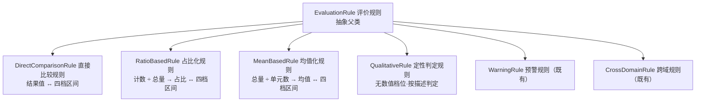

# 评价规则四档化与参考值实例化 · 决策讨论（v1 · 待讨论）

> 状态：【决策讨论·待批】——大王 2026-11-19 四条指示形成本稿，**只讨论、未改本体**。  
> 依据：`新疆维吾尔自治区城市体检工作手册（2026年版）-评价标准建议.pdf`（16页，附件一）、`城市体检自评表.pdf`（样本市2025，1页长表）、`判定范式归纳-v1.md`、`类与层级.md` §2.9.3、`属性与关系.md`。  
> 性质提示：手册是**公开标准口径**；自评表是**地方实操成果**，其数值只能作口径参考与实例，**不得当标准依据**（红线）。

---

## 〇、四条指示与本稿的对应

| # | 大王指示                                          | 本稿落点                    |
| - | --------------------------------------------- | ----------------------- |
| 1 | 按自评表和手册，定为**四档**                              | §一（含推翻旧决议的代价）           |
| 2 | 占比化方法可用，先梳理哪些指标适用；"这是评价规则本身的细致分类"             | §二、§三、§四（分类台账 + 规则分类设计） |
| 3 | 全国平均值是评价标准的**参考值**，随城市/年份变化，应是**实例**，本体要有实体承载 | §五（参考值实体设计）             |
| 4 | 样本市实测值可作为**ABox 数据实例**                        | §六                      |


---

## 一、四档决议（指示1）

### 1.1 事实依据

两份材料口径一致，均为四档：

| 档位  | 手册用词 | 自评表列名 |
| --- | ---- | ----- |
| 第1档 | 很好   | 很好    |
| 第2档 | 较好   | 较好    |
| 第3档 | 一般   | 一般    |
| 第4档 | 不足   | 不足    |

手册个别条目用词稍异（指标33写"≤10%为好"、指标31只有"很好/不足"两档、指标3"各城市结合实际确定"），属**档位数退化**，不影响四档框架。

### 1.2 必须明示的代价

| 既有决议                                           | 出处                                   | 本指示的影响                        |
| ---------------------------------------------- | ------------------------------------ | ----------------------------- |
| `AssessmentResult.grade` 维持**三档**（达标/基本达标/不达标） | 2026-10-09 Q2 决议；`类与层级.md` §2.9.3、§五 | **推翻**。grade 取值改为 很好/较好/一般/不足 |
| `grade` 四档（原 C2）"暂不执行"                         | 2026-10-09 大王批注；`类与层级.md` §356/§492  | **解禁**                        |
| `referenceValue` + `ratingBand`（原 C5）"暂不执行"    | 同上                                   | **解禁**（指示3 实质就是要它）            |

⚠️ 连带影响面：`grade` 在 SHACL 有枚举约束、`_to_graph_json.py` 有引用、原型详情卡有显示。四档化须同步这三处，否则校验失败或前端显示错乱。

- [x] **决策点 A**：确认四档取中文标签"很好/较好/一般/不足"，还是映射为我方术语（如"优/良/中/差"）？
- [x] **决策点 B**：确认解禁 C2/C5，并同步 SHACL 枚举与前端显示？（前端原型可先不动）

---

## 二、评价规则的细致分类（指示2 的核心）

大王的判断极准——**"评价规则"不是一种规则，是一族**。老奴据两份材料梳理出四种评价形态，这四种就是 `EvaluationRule` 该有的子类。

### 2.1 四种形态

| 形态      | 名称    | 判据                     | 评价对象    | 样例                                     |
| ------- | ----- | ---------------------- | ------- | -------------------------------------- |
| **R-D** | 直接比较型 | 结果值直接与四档参考区间比较         | 指标结果值本身 | 27 绿道覆盖率 ≥70%=很好；30 道路网密度 ≥8=很好        |
| **R-P** | 占比化型  | 先把"个数/栋数"除以总量得占比，再比四档  | 派生占比    | 1 结构隐患住宅 255栋 → 占比7.09% → <3.21=很好     |
| **R-M** | 均值化型  | 先把总量除以单元数得"每单元均值"，再比四档 | 派生均值    | 13 停车缺口 58635个 → 145.14个/小区 → <77.3=很好 |
| **R-N** | 暂无标准型 | 无参考值、无分档，只做计数或定性       | 无       | 24/25/26 老旧街区；55 入库项目数                 |

> 另有 **R-C 跨域组合型**（类与层级.md 既有 `CrossDomainRule`）：多指标交叉判定，本批材料未涉及，保留。  
> 另有 **R-W 预警型**（既有 `WarningRule`）：越界预警，本批材料未涉及，保留。

### 2.2 关键澄清：住房尺度 vs 城区尺度

大王提到"住房尺度很多指标较合适，城区尺度很多不适用"——老奴据实核查后，**实情恰好相反**，请大王复核：

| 尺度                   | 手册标注         | 自评表实况                         | 适用形态                |
| -------------------- | ------------ | ----------------------------- | ------------------- |
| **住房 1–8**（栋数）       | 全部"暂无评价标准"   | 全部给出**占比**分档                  | ✅ **最适合 R-P**（占比化）  |
| **小区/社区 9–21**（个数）   | 全部"暂无评价标准"   | 多数给出**占比**分档；13/14 给**每小区均值** | ✅ 适合 R-P / R-M      |
| **街区 19–26**（覆盖率/个数） | 全部"暂无评价标准"   | 覆盖率类有分档（R-D）；24/25/26 **空白**  | 部分 R-D，部分 R-N       |
| **城区 27–55**（率/密度为主） | **多数已有四档标准** | 多数直接分档，与手册一致                  | ✅ **最适合 R-D**（直接比较） |

**结论**：占比化主要用在**住房、小区社区**（计数型）；城区指标本身已经是率/密度/人均，天然适合直接比较。这与大王的原话方向相反，但**结论更利于建模**——因为规则分类与维度尺度自然对齐，不用额外造派生量。

- [x] **决策点 C**：确认采用 R-D / R-P / R-M / R-N 四形态（+保留既有 R-C/R-W）？
- [x] **决策点 D**：确认"占比化主要用于计数型指标、城区率值型直接比较"这一实情？

---

## 三、逐指标分类台账（指示2 的落地清单）

> 依据：自评表"关联指标"列 + 手册"评价标准建议"栏逐项核对。  
> ⚠️ **编号陷阱**：§3.1/§3.2 用**自评表序号**，§3.3/§3.4 用**手册/我方 55 项编号**，两套编号整体偏移（例：老旧商业街区＝自评表27＝手册24）。**一律按指标项名称对照，禁止按序号跨表取值**（承袭 2025手册60项 vs 2026附件1 55项的错位教训）。

### 3.1 R-P 占比化型（18 项）——手册标"暂无标准"，自评表用占比补出标准

| 自评表序号 | 指标项               | 原始值       | 关联指标（评价载体）                      | 全国平均值 |
| ----: | ----------------- | --------- | ------------------------------- | ----- |
|     1 | 存在结构安全隐患的住宅数量     | 255 栋     | 结构安全隐患住宅数量占比%                   | 3.52  |
|     2 | 存在燃气安全隐患的住宅数量     | 25 栋      | 燃气安全隐患住宅数量占比%                   | 4.08  |
|     3 | 存在楼道安全隐患的住宅数量     | 2333 栋    | 楼道安全隐患住宅数量占比%                   | 12.85 |
|     4 | 存在围护安全隐患的住宅数量     | 330 栋     | 围护安全隐患住宅数量占比%                   | 5.87  |
|     5 | 非成套住宅数量           | 81 栋      | 非成套住宅数量占比%                      | 1.76  |
|     6 | 存在管线管道破损的住宅数量     | 1349 栋    | 管线破损住宅数量占比%                     | 6.52  |
|     7 | 需要进行适老化改造的住宅数量    | 2495 栋    | 适老化改造住宅数量占比%                    | 11.12 |
|     8 | 需要进行节能改造的住宅数量     | 1012 栋    | 节能改造住宅数量占比%                     | 2.31  |
|     9 | 需要进行数字化改造的住宅数量    | 1301 栋    | 数字化改造住宅数量占比%                    | 13.71 |
|    10 | 未达标配建养老服务设施的社区数量  | 391 个     | 养老设施未达标社区占比%                    | 20.27 |
|    11 | 未达标配建婴幼儿托育设施的社区数量 | 404 个     | 托育设施未达标社区占比%                    | 23.04 |
|    12 | 小学学位缺口数           | 0 个       | 小学学位缺口%（这个是什么占比，分子分母分别是谁）       | 3.38  |
|    15 | 未配建电动自行车充电设施的小区数量 | 77 个      | 电动车充电未配建小区占比%（这个是什么占比，分子分母分别是谁） | —     |
|    16 | 未达标配建公共活动场地的社区数量  | 113 个     | 公共活动场地未达标社区占比%                  | 18.34 |
|    17 | 不达标的步行道长度         | 428.77 千米 | 不达标步行道长度占比%（这个是什么占比，分子分母分别是谁）   | 3.57  |
|    18 | 未实施生活垃圾分类的小区数量    | 114 个     | 未垃圾分类小区占比%                      | 13.97 |
|    19 | 未实施物业管理的小区数量      | 87 个      | 未物业管理小区占比%                      | 33.49 |
|    20 | 需要进行智慧化改造的小区数量    | 60 个      | 智慧化改造小区占比%                      | 39.93 |

### 3.2 R-M 均值化型（2 项）

| 序号 | 指标项         | 原始值      | 关联指标          | 全国平均值 |
| -: | ----------- | -------- | ------------- | ----- |
| 13 | 停车泊位缺口数     | 58,635 个 | 每小区停车泊位缺口数（个） | 86    |
| 14 | 新能源汽车充电桩缺口数 | 7,019 个  | 每小区充电桩缺口数（个）  | 9     |

### 3.3 R-D 直接比较型（31 项，摘代表性）

> ⚠️ 本表序号为**手册/我方 55 项编号**（非自评表序号）。两套编号存在整体偏移，禁止直接按序号对照；以**指标项名称**为准。

| 手册序号 | 指标项         | 手册四档标准（原文节录）                                     | 依据                 |
| ---: | ----------- | ------------------------------------------------ | ------------------ |
|   27 | 绿道服务半径覆盖率   | ≥70%很好 / 60–70较好 / 50–60一般 / <50不足               | 《国家园林城市评选标准》(2022) |
|   30 | 城市道路网密度     | ≥8很好 / 7–8较好 / 6–7一般 / <6不足                      | 中发〔2016〕6号         |
|   31 | 新建建筑绿色建筑占比  | 100%很好 / 其余不足                                    | 《城乡建设领域碳达峰实施方案》    |
|   32 | 挂牌建档率       | 100%很好 / 其余不足                                    | 中办国办《加强历史文化保护传承意见》 |
|   33 | 历史建筑空置率     | ≤10%好 / 10–15较好 / 15–20一般 / >20不足                | 住建部《2022年城市体检指标体系》 |
|   34 | 负面事件数       | 0起很好 / 其余不足                                      | 2026手册             |
|   35 | 擅自拆除数量      | 0栋很好 / 其余不足                                      | 2026手册             |
|   37 | 高峰机动车平均速度   | ≥30很好 / 20–30较好 / 10–20一般 / <10不足                | GB/T 51328-2018    |
|   39 | 公租房最长轮候时间   | ≤36月很好 / 36–48较好 / 48–60一般 / >60不足               | 建保〔2019〕55号        |
|   44 | 应急水源供水保障率   | ≥60%很好 / 40–60较好 / 30–40一般 / <30不足               | GB50282-2016 等     |
|   47 | 燃气管网年度改造完成率 | 100%很好 / 80–100较好 / 70–80一般 / <70不足              | 十五五韧性城市要求          |
|   48 | 消防站服务半径覆盖率  | ≥75%很好 / 60–75较好 / 45–60一般 / <45不足               | 《城市消防站建设标准》        |
|   51 | 危大工程安全监测覆盖率 | ≥90%很好 / 70–90较好 / 50–70一般 / <30不足               | 住建部令37号            |
|   53 | 运行管理服务智慧化水平 | ≥2000件/km²很好 / 1000–2000较好 / 500–1000一般 / <500不足 | 住建部一网统管通知          |

> 其余 R-D 项（22/25/26/26/30/36/38/41/42/45/46/49/50/52/54/55/56/57/59/60）同形态，详见手册附件一逐项。

### 3.4 R-N 暂无标准型（6 项）

| 序号 | 指标项             | 手册     | 自评表        |
| -: | --------------- | ------ | ---------- |
| 23 | 未达标配建的多功能运动场地数量 | 暂无评价标准 | 空白         |
| 24 | 未达标配建的文化活动中心数量  | 暂无评价标准 | 空白         |
| 27 | 需更新改造的老旧商业街区数量  | 暂无评价标准 | 空白         |
| 28 | 需更新改造的老旧厂区数量    | 暂无评价标准 | 空白         |
| 29 | 需更新改造的老旧生活街区数量  | 暂无评价标准 | 空白         |
| 61 | 城市更新入库项目数       | 暂无评价标准 | 空白（但有定性描述） |

> 注：手册 54「问题整治率」、55「入库项目数」虽标"暂无评价标准"，但附了**定性分档描述**（限时解决类按期完成=达标等），属 R-N 中的"定性型"，可另立 R-Q 子类。

- [x] **决策点 E**：确认 R-N 类指标本轮**不做数值分档**，沿用核查项 OR 规则 + 定性描述？

---

## 四、评价规则子类设计建议（指示2 的本体落点）

在既有 `EvaluationRule` 族（抽象父类 + `AssessmentRule`/`WarningRule`/`CrossDomainRule`）下，建议按**评价算法**再分一层：



⚠️ 这是**结构性变更**（加类），须单独报批；本稿只提建议，不动 TBox。  
⚠️ 与既有 `AssessmentRule`（达标评价规则）的关系须厘清：**AssessmentRule 按"用途"分，上述新类按"算法"分**，两组正交、非互斥——与 W-B01 里 `AssessmentResult` 两组子类正交是同一种处理。

- [x] **决策点 F**：是否采纳上述子类划分？还是只加一个 `EvaluationRule` 实例、用属性区分算法？（原则同意，但给我review一下，assessmentrule都是啥来着?并且举一个例子）

---

## 五、参考值实体设计（指示3）

### 5.1 大王的判断成立

自评表"全国平均值（十四五目标值参考）"列（如结构隐患住宅占比 3.52、停车缺口每小区 86）——它**不是固定标准**，而是：

- 随**城市**变（样本市 2025 用全国平均，别的城市可用本省平均/同类城市平均）；
- 随**年份/规划期**变（十四五目标值 → 十五五目标值）；
- 是**评价标准的输入参数**，不是指标实测结果。

所以它是**实例数据**，不能写成类属性或硬编码常量。

### 5.2 建议的承载实体

新增一个实体类 **`EvaluationReference`（评价参考值）**，一条实例 = "某指标 + 某适用范围 + 某时期 + 一组四档边界"：

| 属性               | 含义              | 示例值                                           |
| ---------------- | --------------- | --------------------------------------------- |
| `forIndicator`   | 指向哪个指标          | `Indicator_1`                                 |
| `appliesTo`      | 适用范围（全国/省/城市类型） | 全国平均                                          |
| `validPeriod`    | 适用时期            | 十四五 / 2025                                    |
| `referenceValue` | 参考值（锚点）         | 3.52                                          |
| `ratingBand`     | 四档边界（结构化）       | 很好<3.21 / 较好3.21–3.59 / 一般3.59–3.94 / 不足>3.94 |
| `basedOn`        | 依据来源            | 样本市自评表【地方实操·待核】                               |
| `direction`      | 方向（正向/逆向）       | 逆向（占比越低越好）                                    |

关系：`Indicator --hasReference--> EvaluationReference`；`EvaluationRule --usesReference--> EvaluationReference`。

**关键收益**：同一指标可挂多条参考值实例（全国/本省/十四五/十五五），评价时按适用范围与时期**选择**——这正是大王说的"不同城市不能同一而论"的本体表达。

- [x] **决策点 G**：参考值实体用**独立类**（推荐）还是挂在既有 `PolicyStandard` 下作为属性？（参考值实体用**独立类**）
- [x] **决策点 H**：`ratingBand` 四档边界用**结构化属性**（四条上下界，推荐）还是字符串（如"<3.21/3.21-3.59/…"）？（`ratingBand` 四档边界用**结构化属性**（）

---

## 六、实测值作为 ABox 实例（指示4）

自评表的"指标值"列（255栋、7.09%、86个/小区等）是样本市 2025 的**实测值**，应作为 `AssessmentResult` 实例的数据属性：

```
ur:AR_sample_I1 a ur:AssessmentResult ;
    ur:assesses ur:UD_01 ;
    ur:ofIndicator ur:Indicator_1 ;
    ur:indicatorValue 255 ;       # 实测值（栋）
    ur:unit "栋" ;
    ur:year "2025"^^xsd:GYear .
```

对占比化型指标，还需一条**派生值**：

```
ur:DR_sample_I1 a ur:DerivedRatio ;
    ur:derivedFrom ur:AR_sample_I1 ;
    ur:ratioValue 7.09 ;
    ur:ratioOf "结构安全隐患住宅占比" .
```

> ⚠️ **脱敏红线**：样本市实测值进公开 ABox 时须按既定规则处理（街道 A–E、去真实地名、数值按 D1 口径"缺/量级"）。本稿示例中的数值仅示意，落地时须走脱敏流程。  
> ⚠️ **性质标注**：全部标【地方实操】，不得当标准依据。

- [x] **决策点 I**：派生占比是**新建类**（`DerivedRatio`，推荐）还是作为 `AssessmentResult` 的附加属性？（派生占比是**新建类**）

---

## 七、总体影响与实施顺序（批复后）

| 顺序 | 动作                              | 性质            | 影响面                            |
| -: | ------------------------------- | ------------- | ------------------------------ |
|  1 | 四档化 `grade` 枚举                  | 数据属性取值变更      | SHACL、前端、`_to_graph_json.py`   |
|  2 | 新增 `EvaluationReference` 类 + 属性 | **结构性变更·须报批** | 类与层级、属性与关系、`_gen_ttl.py`、重跑三步链 |
|  3 | 新增评价规则子类（R-D/R-P/R-M/R-Q）       | **结构性变更·须报批** | 同上                             |
|  4 | 实测值/参考值实例接入                     | 数据接入          | ABox 增量，脱敏后入库                  |
|  5 | 全链自检 + 独立 SPARQL 复核             | 验证            | `_check_all.py` 基线重建           |

**回滚**：改前备份 `_bak_20261119/`，逐文件可回退。

---

## 八、待批清单汇总

- [ ] A 四档标签用词
- [ ] B 解禁 C2/C5 + 同步下游
- [ ] C 规则四形态（+保留既有两类）
- [ ] D 占比化主要用于计数型、城区率值型直接比较
- [ ] E R-N 类不做数值分档
- [ ] F 规则子类划分方式
- [ ] G 参考值实体独立类
- [ ] H 四档边界结构化
- [ ] I 派生占比新建类

> 请大王逐条勾选/批注。批复后老奴按§七顺序执行；凡涉结构性变更，另出单独报批方案。（已在正文中批注，先解答我正文中的一个疑问，暂不动手）
