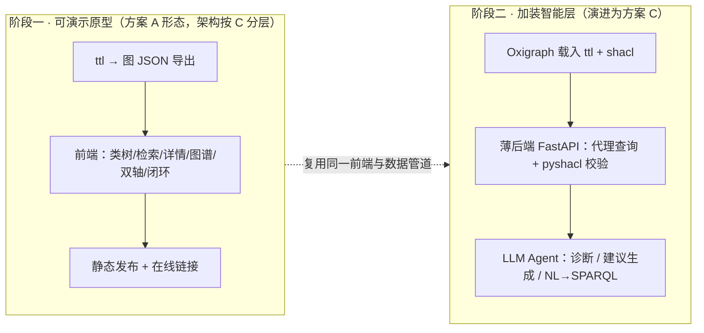
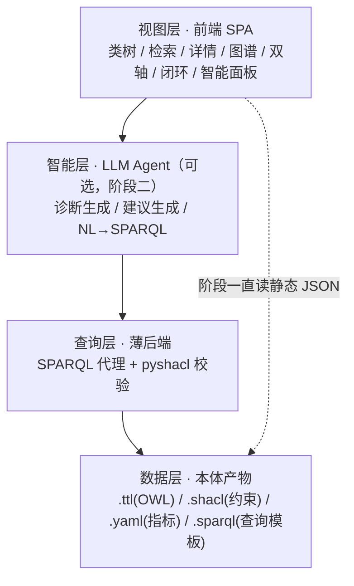

# 城市体检与更新本体 · 高保真交互原型 实施路线方案

> 版本：v1-20261010 ｜ 状态：**方案已定（D2 = 方案 C，分阶段推进）；D1 视觉风格待选**
> 目的：把已建成的本体成果（`.ttl` / `.shacl` / `.yaml`）转化为**可展示、可交互**的高保真原型，并为后续「智能应用原型」预留演进接口。
> 依据：`README.md` §六、`03-本体模型/`、`04-指标映射/`（本方案所有规模数字均来自对现产物的实测，见 §一·2）。
> 决议记录：2026-10-11 大王批注（见 §六）。

---

## 〇、结论先行

1. **推荐目标形态**：**方案 C「可演进的本体工作台」**——前端图谱应用 + 轻量 SPARQL 查询层 + LLM 挂载点。它是唯一能同时满足第 2 条（交互）与第 3 条（未来智能应用）且**不需要二次重构**的路线。
2. **推荐落地节奏**：**分两阶段**。阶段一先做**方案 A 形态的静态单页**（最快出可演示成果，可挂在线链接做评审演示）；阶段二在原架构上**加装查询层与智能层**，演进为方案 C。**阶段一就按方案 C 的分层架构搭骨架**，只是先空出后端。
3. **一条关键判断**：**当前本体规模偏小，不需要上图数据库。** 实测 TBox 197 节点（107 类 + 90 属性）+ ABox 92 个体 = 约 **289 个节点** / 1595 条三元组，前端单页（Cytoscape.js / AntV G6）可轻松流畅承载数千节点。上 Neo4j/Fuseki 属于**为第 3 条智能应用铺路**，而不是为了可视化好看。这一点直接决定了成本量级——**可视化部分几乎零成本**。
4. **第 3 条「智能应用」的真正瓶颈不在前端，而在三件套**：① 实例数据（本体现在只有 TBox + 指标 ABox，**没有空间单元实例**，体检测值无处安放）；② 评价规则的可执行化（`EvaluationRule` 族目前是类，还没有规则实例与四档评分区间）；③ LLM 编排（把 SPARQL 查询结果喂给模型生成建议）。**建议阶段一就把这三件事的接口留出来**，否则智能应用要推倒重来。

---

## 一、需求拆解：把三条要求翻译成可验收的功能

### 1. 三条要求 → 功能点 → 技术前提

| # | 大王的要求          | 拆成可验收功能                                                                             | 技术前提                                        | 现状          |
| - | -------------- | ----------------------------------------------------------------------------------- | ------------------------------------------- | ----------- |
| 2 | 可展开本体类         | 类层级树：16 顶层类 → 子类逐级展开 / 折叠 / 定位                                                      | `.ttl` 的 `rdfs:subClassOf`（**76 条边**）       | ✅ 已有        |
| 2 | 可检索            | 全局检索：中文名 / 英文名 / URI 名 / 指标编号，模糊匹配                                                  | `rdfs:label` + 指标 `code`                    | ✅ 已有        |
| 2 | 可看详情           | 详情卡：定义 / 上位类 / 子类 / 属性清单 / 关联指标 / 来源                                                | `类与层级.md`、`属性与关系.md` 结构                     | ✅ 已有（需转结构化） |
| 2 | 知识图谱交互         | 力导向图：拖拽 / 缩放 / 悬停高亮邻居 / 邻居展开 / 两节点路径查找                                              | 节点-边 JSON（由 `rdflib` 遍历导出）                  | ⚠️ 待新增导出脚本  |
| 2 | （增值）指标双轴矩阵     | 维度（5 级）× 分类（13 类）交叉矩阵，点格下钻到指标清单                                                     | `55项指标.yaml` 的 `inDimension` / `inCategory` | ✅ 已有        |
| 2 | （增值）主干闭环视图     | 「体检活动→评估结果→问题→整治建议→更新项目」链路可视化                                                       | `类与层级.md` §三 Mermaid 已画                     | ✅ 已有（需转交互图） |
| 2 | （增值）约束展示       | 列出 5 个 SHACL 形状 / 20 条约束；对选中实例跑校验并标红                                                | `.shacl` + `pyshacl`（**需服务端**）              | ⚠️ 视方案      |
| 1 | 视觉美观           | 统一设计语言：配色 / 字体 / 卡片 / 过渡动效 / 深浅主题                                                   | 设计规范 + 组件库                                  | ⚠️ 待定风格     |
| 3 | 快速诊断某社区的功能完善程度 | 输入：空间单元（社区）+ 一组指标实测值 → 取该维度指标 + 规则族 → 落档 → 输出诊断卡                                    | **空间单元实例 + 测值 + 规则实例**                      | ❌ 缺数据       |
| 3 | 自定义生成可视化更新建议   | 输入：筛选条件（问题类型 / 空间层级 / 责任单位）→ 反查 `Problem → RemediationSuggestion` → LLM 生成建议 + 前端出图 | 上述 + LLM Agent 层                            | ❌ 缺数据与模型    |

### 2. 数据底座盘点（实测，2026-10-10）

| 项                   | 数量                                                                                                       | 来源                |
| ------------------- | -------------------------------------------------------------------------------------------------------- | ----------------- |
| OWL 三元组             | **1595**                                                                                                 | `城市体检-更新本体.ttl`   |
| TBox 类              | **107** = 106 概念类 + 1 技术构件（`DataObjectRoleUnion`）                                                       | 同上                |
| 对象属性 / 数据属性         | **33 / 57**（合计 90）                                                                                       | 同上                |
| `rdfs:subClassOf` 边 | **83**（2026-10-11 补声明 7 类后 +7；原 76）                                                                        | 同上                |
| ABox 个体             | **92**（`Indicator` 55 + `IndicatorCategory` 13 + `CollectionMethod` 9 + `FormulaType` 7 + `Dimension` 5 + `TreatmentType` 2 + `PolicyDocument` 1） | 同上                |
| **可视化节点合计**         | **≈ 289**（197 TBox + 92 ABox）                                                                            | 计算值               |
| SHACL               | **5 个目标类形状 / 20 条约束**（197 三元组）                                                                           | `城市体检-更新约束.shacl` |
| 查询模板                | **6 条**                                                                                                  | `常用查询.sparql`     |
| 指标映射                | 55 项 / 50 数据对象 / 67 次引用 / 0 异常                                                                           | `55项指标.yaml`      |

> **107 的口径**：107 = **106 个概念类** + **1 个技术构件**（`DataObjectRoleUnion` —— `computedFrom` 值域的 `owl:unionOf` 包装类，非概念）。**类与 ABox 个体实测无交集**（不存在 punning）。
>
> **规模结论**：289 节点属「中小图」。**前端浏览器完全够用**，无需图数据库即可实现流畅的力导向交互（Cytoscape/G6 的舒适区是数千节点）。

---

## 二、四个候选方案

### 方案 A ｜ 纯静态单页图鉴（Static SPA）

**做法**：写一个 `_to_graph_json.py`，用 `rdflib` 把 `.ttl` 遍历成 `nodes.json` / `edges.json` / `indicators.json`，预置在前端；前端用 Cytoscape.js 或 AntV G6 渲染；整个原型就是一组静态文件，`python -m http.server` 或 GitHub Pages 即可访问。

- **能力覆盖**：类树展开 ✅ / 检索 ✅ / 详情 ✅ / 图谱交互 ✅ / 指标双轴 ✅ / 闭环视图 ✅
- **不能做**：实时 SPARQL、SHACL 在线校验、LLM 智能应用（第 3 条做不了）
- **优点**：零后端、零运维、可离线、可 git 托管、**可发布成在线链接**、交付轻、改数据只需重跑导出脚本
- **缺点**：数据一更新就要重新导出+重新部署；第 3 条要另起炉灶
- **交付成本**：**低**（一个导出脚本 + 一个前端工程）

### 方案 B ｜ SPARQL 图谱应用（Oxigraph / Fuseki + 前端）

**做法**：在本机（或云）跑一个 **Oxigraph**（Rust 写的轻量 SPARQL 端点，单二进制、无 JVM 依赖）或 Apache Jena Fuseki；把 `.ttl` 载入；前端把「查询」直接做成交互——用户点选条件 → 发 SPARQL → 渲染结果图/表。`常用查询.sparql` 里 6 条模板可直接复用。

- **能力覆盖**：A 的全部 + **真实 SPARQL 查询** ✅ + **SHACL 校验** ✅ + OWL 推理（`owlrl`）✅
- **优点**：把本体的**查询能力真正暴露出来**，"查询即交互"；第 3 条诊断场景的**查询底座已经就位**
- **缺点**：需要一个常驻服务进程；部署比 A 重一档；版本耦合（前端要约定数据已载入）
- **交付成本**：**中**

### 方案 C ｜ 可演进的本体工作台（前端 + 薄后端 + LLM 挂载点）★ 推荐

**做法**：在方案 B 之上叠一层薄后端（FastAPI / Node），职责有三：① 代理 SPARQL 端点；② 跑 `pyshacl` 校验；③ **LLM Agent 编排**（NL→SPARQL、诊断、建议生成）。前端仍是 A 的交互界面，只是数据来路从 JSON 变成 API。架构**从一开始就按三层划分**（数据层 / 查询-推理层 / 视图-智能层），阶段一可以先行把后端留空。

- **能力覆盖**：A + B 的全部 + **智能应用（第 3 条）** ✅
- **优点**：**一次到位、不用二次重构**；智能应用可插拔（先接 mock，后接真模型）；SHACL 在线校验天然支持
- **缺点**：交付成本最高、周期最长；引入 LLM 后有 API key / 国内可用性 / 成本问题
- **交付成本**：**高**（但可拆成两阶段摊薄）

### 方案 D ｜ 图数据库路线（Neo4j + Bloom）

**做法**：把 RDF 转成属性图导入 Neo4j，用 Neo4j Bloom 做商业级交互图探索，查询用 Cypher。

- **能力覆盖**：交互体验最好（Bloom 是成熟产品）
- **致命缺点**：**RDF→属性图的语义损耗**。本体的关键设计会被压扁——`DataObject` 是**角色类**（多继承式复用，`computedFrom` 值域是并集）、`Dimension`/`IndicatorCategory` 是**ABox 个体而非子类**，这些在属性图里都会退化或需要重新组织。等于**为可视化好看而牺牲本体严谨性**，与项目"本体可推理"的初衷相悖。
- **交付成本**：中（但要额外维护一套映射，长期反噬）

---

## 三、方案对比与分维度评分（10 分制）

| 维度                    | 权重   | A 静态单页   | B SPARQL 应用 | **C 可演进工作台** | D 图数据库   |
| --------------------- | ---- | -------- | ----------- | ------------ | -------- |
| 视觉表现力                 | 20%  | 9        | 9           | **9**        | 10       |
| 交互完整度（展开/检索/详情/图谱）    | 25%  | 9        | 9           | **10**       | 9        |
| 查询与推理能力（SPARQL/SHACL） | 20%  | 3        | 9           | **10**       | 7        |
| 第 3 条智能应用扩展性          | 25%  | 2        | 6           | **10**       | 5        |
| 部署与运维成本（分越高越轻）        | 10%  | 10       | 6           | **5**        | 4        |
| **加权总分**              | 100% | **6.55** | **7.85**    | **9.20**     | **7.15** |

> 评分为建议值，供大王调整权重后重算。若**只看第 2 条**（纯展示交互），A 的性价比最高；**一旦把第 3 条计入**，C 明显领先。

**方案取舍一句话**：

- 只要「一次评审演示」→ **选 A**，最快、最轻、能上线。
- 要「长期用、要接智能应用」→ **选 C**，阶段一先落 A 的形态即可。
- **不建议 D**：为了图数据库的交互体验，牺牲本体语义，得不偿失。

---

## 四、推荐路线图（分两阶段）



### 阶段一 交付清单（可演示）

- [ ] `_to_graph_json.py`：`rdflib` 遍历 `.ttl` → `nodes.json` / `edges.json` / `indicators.json`（**同源、可重跑**，与 `_gen_ttl.py` 一脉相承）
- [ ] 前端工程：类层级树 + 全局检索 + 详情卡 + 力导向图谱（拖拽/缩放/邻居高亮/路径查找）
- [ ] 增值视图：指标「维度 × 分类」双轴矩阵下钻、主干闭环链路图
- [ ] 视觉规范：统一配色/字体/卡片/动效（风格待大王定，见 §六）
- [ ] 静态发布：本地 `http.server` 预览 + 可导出在线链接

### 阶段二 交付清单（智能应用）

- [ ] `Oxigraph` 载入 `.ttl` + `.shacl`，暴露 SPARQL 端点（复用 `常用查询.sparql` 6 条模板）
- [ ] 薄后端：SPARQL 代理 + `pyshacl` 在线校验（校验失败在图上标红）
- [ ] **补实例数据**：空间单元实例（社区/小区/街区…）+ 指标测值（这是诊断场景的**硬前提**，见 §零·4）
- [ ] **补规则实例**：`EvaluationRule` 落成可执行规则 + 引入四档评分区间（`referenceValue` / `ratingBand`，源自样本市自评表，见项目记忆 §五）
- [ ] LLM Agent：① 诊断（社区 + 测值 → 查询 + 规则 → 结论卡）；② 建议生成（筛选条件 → `Problem→RemediationSuggestion` → 生成建议 + 可视化）

---

## 五、关键技术细节（给落地参考）

### 1. 数据管道（复用现有生成链）

```
55项指标.yaml ──┐
                ├─ _gen_ttl.py ──→ 城市体检-更新本体.ttl ──┐
类与层级.md ────┘                  城市体检-更新约束.shacl ─┤
                                                           ├─ _to_graph_json.py ─→ nodes/edges/indicators.json ─→ 前端
                                              常用查询.sparql ─┘（阶段二供 SPARQL 端点）
```

> **要点**：导出脚本必须与 `_gen_ttl.py` 一样带**防漂移断言**（每个 URI 必须见于源 md），保持「单一数据源、同源生成」的项目惯例。

### 2. 前端图谱库选型

| 库                | 优势                                 | 劣势                     | 建议        |
| ---------------- | ---------------------------------- | ---------------------- | --------- |
| **AntV G6**      | 国产、中文文档、性能好、与 React/Vue 融合佳、内置多种布局 | 生态不如 Cytoscape 在国际社区活跃 | **首选**    |
| **Cytoscape.js** | 图分析功能最强（路径、中心度）、有 RDF 场景先例         | 默认样式偏"科研风"，需较多定制才美观    | 备选        |
| D3-force         | 自由度最高、可做出最惊艳的定制效果                  | 开发量大，工作量大              | 仅在追求极致定制时 |
| sigma.js         | 大图性能最好                             | 小图无优势，本场景用不上           | 不推荐       |

### 3. 分层架构（方案 C 目标形态）



### 4. 部署与发布选项

| 方式                         | 适用    | 说明                                |
| -------------------------- | ----- | --------------------------------- |
| 本地 `python -m http.server` | 阶段一自查 | 零依赖，最快                            |
| **WorkBuddy 发布为应用**        | 阶段一演示 | 可生成在线链接，供评审 / 同事访问                |
| GitHub Pages               | 阶段一长期 | 与公开仓库 `urban-renewal-ontology` 同源 |
| 本机/云服务器常驻服务                | 阶段二   | Oxigraph + FastAPI，建议内网或云主机       |

---

## 六、风险与决议

### 风险

| #  | 风险                                                                 | 影响              | 缓解                                                 |
| -- | ------------------------------------------------------------------ | --------------- | -------------------------------------------------- |
| R1 | **实例数据缺口**：本体仅有 TBox + 指标 ABox，**无空间单元实例与测值**                      | 第 3 条诊断场景无数据可跑  | 大王将另整理「样本市样例数据」一套（2026-10-11 表态）                    |
| R2 | 规则未可执行：`EvaluationRule` 族只有类，无规则实例与评分区间                            | 诊断结论无法自动生成      | 引入 `referenceValue` + `ratingBand`（样本市自评表已有四档区间资产） |
| R3 | 命名空间 `https://ontology.cset-digital.cn/urban-renewal#` **仍占位【待核】** | URI 会直接显示在原型界面上 | 原型阶段先原样展示并标注；定稿后统一替换                               |
| R4 | 脱敏边界：原型若含地方实例数据                                                    | 违反公开脱敏约定        | 原型**只用样例/构造数据**，沿用「样本市」口径                          |
| R5 | LLM 引入（阶段二）的 API key / 国内可用性 / 成本                                  | 影响智能应用能否落地      | 阶段二前需专项确认模型与通道                                     |
| R6 | 前端风格未定                                                             | 影响美观度与演示受众感受    | **已出三款样例（2026-10-11），待大王选定**                        |

### 决议（2026-10-11 大王批注）

| # | 事项 | 大王决议 |
|---|---|---|
| D1 | 视觉风格 | **先出风格样例再定** —— 已产出三款可切换样例 `原型风格样例-三款-20261011.html`（科技深色 / 政务蓝白 / 现代中性），待大王选定 |
| D2 | 方案选型 | **方案 C（可演进的本体工作台）** |
| D3 | 阶段拆分 | **按阶段推进：先做阶段一** |
| D4 | 演示受众 | **对外评审 + 内部同事，二者兼顾** |
| D5 | 是否纳入公开仓库 | **随 `urban-renewal-ontology` 一并公开** |
| D6 | 智能应用优先级 | **暂缓，后续再议** |

> **大王补充（2026-10-11）**：① 关于实例数据缺口（R1），由大王**另整理「样本市样例数据」一套**解决；② 以上六项**按顺序逐项推进，做完一步再进入下一步**；③ **先启动 D1**（视觉风格）。

---

## 七、建议的下一步

> 节奏已定（2026-10-11）：**六项按顺序逐项推进，做完一步再进下一步**。

1. **D1（进行中）** —— 三款视觉风格样例已产出：`原型风格样例-三款-20261011.html`（页面右上可实时切换，也支持 `?theme=dark|gov|modern` 直达）。**等大王选定一款**。
2. 风格定稿后 → **阶段一**：先出 `_to_graph_json.py` 数据导出脚本 + 前端骨架（含 1~2 个视图打通），验证风格落地效果。
3. 骨架通过后 → 铺满全部视图（类树 / 检索 / 详情 / 图谱 / 双轴 / 闭环），并按要求**随仓库一并公开**（D5）。
4. 阶段一交付演示后 → 再议 D6（智能场景优先级）与阶段二立项；实例数据由大王提供的「样本市样例数据」接入。
