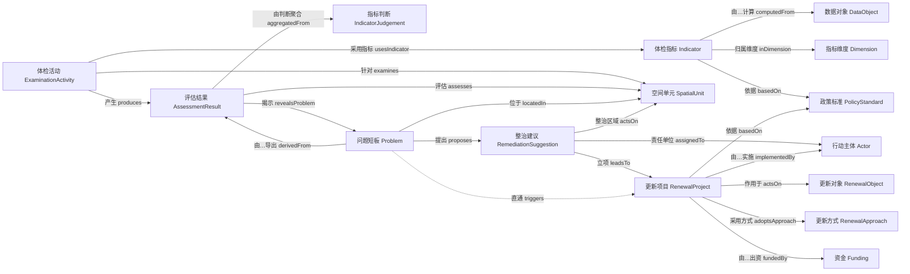
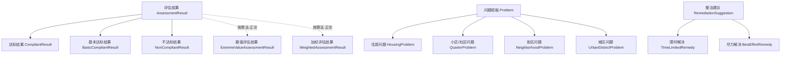

# 图1 主干闭环关系图

> W-E02 产出 · 2026-11-21 · Mermaid 源文件（导出图见 `图1-主干闭环.png`）
> 来源：`03-本体模型/类与层级.md` §三 主干闭环 Mermaid（权威底稿，本次按 W-B01 子类细化同步）
> 术语：城市体检（Urban Physical Examination）≠ 房屋安全体检；城市更新（Urban Renewal）为上位概念。

## 图

## 子类细化（W-B01 / W-B02 批复，均单继承）

> 两组 `AssessmentResult` 子类**正交非互斥**（按等级 vs 按算法）；`RemediationSuggestion` 两子类**二者择一互斥**（大王 2026-11-20 定，SHACL `maxCount 1`）。

## 与机读产物核对

- 概念类 123（不含 25 个 `owl:unionOf` 并集类），对象属性 47，数据属性 102（`城市体检-更新本体.ttl` 实测）。
- 本图仅画主干闭环核心类与关系，非全量 123 类；完整类表见 `类与层级.md`。
