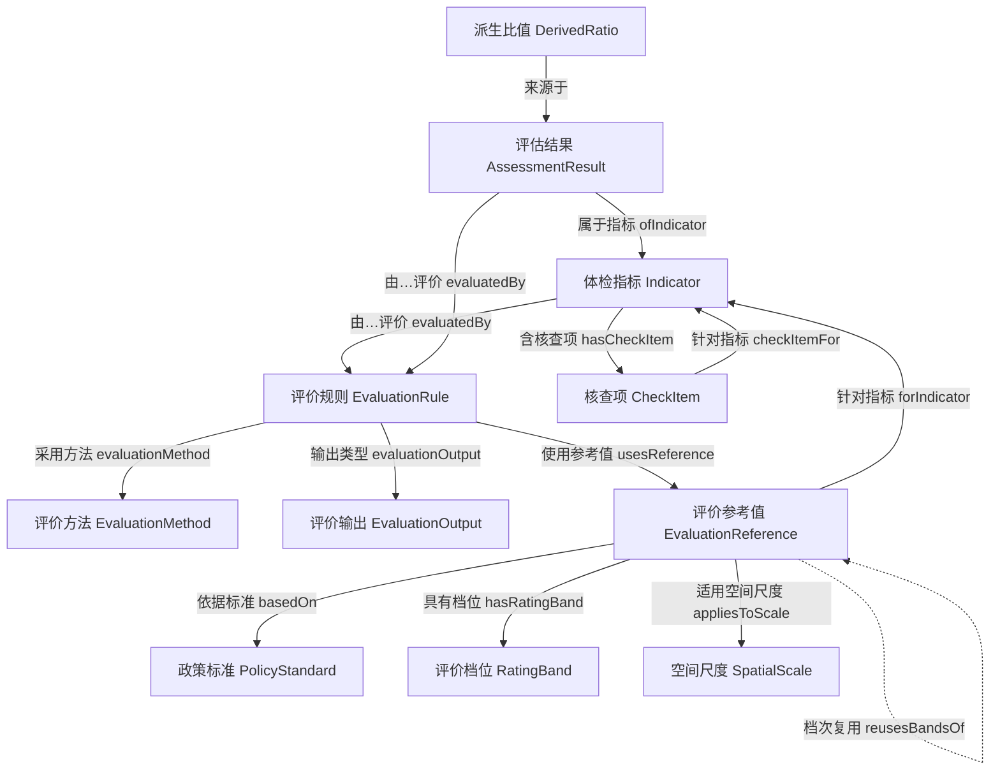
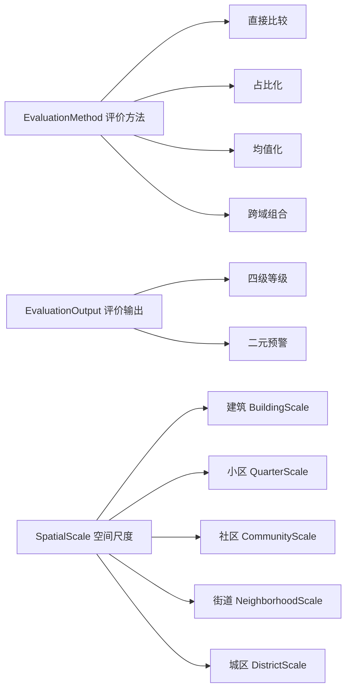

# 图2 指标内核与评价规则关系图

> W-E02 产出 · 2026-11-21 · Mermaid 源文件（导出图见 `图2-指标内核.png`）
> 来源：`类与层级.md` §2.9.3、`属性与关系.md`、`分尺度评级-结构性变更报批方案-v1.md`（均已批复）
> 术语：评价规则（Evaluation Rule）、参考值（Evaluation Reference）、档位（Rating Band）。

## 图

## 受控词表成员（加成员即扩展，不动类结构）

> **档位共用**（大王 11-20 拍板）：四档"很好/较好/一般/不足"全市共用一套，不随尺度重标定；`SpatialScale` 词表成员 URI 用英文、label 用中文（D1 批复）。
> **规则逻辑三层分工**：本体存元数据与参数、SHACL 只校结构、SPARQL/脚本执行比较——本体是描述性语言，不是编程语言。

## 与机读产物核对

- `EvaluationRule` 实例 **40** 条、`EvaluationReference` **40** 条、`RatingBand` **130** 条、`CheckItem` **56** 个（`城市体检-更新本体.ttl` + 各规则实例 TTL 合并图实测）。
- `SpatialScale` 5 个成员、`EvaluationMethod` 4 个、`EvaluationOutput` 2 个（词表实例实测）。
