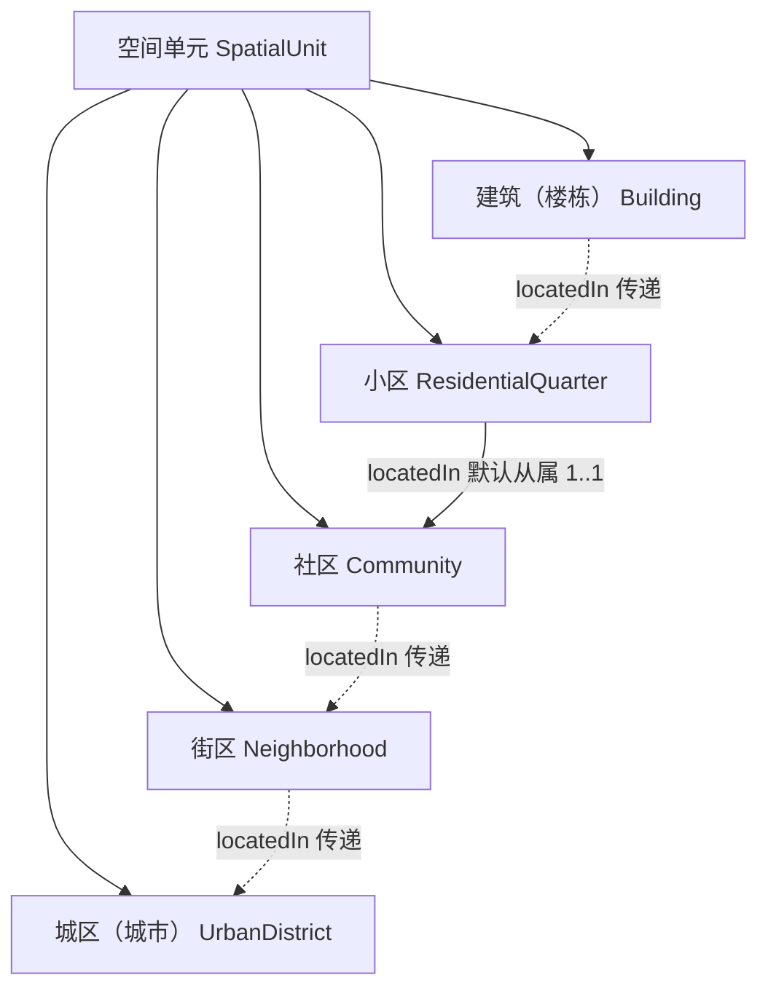
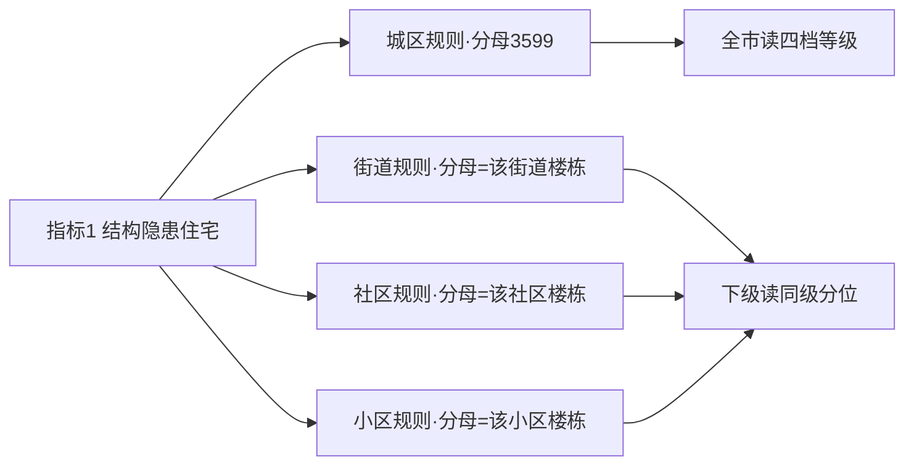

# 图3 空间层级与分尺度评级图

> W-E02 产出 · 2026-11-21 · Mermaid 源文件（导出图见 `图3-空间层级.png`）
> 来源：`类与层级.md` §2.1、§2.9.3（分尺度评级），`楼栋数据.xlsx`（大王 11-20 指定权威表）
> 术语：空间单元（Spatial Unit）、街区（Neighborhood，按街道落地）、社区（Community）、小区（Residential Quarter）。

## 图

> `locatedIn` 是**传递属性**（TransitiveProperty），实例层已有 3931 条边，表达"楼栋→小区→社区→街区→城区"整条空间链。第 5 级"住房"已由 `Housing` 改为"建筑（楼栋）`Building`"（2026-09-28 批注）——"住房" = `buildingNature`=住宅 的 `Building`。

## 分尺度评级：同一指标各尺度各评各的

> **全市评级不可反推下级**（聚合悖论）：全市"不足"不代表某新建街道也要整治住宅安全。各尺度独立计算、无汇总关系。四档区间共用一套；下级尺度以"同级分位"为主读法（如 CM_S01 在 53 社区中排第 25、前 46.2%）。楼栋级暂缓（布尔隐患 vs 四档百分比不同构）。

## 与机读产物核对（权威表 `楼栋数据.xlsx`）

| 层级 | 实例数 | 分母来源 |
|---|---:|---|
| 城区 | 1 | 3,599（楼栋名义总量） |
| 街道 | 5 | 各 859–888 栋 |
| 社区 | 53 | 各 5–154 栋 |
| 小区 | 404 | 各 1–66 栋 |
| 楼栋 | 3,599 | ——（本体实例数，URI BD_B0001–3599 连续） |

来源：`06-实例数据/_shared_楼栋台账.py`（`read_scopes()` 实测）、`06-实例数据/abox/城市体检实例.ttl`。
