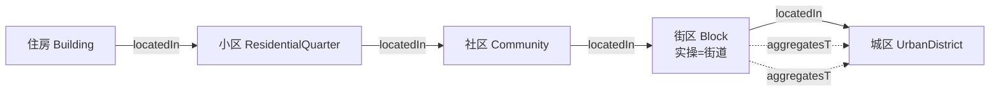

# 样本市 2025 年城市体检成果研究——内容梳理与意义分析

> **版本**：v1 / 2026-09-30
> **依据文件**（均为 `01-资料/样本成果/城市体检报告案例/` 下原件）：
> 1. `城区维度体检成果参考.doc`（Word 97-2003）
> 2. `街区维度体检成果参考.docx`
> 3. `城市体检自评表.pdf`（单页扫描图像，2432×17318 px）
> **方法**：.doc 经 LibreOffice 转 .docx，与 .docx 一并用零依赖抽取器取「段落+表格」；扫描件提取内嵌图像后分片目视识别，关键行定点放大复核。
> **识读标记**：`【识读】` = 由扫描图像识读所得，非文本层直取，引用前建议核原表。
> **本文性质**：内部研究笔记（非交付成果）。文中所有对我方口径的判断均标注依据文件与位置；无法确定者标 `【待核】`。

---

## 一、结论先行

1. **三份件不是"参考资料"，而是一套完整的实证样本**：城区维度（指标值+评级+问题清单+整治清单）、街区维度（5 个街道逐街道体检）、自评表（全市全维度指标值+全国参照值+四档评分区间）三件互补，恰好覆盖「指标—评价—问题—整治」全链。
2. **最大发现：样本市用的是《城市体检工作手册（试行）2025 年》的编号体系（住房 1–9 / 社区（小区）10–21 / 街区 22–29 / 城区 30–60 + T 系列），与我方 `55项基础指标_录入模板.md` 采用的「建办科〔2026〕16 号附件1」55 项**（住房 1–8 / 社区小区 9–18 / 街区 19–26 / 城区 27–55）**是两套编号，不能直接互相引用**。城区维度实测为 29 项，与我方城区 29 项**数量相同但内容有 8 项替换**（见附录 A）。
3. **此发现同时修正我方此前对「同事成果硬伤」的两条判断**（项目既有结论）：
   - 同事「60 项制」并非自创，而是 **2025 工作手册的官方编号**（样本市 #35 = 城市道路网密度、#52 = 老旧市政燃气管网年度改造完成率，与同事编号**完全一致**）→ 应改判为「**版本差异**」而非「硬伤」；
   - 同事「道路网密度 ≥8（目标值）与 <6（病症判据）自相矛盾」的判断**不成立**——样本市自评表该指标四档区间为「很好 ≥8 / 较好 7–8 / 一般 6–7 / 不足 <6」，**≥8 与 <6 是同一张区间表的上下限**，逻辑自洽。
4. **我方录入模板中 47 项「达标/目标值 = 不适用」并非真空**：自评表为**每一项**都配了「全国平均值/十四五目标值参考」与四档评分区间，可直接作为 `Indicator.threshold` / `EvaluationRule` 的实证来源（附录 B）。
5. **空间单元口径得到实测修正**：「街区维度」在样本市**按行政区「街道」落地**（5 个街道辖区面积 6–15 km² 不等），**远超重庆导则「1—5 平方公里基本单元」**——我方 `概念清单.md` §二「街区面积阈值待核」应按此修正口径，而非直接采用 1–5 km²。
6. **「街区 → 城区」聚合关系得到逐项验证**：5 个街道的城中村面积、户数、道路堵车条数三类逐项加总后，与自评表 T5*/T4* 全市值**完全吻合** → 本体 `partOf` / `aggregatesTo` 有真实数据支撑。
7. **反面价值同样重要**：自评表存在**指标编号不唯一（T6/T6*、T7/T7*、T8/T8* 并存）**、**区间定义缺陷（多处档位重叠或缺档）**、**自评与第三方核验结果背离（严重易涝积水点：自评 0 / 第三方 5）**、**整行重复**等问题——这是我方 `.shacl` 约束设计的真实靶子。

---

## 二、三份文件内容梳理

### 2.1 `城区维度体检成果参考.doc`

**体裁**：体检报告的一个章节（「2. 指标评价」节选），样本市中心城区 2025 年，**城区维度指标共 37 项**，评价标准明示「参考《城市体检工作手册（试行）2025 年》、2024 年度城市体检相关指标、各类规划、行业规范、部门目标值等」。

**结构**（5 张表）：

| 节 | 内容 | 关键设计 |
|---|---|---|
| （1）评价标准 | 说明 37 项来源 | 多源参照（手册+上年值+规划+部门目标值） |
| （2）单项指标评级 | **两步法**：① 与参考标准比 → 高于=「很好」/ 低于=「不足」；② 与上一年度比 → 升高一档 / 降低一档（顶/底档保持）；去年无数据视为优于上一年 | 四档：**很好 / 较好 / 一般 / 不足** |
| （3）一级分类评级 | 5 个一级分类按「很好+较好占比」定级 | 四档：**优 / 良 / 中 / 差**（比重阈值 80% / 60% / 40% + 有无不足项） |
| 问题清单 | 14 项问题指标逐条「问题分析」 | 表述到街道粒度 |
| 整治清单 | 问题领域 / 指标名称 / **整治建议 / 整治区域 / 整治类型 / 责任单位** | 整治类型二值：**限时解决 + 尽力解决** |

**实测结果**：5 个一级分类分别给出「优 / 良 / 中 / 差」评级；问题指标 14 项、暂无问题 23 项。

**对我方有价值的三处细节**：
- 「整治清单」含**责任单位**（住建局 / 文体广旅局 / 发改委 / 消防救援队）→ 我方 `行动主体` 有实证；
- 「整治区域」可细到街道（如消防站整治区域「街道B和街道D西侧、街道C火车站附近…」）→ 说明**问题与整治建议均带空间落点**，本体需支持 `Problem.locatedIn`；
- 表头含「是否完成情况（限时解决+尽力解决）」→ 该二分法在实操中已内嵌进指标评价表，不是独立附录。

### 2.2 `街区维度体检成果参考.docx`

**体裁**：街区维度成果，**体检对象为市辖区 5 个街道**（街道A / 街道B / 街道C / 街道D / 街道E）。每街道一式三段：基本情况 → 问题清单 → 体检诊断结论；末尾附「与往年问题清单对比」。

**逐街道基本情况实测**（字段结构可直接作为空间单元属性样本；明细数值已脱敏）：

| 街道 | 辖区面积 | 社区数 | 小区数 | 常住户 | 人口 | 企业数 |
|---|---|---|---|---|---|---|
| 街道A–E（5 行明细） | 6–15 km² | 个位～十余 | 十余～百余 | 万级～数万级 | 数万级 | 数十～数千 |

> 原表为 5 个街道各自一行、六列齐全的明细，此处仅保留字段结构与量级；明细留存在本地工作底稿。

> 注：街道E「因农场社区农用地较多，建筑以平房和沿街二层商业楼栋为主，因此 2025 年体检未将农场社区纳入」——**这是「体检范围排除规则」的实操样本**，我方本体目前无此表达位置。

**每街道 12 项指标 × 3 个二级维度**：功能完善（22 中学服务半径覆盖率 / 23 未达标配建多功能运动场地 / 24 未达标配建文化活动中心 / T2 互嵌式小区建设数量 / T3 基层医疗卫生设施覆盖率 / 25 公园绿化活动场地服务半径覆盖率）、整洁有序（26 存在乱停乱放车辆问题的道路数量 / T4* 学校城市商业周边道路高峰期堵车条数）、特色活力（27 老旧商业街区 / 28 老旧厂区 / 29 老旧生活街区 / T5* 城中村面积规模和户数）。

**两个我方尚未建模的关键设计**：
- **「问题评价值」（0–1 连续值）**：每街道末尾表给出「指标体检值 + 问题评价值」双列，如覆盖率型指标体检值为百分数、对应问题评价值为 0–1 小数，计数型指标可落 0 或 1，实现街道级 0–1 严重度量化。这为 `Problem` 提供了**连续严重度**而非二值判定，我方 `EvaluationRule`/`Problem` 可按此扩展 `severity`。
- **「与往年问题清单对比」表**（仅街道E给出）：2025 值 / 2024 值 / 整治完成情况三列 → 是「体检—整治—复检」闭环的最小实例。

### 2.3 `城市体检自评表.pdf`（扫描件）

**体裁**：全市逐项填报总表，单页超长表（纵向 2432×17318 px 图像）。**列结构**`【识读】`：

`维度 | 指标分类 | 序号 | 指标项 | 指标值 | 关联指标 | 指标值(%) | 全国平均值/十四五目标值参考 | 单个指标评分区间（很好 / 较好 / 一般 / 不足）| 备注`

**覆盖范围**`【识读】`：住房（1–9、T1*）、社区（小区）（10–21、T1、T2*、T3*）、街区（22–29、T2、T3、T4*、T5*）、城区（30–60、T4–T9*）；与两份成果件的维度、编号、指标名一致。

**三项结构性发现**：
- **「关联指标」列**：一个指标项拆成「绝对量 + 占比」两栏（例：`存在结构安全隐患的住宅数量` 填绝对数，关联指标列填其 `占比(%)`）→ 与我校 `指标/数据对象` 二分一致，且证明**绝对量与派生率是两个并列填报位**。
- **「全国平均值/十四五目标值参考」列**：即我方 `Indicator.threshold` 的实证对应物（如 35 城市道路网密度参考 8、32 绿道服务半径覆盖率参考 70、49 应急供水保障率参考 80）。
- **四档评分区间逐项给定**：例 35 城市道路网密度「很好 ≥8 / 较好 7–8 / 一般 6–7 / 不足 <6」；32 绿道服务半径覆盖率「≥70 / 60–70 / 50–60 / <50」。**这是自评表最可复用的资产。**

---

## 三、对本研究的七项意义

### 3.1 指标编号是「版本相对量」，不是绝对量（最高优先级）

样本市实证 = 2025 手册口径；我方 = 2026 附件1 口径。两者**城区维度均为 29 项、数量相同，但 8 项被替换**（附录 A）。三条直接影响：

1. `04-指标映射/指标映射表.md` 与同事成果的所有「#N」**必须绑定版本**，否则引用即错（同事 #35=道路网密度 是 2025 口径，我方 #30 才是同一指标）；
2. `概念清单.md` §八 待办「同事『#N』→ 我方 55 项编号重编对照」可由本次附录 A 直接支撑（2025↔2026 对照已完成）；
3. `Indicator.code` 需增加**版本维度**（如 `codeScheme = 2025手册|2026附件1`），否则同一 code 在不同年份指不同指标——样本市自评表的 T 系列重复编号正是反例。

### 3.2 「不适用」的 47 项，实际有可用的参照值与区间

我方录入模板按大王 2026-09-29 批注「其他没有是正常的」将 47 项目标值记为「不适用」，这是**范围判断**（手册未给强制目标值）。但样本市自评表表明：**手册给的是「全国平均值/十四五目标值参考 + 四档评分区间」而非单一达标值**。建议在 `Indicator.threshold` 之外增设 `referenceValue`（参考值）+ `ratingBand`（四档区间），把「不适用」改为「无强制目标值，有参照区间」。

### 3.3 评价规则族（`EvaluationRule`）有了两套实证算法

我方 `类与层级.md` §2.9 新增的 `EvaluationRule` / `WarningRule` / `AssessmentRule` / `CrossDomainRule` 此前为草案，现在有了真实取值：

| 算法 | 出处 | 结构 | 对应我方类 |
|---|---|---|---|
| 两步法（与标准比 + 同比升降） | 城区维度成果 (2) | 基准档 ±1 档，顶底档饱和 | `AssessmentRule` |
| 四档区间法（值直接落档） | 自评表「单个指标评分区间」 | 4 段闭开区间 | `WarningRule` |
| 一级分类比重定级（优/良/中/差） | 城区维度成果 (3) | 门槛 80%/60%/40% + 有无不足项 | 分类聚合规则（我方尚无） |

**关键提示**：同一指标在「自评表」与「第三方成果」中走的是**不同算法**——自评表按「单指标评分区间」直接落档（判「较好」）；成果件按「与参考标准比」判「不足」（因低于参考值）。**同一数据、两种结论**，本体必须能承载「同一指标值的多规则评价结果」。

### 3.4 空间单元口径需按实证修正

| 项 | 我方现记 | 样本市实证 | 建议 |
|---|---|---|---|
| 街区面积 | 「1—5 km²（重庆导则）【待核】」 | 5 街道实测 **6–15 km²**，远超该阈值 | 街区维度实操 = **街道**，非 1–5 km² 单元；1–5 km² 仅重庆导则口径，须分列 |
| 社区/小区计数单元 | 我方 9/10/14 为「**社区**数量」 | 2025 口径为「**小区**数量」（自评表 10/11/17 行）`【识读】` | 属版本口径变更，须在 `概念清单.md` 显式登记，防互换（AGENTS.md 强制） |
| 计量口径 | 我方 11「停车泊位存在较大缺口数的**小区数**」 | 2025「停车泊位**缺口数（个）**」 | **计量对象改变**（计数 vs 计数单位），映射时不可等价 |

### 3.5 「街区 → 城区」聚合链被数据证实

5 街道逐项加总与自评表全市值**完全吻合**（城中村面积与户数、道路堵车条数三类均一致）。这为以下建模决策提供实证：

同时提示一个**建模缺口**：比率型指标（如 T3 基层医疗卫生设施覆盖率）**不可跨层加总**，自评表该行值与单一街道值**完全相同**，**疑似直接引用了单街道值**【待核】——说明「可加总」与「需重算」的指标须在模型中区分（`aggregationRule`）。

### 3.6 「问题—整治—复检」闭环有了完整实例

城区成果的「问题清单 → 整治清单（整治建议 / 整治区域 / 整治类型 / 责任单位）」+ 街区成果的「问题评价值 + 与往年对比」+ 自评表 #60「问题整治完成率」（有实测值），三段合起来是我方主干闭环的**完整证据链**：

`体检活动 → 指标值 → 评价结果（四档）→ 问题短板（含 0–1 严重度、空间落点）→ 更新对象（老旧商业街区/厂区/生活街区/城中村）→ 更新方式（限时解决 + 尽力解决）→ 行动主体（住建局等）→ 复检（问题整治完成率）`

对应我方类：`Problem`（补 `severity`、`locatedIn`）、`RenewalObject.*`、`RenewalProject`、`行动主体`、`问题整治率`（我方 #54）。

### 3.7 数据质量问题 = `.shacl` 约束的真实靶子

自评表暴露的缺陷（均可直接翻译为约束）：

| 缺陷 | 实例`【识读】` | 建议 SHACL 约束 |
|---|---|---|
| 编号不唯一 | T6 与 T6*、T7 与 T7*、T8 与 T8* 并存，且 T2/T3 在社区与街区语义不同 | `Indicator.code` 在「方案+维度」内唯一 |
| 区间定义缺陷 | 某行「很好 =1」与「较好 1–5」重叠且不含 0；某行「很好 ≥60」与「较好 61–70」重叠；某行「≥0.01」后接「0.07–0.09」断层 | `ratingBand` 须连续、互斥、覆盖全域 |
| 整行重复 | 多条指标出现重复行（行号：1、10、23、24、30） | 单次体检内「指标×空间单元」唯一 |
| 跨列错填 | 某行「关联指标」名与指标项不符，值仍沿用旧数据 | 名称与值的一致性校验 |
| 自评 ≠ 第三方 | 「严重易涝积水点数量」自评落「很好」，城区成果判「不足」 | 需建「自评值 / 核验值」双值结构 + 差异标记 |
| 参考列与区间列矛盾 | #55 市政管网管线智能化监测管理率「参考 30%」但「很好 ≥15」 | 参考值须落在区间内 |

---

## 四、建议动作（须大王拍板）

| # | 动作 | 落点 | 影响范围 | 是否结构变更 |
|---|---|---|---|---|
| A1 | 采纳「编号方案版本」概念，`Indicator.code` 增 `codeScheme` | `03-本体模型/属性与关系.md`、`04-指标映射/` | 属性新增，非类增删 | 否 |
| A2 | 增设 `referenceValue`（参照值）+ `ratingBand`（四档区间）承载自评表资产 | `03-本体模型/`、`04-指标映射/55项基础指标_录入模板.md` | 属性新增 + 47 行「不适用」改写 | 否 |
| A3 | 修正「街区面积阈值」口径为「街区维度实操=街道（实测远超 1–5 km²）」并保留 1–5 km² 为重庆导则口径 | `02-术语与概念/概念清单.md` §二 | 术语行修订 | 否 |
| A4 | 在 `概念清单.md` 登记 2025↔2026 口径变更（小区↔社区；停车泊位「缺口数」↔「小区数」） | `02-术语与概念/概念清单.md` | 术语新增行 | 否 |
| A5 | 修正 `MEMORY.md` §三 对同事成果的两条过严判断（60 项制=官方口径；≥8/<6 不矛盾） | 项目 `MEMORY.md` | 记忆修订 | — |
| A6 | 将本次附录 A 的 2025↔2026 对照表并入 `04-指标映射/`，作为同事编号重编的桥 | `04-指标映射/` 新增一份对照表 | 新增文件 | 否 |
| A7 | `Problem` 增 `severity`（0–1）+ `locatedIn`（空间落点） | `03-本体模型/类与层级.md` §2.9 | **类属性变更，须先说明影响** | 是（轻） |

---

## 五、风险与待核

- **风险 1｜扫描件识读误差**：本文所有取自 PDF 的数值均标 `【识读】`，竖排文字识读存在误读可能。**凡要写入本体或录入模板的数值，须以原表复核后方可定稿。**
- **风险 2｜地方交付物不得当标准依据**（项目规则 1）：样本成果与自评表是**地方实操文件**，可作「实例佐证」「口径参考」，**不可作为国家标准的条款出处**。任何引用须写「样本市 2025 年城市体检自评表」并标【地方实操】。
- **待核 1**：我方 55 项所用「建办科〔2026〕16 号附件1」文号本身仍 `【待核】`（沿用项目既有结论）。
- **待核 2**：自评表 #26「很好 = 1」是否为「= 0」之误；#13 小学学位缺口数区间（<24 / 25–50 / 51–75 / >76）与该行指标值、参考值明显不同源，疑为串行。
- **待核 3**：城区维度成果「年度保障性住房占比」引用「国发（2023）14 号文」——该文号格式不规范（应为「国发〔2023〕14 号」或另有所指），**不得直接转引**。
- **待核 4**：T 系列（自治区特色指标）归属维度在两份件中不一致（城区成果把 T6* 归入「产城融合职住平衡」，自评表归入「智慧高效」）——T 系列是否纳入我方本体仍待定。
- **待核 5**：本次成果件仅「节选」，街区件缺「问题清单」表头列（部分表首行即数据行），目录结构不完整；如需完整对照须向大王索取全本。

---

## 附录 A：2025 工作手册（样本市实证）↔ 我方 55 项（2026 附件1）编号对照

> 说明：左列 = 样本市实证编号（= 2025 工作手册口径）；右列 = 我方 `55项基础指标_录入模板.md` 序号。名称一致者简写。**本表为工作底稿，定稿前须以两版原文核对。**

### A-1 住房维度（2025：1–9 + T1*；我方：1–8）

| 2025 手册 | 我方 55 项 | 差异类型 |
|---|---|---|
| 1 存在结构安全隐患的住宅数量 | 1 | 一致 |
| 2 存在燃气安全隐患的住宅数量 | 2 | 一致 |
| 3 存在楼道安全隐患的住宅数量 | 3 | 一致 |
| 4 存在围护安全隐患的住宅数量 | 4 | 一致 |
| 5 非成套住宅数量 | — | **2026 删除** |
| 6 存在管线管道破损的住宅数量 | 5 | 错位起于此 |
| 7 需要进行适老化改造的住宅数量 | 6 | 错位 |
| 8 需要进行节能改造的住宅数量 | 7 | 错位 |
| 9 需要进行数字化改造的住宅数量 | 8 | 错位 |
| T1* 四层以下（含四层）的住宅数量 | — | 自治区特色，不入 |

### A-2 社区 / 小区维度（2025：10–21 + T1、T2*、T3*；我方：9–18）

| 2025 手册 | 我方 55 项 | 差异类型 |
|---|---|---|
| 10 未达标配建养老服务设施的**小区**数量 | 9 未达标配建养老服务设施的**社区**数量 | **计数单元 小区→社区** |
| 11 未达标配建婴幼儿照护服务设施的**小区**数量 | 10 未达标配建婴幼儿托育设施的**社区**数量 | 单元改 + 名称改（照护→托育） |
| 12 未达标配建幼儿园的小区数量 | — | **2026 删除** |
| 13 小学学位缺口数 | — | **2026 删除** |
| 14 停车泊位**缺口数**（个） | 11 停车泊位存在较大缺口数的**小区数**（个） | **计量口径改** |
| 15 新能源汽车充电桩缺口数 | 12 | 一致 |
| 16 未配建电动自行车充电设施的小区数量 | 13 | 一致 |
| 17 未达标配建公共活动场地的**小区**数量 | 14 未达标配建的公共活动场地的**社区**数量 | **计数单元 小区→社区** |
| 18 不达标的步行道长度 | 15 | 一致 |
| 19 未实施生活垃圾分类的小区数量 | 16 | 一致 |
| 20 未实施好物业管理的小区数量 | 17 未实施物业管理的小区数量 | 名称微调 |
| 21 需要进行智慧化改造的小区数量 | 18 | 一致 |
| T1 二次供水设施不达标的小区数量 | — | 自治区特色 |
| T2* 未达标配建社区室内活动室的社区数量 | — | 自治区特色 |
| T3* 未达标配建社区卫生服务站社区数量 | — | 自治区特色 |

### A-3 街区维度（2025：22–29 + T2、T3、T4*、T5*；我方：19–26）

| 2025 手册 | 我方 55 项 | 差异类型 |
|---|---|---|
| 22 中学服务半径覆盖率 | 19 | 一致 |
| 23 未达标配建的多功能运动场地数量 | 20 | 一致 |
| 24 未达标配建的文化活动中心数量 | 21 | 一致 |
| 25 公园绿化活动场地服务半径覆盖率 | 22 | 一致 |
| 26 存在乱停乱放车辆问题的道路数量 | 23 | 一致 |
| 27 需要更新改造的老旧商业街区数量 | 24 | 一致 |
| 28 需要更新改造的老旧厂区数量 | 25 | 一致 |
| 29 需要更新改造的老旧生活街区数量 | 26 | 一致 |
| T2 互嵌式小区建设数量 | — | 自治区特色 |
| T3 基层医疗卫生设施覆盖率 | — | 自治区特色 |
| T4* 学校、城市商业周边道路高峰期堵车条数 | — | 自治区特色 |
| T5* 城中村面积规模和户数 | — | 自治区特色 |

> **街区维度是唯一 1:1 完全对齐的维度**（8 项，恒定错位 −3）。

### A-4 城区维度（2025：30–60 去缺号 = 29 项；我方：27–55 = 29 项）

**可对上的 21 项**：

| 2025 手册 | 我方 55 项 |
|---|---|
| 32 绿道服务半径覆盖率 | 27 |
| 34 人均公共文化设施面积 | 29 |
| 35 城市道路网密度 | 30 |
| 36 新建建筑中绿色建筑占比 | 31 |
| 37 历史文化街区、历史建筑挂牌建档率 | 32 |
| 38 历史建筑空置率 | 33 |
| 39 历史文化资源遭受破坏的负面事件数 | 34 |
| 41 当年各类保护对象增加数量 | 36 各类保护对象增加数量 |
| 42 城市高峰期机动车平均速度 | 37 |
| 45 城中村改造完成率 | 40 |
| 46 房屋市政工程生产安全事故死亡率 | 42 |
| 48 城市排水防涝应急抢险能力 | 43 |
| 49 应急供水保障率 | 44 应急水源供水保障率 |
| 50 "平急两用"公共基础设施数量 | 45 |
| 51 城市危旧桥梁数量 | 46 |
| 52 老旧市政燃气管网年度改造完成率 | 47 |
| 53 城市消防站服务半径覆盖率 | 48 |
| 56 建筑施工危险性较大的分部分项工程安全监测覆盖率 | 51 |
| 57 高层建筑智能化火灾监测预警覆盖率 | 52 高层民用建筑智能化火灾监测预警覆盖率 |
| 59 城市运行管理服务智慧化水平 | 53 |
| 60 问题整治完成率 | 54 问题整治率 |

**2025 有、2026 无（8 项）**：30 城市生活污水集中收集率、31 城市黑臭水体数量、33 足球场地服务半径覆盖率、44 年度保障性住房占比、47 严重易涝积水点数量、54 人均避难场所有效避难面积、55 市政管网管线智能化监测管理率、58 城市信息模型（CIM）基础平台建设三维数据覆盖率。

**2026 有、2025 无（8 项）**：28 新增各类体育场地面积、35 擅自拆除历史文化街区内建筑物构筑物的数量、38 轨道站点周边覆盖通勤比例、39 公租房保障最长轮候时间、41 城市危旧房改造完成率、49 存量应急避难场所改造个数、50 城市生命线安全工程监测覆盖率、55 城市更新入库项目数。

> 另：2025 手册城区序列中 **40、43 为缺号**（39 与 41 均属历史文化保护利用，中间空 40）；我方 35、38 疑为 2026 新增后占位。**【待核】**
> 自治区特色 T 系列（城区）：T4 城市再生水利用率、T5 城市公共供水管网漏损率、T6 需要更新改造的地下管网长度、T6* 落户大学生引进人才外来务工人口新增规模、T7 商品房销售去化周期、T7* 城市道路断头路条数、T8 城镇人均住房建筑面积、T8* 城市道路对外交通衔接点不畅的条数、T9* 城市市政消火栓和消防水鹤完好率。

---

## 附录 B：自评表评分区间摘录（`【识读】`，供 `ratingBand` 建模）

| 序号 | 指标项 | 参数（全国平均/十四五参考） | 很好 | 较好 | 一般 | 不足 |
|---|---|---|---|---|---|---|
| 32 | 绿道服务半径覆盖率（%） | 70 | ≥70 | 60–70 | 50–60 | <50 |
| 35 | 城市道路网密度（km/km²） | 8 | ≥8 | 7–8 | 6–7 | <6 |
| 37 | 历史文化街区、历史建筑挂牌建档率（%） | 100 | =100 | 90–100 | 80–90 | <80 |
| 41 | 当年各类保护对象增加数量（个） | — | ≥5 | 3–5 | 1–3 | =0 |
| 45 | 城中村改造完成率（%） | 60 | ≥60 | 61–70 ⚠区间重叠 | 20–40 | <20 |
| 47 | 严重易涝积水点数量（个） | 0 | =0 | 1–5 | 5–10 | ≥10 |
| 49 | 应急供水保障率（%） | 80 | ≥80 | 70–80 | 60–70 | <60 |
| 53 | 城市消防站服务半径覆盖率（%） | 80 | ≥80 | 60–80 | 40–60 | <40 |
| 55 | 市政管网管线智能化监测管理率（%） | 30% ⚠与区间不符 | ≥15 | 10–15 | 5–10 | <5 |
| 57 | 高层建筑智能化火灾监测预警覆盖率（%） | 100 | =100 | 90–100 | 80–90 | <80 |
| 60 | 问题整治完成率（%） | 100 | =100 | 90–100 | 80–90 | <80 |

> 逆向指标（如 33、35、38、39、41、45、46、47、50、51、54、55 等）区间方向与正向相反，上表仅摘录，**完整 60+ 项区间见原表**。
> **⚠ 标记者为区间定义缺陷，不得原样搬入本体。**

---

## 附录 C：本次抽取产物清单

| 路径（均在 `01-资料/样本成果/_extracted/`） | 说明 |
|---|---|
| `城区维度体检成果参考.docx` | LibreOffice 由 .doc 转换所得中间件 |
| `城区维度_正文.md` / `街区维度_正文.md` | 段落+表格抽取结果（55 段/5 表；130 段/16 表） |
| `pdf_img/p1_i0.png` | 自评表内嵌扫描图像（2432×17318） |
| `pdf_chunks/chunk_01–12.jpg` | 纵向 12 分片（供识读） |
| `pdf_zoom/rows_*.jpg` | 关键行定点放大（复核用） |
| `extract_docx.py` / `pdf_images.py` / `split_img.py` / `crop_zoom.py` | 四个零依赖/低依赖抽取脚本（可复用） |

> **目录规范提示**：`01-资料/README.md` 规定「存放原件，不放摘抄与加工结论」。`_extracted/` 为抽取产物，**建议迁至 `05-产出/` 或项目根 `_tmp/`**，是否迁移请大王示下。
