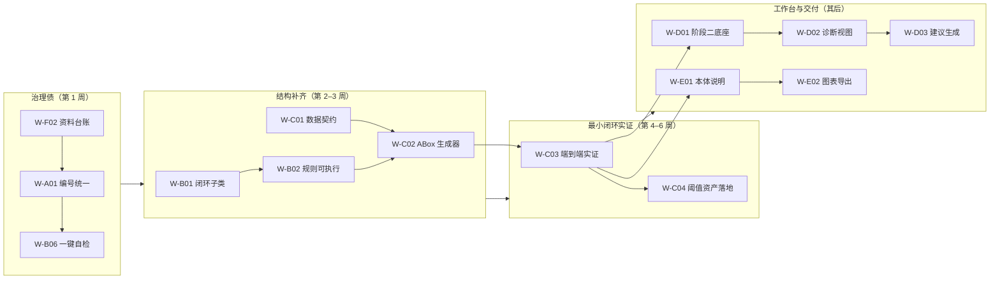
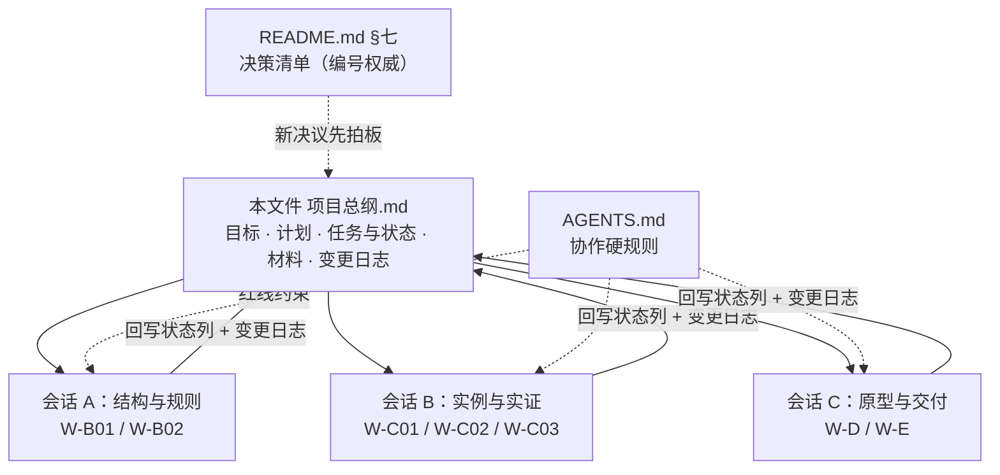

# 城市体检与更新本体研究 · 项目总纲

> **版本**：v3-20261107 ｜ **现状快照**：2026-11-07（实测核对，非引述旧文档）  
> **本文件是什么**：项目**目标 · 计划 · 任务定义（W-xx）· 材料清单 · 协同协议 · 现状与进度 · 变更日志**的唯一出处。  
> 由原 `工作进度.md`（v2）与 `项目规划与过程管控-v1-20261107.md`（v1）于 **2026-11-07 合并而成**；两份旧文件停用，实质内容已全部吸收，重复项已去重（备份在 `_bak_20261107/`）。  
> **本文件不管什么**：决议结论（→ [`README.md`](README.md) §七 决策清单，编号权威）、AI 协作红线（→ [`AGENTS.md`](AGENTS.md)）。  
> **一句话用法**：开工前读 §〇 与 §一，认领 §五 的某个 W 编号；收工按 §1.3 回写本文件（WBS 状态列 + §十 变更日志 + §9.2 待核）。

---

## 〇、结论先行（给大王的六条）

1. **项目已越过「能不能建出来」的阶段，卡在「能不能算」**。本体 107 类 / 1595 三元组 / SHACL 20 条约束 / SPARQL 6 条查询均已自洽且可重跑；阶段一原型也能演示。但**业务实体实例至今为 0**（92 个 ABox 全是指标、维度、分类这类元数据个体），所以「体检→问题→更新」这条闭环**从未用真实数据跑通过一次**。这是当前唯一的真差距。
2. **继续往原型上加功能，边际收益已经很低**。原型现在能“看”不能“算”：没有实例数据，点开一个社区看不到它的指标值、问题与项目。**建议主线从「做界面」转为「做一次端到端最小闭环实证」**——哪怕只做 1 个社区 × 10 项指标 × 1 条问题链，把链条跑通并留证。
3. **主干闭环 5 个类至今零子类**，`severity` 还只是数据属性，`EvaluationRule` 族没有一条可执行规则。**一旦接入实例数据就会先撞在这里**——评估结果没分级、问题没分型、建议没分类，SHACL 就无从校验、“快速诊断”也无从落档。这是接数据前必须先补的结构，不是可选项。
4. **有三笔治理债必须在并行开工前还掉**：① **编号重号四处**（报告 A1–A7 / 原型决议 D1–D6 / 概念清单 A1·D1 / 待决 D-1–D-4），跨会话必然串号；② **没有一键自检**，全部产物吊在 3 个生成脚本上，脚本一坏整链失守；③ **`01-资料/资料台账.md` 至今未建**，而它是本项目可信度的地基（`01-资料/README.md` 自己列为待建）。
5. **需大王拍板 8 件事**（§九 Q10–Q17），其中 3 件是硬卡口、不定就动不了：**主线是否转端到端实证（Q10）**、**样例数据由谁造（Q11）**、**主干闭环按什么分型（Q12）**；其余 5 件可后置，但建议顺手一并定了。
6. **治理已收口（2026-11-07）**：原「进度」与「规划」两份文件逐条镜像同一批任务（32 项任务写两遍、待拍板写两遍、已交付成果两张近似表）。今日合并为本文件——**任务只在一处登记**（§五 WBS 一张表兼「定义 + 状态」），从此不再有第二份进度。

---

## 一、这份文件怎么用

### 1.1 三份文档的分工（防重复维护）

| 文档                 | 管什么                                                   | 不管什么                               |
| ------------------ | ----------------------------------------------------- | ---------------------------------- |
| **本文件**（`项目总纲.md`） | 目标、计划、**任务定义与状态（W-xx，一张表兼两用）**、现状快照、材料清单、风险、协同协议、变更日志 | 不定义决议结论（只引用编号）；不重复 `AGENTS.md` 的规则 |
| `README.md` §七     | **决策清单**（编号权威，只增不改号）                                  | 不管执行进度                             |
| `AGENTS.md`        | AI 协作**硬性规则**（术语口径、引用规则、命名规范）                         | 不管进度与计划                            |

> 关系：本文件说「要做哪些事、做成什么样、做到哪一步」；`README.md` §七 说「哪件事已经拍过板」；`AGENTS.md` 说「不许怎么做」。
>
> **已退役（2026-11-07 合并入本文件）**：`工作进度.md`、`项目规划与过程管控-v1-20261107.md`。旧内容原样留档在 `_bak_20261107/`；旧编号（T1–T11 / D-1–D-4 / 报告 A1–A7）映射见附录 A。

### 1.2 开工规程（任何会话接手前必读）

1. **先认领编号**：我要做的是 §五 里的哪个 W 编号？没编号的任务先报编号，别直接干。
2. **查输入是否齐备**：任务表「输入」列 + §六 材料清单。缺料就停在「出规格 / 出草案」，别自造依据。
3. **查阻塞**：§七 风险表 + §九 待拍板。被 M1/M2/M3 卡住的任务不要硬推。
4. **查依赖**：任务表「依赖」列，前置未完成不启动。

### 1.3 收工规程（做完必须做的三件，全在本文件内闭环）

1. **§五 WBS 表更新状态列**（只改状态，不改任务定义；定义要改先报）；
2. **§十 变更日志追加一行**（日期 / 事项 / 产物·落点 / 验收证据）；
3. **新增的【待核】登记到 §9.2**；产物落点与命名按 §8.2 执行；**涉本体的必须跑一遍 `_check_all.py` 且全绿**（见 §5.7）。

### 1.4 五条红线（违反即返工）

1. **结构性变更**（类的增删改、属性值域变更）先报影响范围 → 大王确认 → 再动 `类与层级.md` → 再跑生成链。
2. **不编造条款号、指标编号、阈值数值、发布日期**；给不出来一律标【待核】。
3. **地方交付物只能作实例佐证 / 口径参考**，引用标【地方实操】，不得当标准依据。
4. **不越过决策清单自定新决议**；新决议先入 §九 待拍板，拍板后由大王编号进 `README.md` §七。
5. **对外发布前四项敏感复查**：真实地名 / 第三方原件 / 本地绝对路径 / 用户名·主机名。

---

## 二、项目目标与验收口径

### 2.1 一句话目标

给「体检查出的问题」到「更新项目」之间补上**一层可计算的语义**，使体检指标、问题短板、更新项目三者可追溯、可推理。

### 2.2 三层目标 + 验收口径（可判定的才算验收）

| 层          | 目标                     | 验收口径（可判定）                                                               | 现状                         |
| ---------- | ---------------------- | ----------------------------------------------------------------------- | -------------------------- |
| **L1 概念层** | 术语统一、口径可引              | 概念清单每条都有来源文件名，或明确标【待核】；五级空间单元口径不混用                                      | ✅ 基本达成（`02-术语与概念/概念清单.md`） |
| **L2 模型层** | 类 / 属性 / 约束 / 查询机读化且自洽 | `pyshacl` CONFORMS=True；悬挂引用 0；三次重跑 md5 一致；每条 URI 可回溯到源 md              | ✅ 达成（2026-10-12 已闭环）       |
| **L3 实例层** | **至少一个空间单元的完整闭环可跑通**   | 给定 1 个社区 + 一组指标测值 → 能算出评估结果 → 生成问题 → 关联整治建议 → 挂到更新项目；SPARQL 能答、SHACL 能校 | ❌ **未开始（核心差距）**            |
| **L4 展示层** | 对外可演示、可评审              | 离线可开、三视图可用、能演示“从问题追到项目”                                                 | 🔄 阶段一可演示，但只能“看”不能“算”      |

### 2.3 本期明确不做（防范围蔓延）

| 不做                  | 依据                                   |
| ------------------- | ------------------------------------ |
| 房屋安全体检（单体建筑结构鉴定）    | `README.md` §三 范围 / `AGENTS.md` 术语口径 |
| 土地一级开发、房地产市场监管      | 同上                                   |
| 绑定 CIM 平台数据模型       | 决策清单第 3 条                            |
| 对齐 BFO / CCO 上层本体   | 决策清单第 4 条（⏳ 待决，本期挂起）                 |
| 图数据库（Neo4j）路线       | 决策清单第 9 条（RDF→属性图有语义损耗）              |
| 智能应用（LLM 诊断 / 建议生成） | 原型决议 D6（暂缓），待 L3 打通后再议               |

---

## 三、现状快照（2026-11-07 实测）

### 3.1 里程碑总览

| 阶段              | 目标                      | 状态                   | 关键产物                                        | 备注                         |
| --------------- | ----------------------- | -------------------- | ------------------------------------------- | -------------------------- |
| **P0** 项目骨架     | 目录、协作约定、术语强制口径          | ✅ 完成                 | `README.md`、`AGENTS.md`、`WorkBuddy项目配置.md`  | —                          |
| **P1** 依据调研     | 政策 / 标准 / 概念演进 / 立法进展   | ✅ 完成                 | `城市体检与更新调研计划/results/` 19 份 JSON + 总清单 77 件 | 复核摘要份数口径待统一（W-F04）         |
| **P2** 术语收口     | 概念清单（中英 / 定义 / 上位 / 来源） | 🔄 约 85%             | `02-术语与概念/概念清单.md`                          | 4 项待办（W-A02/A03/A04/A05）   |
| **P3** 本体建模     | 类 / 属性 / 约束 / 查询 + 机读产物 | ✅ 完成（L2 层）           | `03-本体模型/` 五件 + 3 生成器                       | 结构短板见 §4.1 R2              |
| **P4** 指标映射     | 55 项基础指标 → 类与属性         | ✅ 完成                 | `04-指标映射/`（同源双产物）                           | 2 项待办（W-A05 / W-B04）       |
| **P5** 样本市实证    | 地方成果件内容梳理与意义分析          | ✅ v2（约 70%）          | `05-产出/报告/…-v2-20261010.md`                 | 4 项待办（W-A02/A03/A05/W-C05） |
| **P6** 高保真原型    | 可视化交互 + 未来智能应用          | 🔄 **阶段一 ✅ / 阶段二 ⏭** | `05-产出/原型方案/原型/`                            | 阶段二缺数据（W-C01 起）            |
| **P7** 公开发布     | 脱敏 + git 公开仓库           | ✅ 完成并已同步             | GitHub `urban-renewal-ontology`（`507377c`）  | 周期性复查（W-E03）               |
| **P8** 实例化与诊断闭环 | **把闭环用数据跑通**（本轮新增）      | ⏭ 未启动                | —                                           | **建议作为主线**，待 Q10 拍板        |
| **P9** 对外交付与评审  | 本体说明、图表、评审材料            | ⏭ 未启动                | —                                           | 优先级取决于 Q-M6（评审场合）          |

### 3.2 硬指标（本次实测）

| 项                   | 数值                                                                                                                                  | 来源                                   |
| ------------------- | ----------------------------------------------------------------------------------------------------------------------------------- | ------------------------------------ |
| OWL 三元组             | **1595**                                                                                                                            | `03-本体模型/城市体检-更新本体.ttl`（rdflib 解析实测） |
| TBox 类              | **107** = 106 概念类 + 1 技术构件（`DataObjectRoleUnion`）                                                                                   | 同上                                   |
| 对象属性 / 数据属性         | **33 / 57**                                                                                                                         | 同上                                   |
| `rdfs:subClassOf` 边 | **83**                                                                                                                              | 同上                                   |
| ABox 个体             | **92**（Indicator 55 / IndicatorCategory 13 / CollectionMethod 9 / FormulaType 7 / Dimension 5 / TreatmentType 2 / PolicyDocument 1） | 同上                                   |
| SHACL               | **5 个目标类形状 / 20 条约束**，`pyshacl` CONFORMS=True，负向测试有效                                                                                | `城市体检-更新约束.shacl`                    |
| SPARQL 查询模板         | **6 条**（Q1 指标全览 / Q2 反查贯通 / Q3 维度计数 / Q4 多对象公式 / Q5 问题→建议→项目 / Q6 阈值溯源）                                                             | `常用查询.sparql`                        |
| 指标映射                | **55 项 / 50 个数据对象 / 67 次引用 / 0 异常**                                                                                                 | `04-指标映射/55项指标.yaml`                 |
| 原型节点                | 107 类（默认总览）/ 199 节点（叠加 ABox）                                                                                                        | `原型/README.md`                       |
| 调研文件总量              | **77 件**（含废止 9 项）                                                                                                                   | `results/现行有效文件总清单.md`               |

### 3.3 三条工作线的完成度评估

| 工作线       | 完成度                       | 判断理由                                                     |
| --------- | ------------------------- | -------------------------------------------------------- |
| 依据调研（P1）  | **95%**                   | 19 份 JSON 覆盖政策演进、概念、标准、立法；台账已建（W-F02 ✅ 11-07）；剩份数口径统一（W-F04）   |
| 术语收口（P2）  | **85%**                   | 核心概念 + 五级空间单元 + 13 分类已收口；编号重编（W-A05）未做、街区面积口径未修（W-A02）   |
| 本体建模（P3）  | **80%**（L2 层 95%，L3 层 0%） | 机读产物自洽度很高；但**主干闭环零子类、规则不可执行、零业务实例**，模型“骨架硬、血肉空”          |
| 指标映射（P4）  | **95%**                   | 55 项零异常，同源生成；仅 codeScheme（W-A05 连带）与 54/55 值域复核（W-B04）未做 |
| 实证研究（P5）  | **70%**                   | 口径与建模硬事实已提炼；A1/A3/A4/A6 四项未执行，T 系列归属待决                   |
| 高保真原型（P6） | **45%**                   | 阶段一浏览能力完整、视觉规范到位；**算不了**，阶段二全未启动                         |
| 公开发布（P7）  | **90%**                   | 仓库已公开并同步；剩周期性脱敏复查                                        |

---

## 四、差距与主线判断

### 4.1 三个真问题（结构性缺口 S1–S3，不是待办）

| #      | 问题                   | 证据                                                                                                                                    | 后果                                                |
| ------ | -------------------- | ------------------------------------------------------------------------------------------------------------------------------------- | ------------------------------------------------- |
| **S1** | **业务实体实例 = 0**       | 92 个 ABox 全为元数据类型个体；无空间单元实例、无指标测值                                                                                                     | 项目最核心的主张（可计算闭环）至今只是“设计上成立”，**未被任何数据验证**；原型无法演示“算” |
| **S2** | **主干闭环零子类 + 规则不可执行** | `AssessmentResult` 无分级子类（三档仅作 `grade` 值）；`Problem` 无类型细分，`severity` 仅数据属性；`EvaluationRule` 族无一条规则实例；无 `referenceValue` / `ratingBand` | 接数据即撞墙：SHACL 无法校验“问题是否成立”，诊断无法落档，建议无法分型           |
| **S3** | **编号体系混乱**           | 同一字母四套含义：报告 A1–A7（行动）、原型 D1–D6（决议）、概念清单/指标映射 A1·A6·D1·D2（待办）、待决 D-1–D-4；`工作进度.md` 另有 T1–T11                                           | 多会话并行必然串号；本文件以 **W-xx** 统一收口（§9 附录 A 映射） **已收口**（2026-11-07，见附录 A） |

### 4.2 差距表（能力视角）

| 能力       | 现在            | 目标（本期）                                              | 差距             | 对应任务          |
| -------- | ------------- | --------------------------------------------------- | -------------- | ------------- |
| 概念口径统一   | 两套编号并存，未做重编对照 | 55 ↔ 60 项可互译，且注明版本                                  | 缺官方对照材料 + 重编工作 | W-A05（卡 M3）   |
| 类结构完整度   | 主干闭环 5 类零子类   | 结果分级 / 问题分型 / 建议分类至少各一层                             | 未设计分型维度        | W-B01（卡 Q13）  |
| 规则可执行    | 只有规则类，无实例、无区间 | 至少 10 项指标带 `referenceValue` + 四档 `ratingBand`，规则可判定 | 阈值资产未建模        | W-B02 + W-C04 |
| 实例数据     | 0             | 1 个社区 + 10–15 项测值 + 3 个问题 + 建议 + 项目                 | 无数据、无数据规格      | W-C01 → W-C02 |
| 闭环可验证    | 设计上成立         | SPARQL Q5 能答出“社区A的问题→建议→项目”，SHACL 能校                | 未跑过            | W-C03         |
| 诊断能力（原型） | 无             | 输入测值 → 出诊断卡                                         | 依赖上两行          | W-D02         |
| 对外说明     | 无独立文档         | 本体模型说明（对外版）+ 类图                                     | 未写             | W-E01 / W-E02 |
| 一键自检     | ✅ 已落地（11-07） | `_check_all.py` 六步：链 / 确定性 / 计数 / SHACL / SPARQL / 基线 | — | W-B06 ✅ |

### 4.3 主线判断（老奴的建议，待 Q10 拍板）

**建议主线：P8 实例化与诊断闭环，暂缓原型加功能。**

三条理由：

1. **验证优先于美化**。现在最贵的风险不是“界面不够炫”，而是“模型经不起数据”。一个社区的真实数据进来，立刻能检验 107 个类里哪些是废的、哪些缺属性——这是任何评审都替代不了的硬证据。
2. **顺序上不可颠倒**。阶段二（SPARQL 端点 + 诊断视图 + LLM）全部依赖实例数据；没有数据，Oxigraph 装了也是空转，LLM 接了也只能编。
3. **原型的边际价值已递减**。三视图 + 类树 + 检索 + 详情卡已覆盖“浏览”需求；再加视图只是换皮。**把“能算”补上，同一次演示的说服力提升一个量级**。

---

## 五、执行计划

### 5.1 路线图



### 5.2 阶段闸门（Gate：不过不进下一阶段）

| 闸门           | 判定标准（可验证）                                                                                  | 对应任务                  |
| ------------ | ------------------------------------------------------------------------------------------ | --------------------- |
| **G0 治理就绪**  | 全项目任务编号唯一（无重号）；`_check_all.py` 一条命令跑通重跑链 + SHACL + SPARQL；`资料台账.md` 登记 ≥ 现有原件数             | W-A01 / W-B06 / W-F02 |
| **G1 结构就绪**  | `Problem` 有分型子类、`AssessmentResult` 有分级、`EvaluationRule` 有 ≥1 条可执行实例；SHACL 新增相应约束且 CONFORMS | W-B01 / W-B02         |
| **G2 闭环成立**  | 1 个社区 + 10–15 项测值的实例数据入库；SPARQL Q5 能答出完整链；至少 1 条反例被 SHACL 拦住                               | W-C02 / W-C03         |
| **G3 可演示诊断** | 输入测值 → 自动出诊断卡（指标达标判定 + 问题清单 + 建议），前端可视化                                                    | W-D02                 |
| **G4 可对外交付** | 本体说明 + 类图 + 演示链接齐备，四项敏感复查通过                                                                | W-E01 / W-E02 / W-E03 |

### 5.3 任务清单（WBS）

> 状态口径（全项目统一）：`✅ 完成`／`🔄 进行中`／`⏭ 待办`／`⏸ 暂缓`／`⏳ 待决`。  
> 「旧编号」列指向原 `工作进度.md` / 报告 v2 / 原型决议的编号，映射见附录 A。

#### W-A 术语与口径收口

| #         | 任务                           | 目的与验收                                                                         | 输入                        | 产出落点                           | 依赖        | 状态              |
| --------- | ---------------------------- | ----------------------------------------------------------------------------- | ------------------------- | ------------------------------ | --------- | --------------- |
| **W-A01** | **编号体系统一 + 文档索引** | 附录 A 建为「编号体系」（现行 7 族 + 历史 9 族 + 3 条硬规则）；8 份使用旧编号的文档加编号族声明。**验收口径已修正**：原定「全项目再无重号」不可达（历史成稿不可原地重编），改为「任一编号可经总表唯一还原，跨文档引用须带出处」 | 本文件附录 A | 附录 A + 8 份文档头 | — | ✅ 2026-11-07 |
| W-A02     | 街区面积口径修正                     | 明确「街区维度实操 = 街道」；1–5 km² 保留为**重庆导则口径**并分列                                      | 报告 v2 §五、`概念清单.md` §二     | `概念清单.md`                      | —         | ⏭（原 T3/A3）      |
| W-A03     | 2025↔2026 口径变更登记             | 小区↔社区、停车泊位「缺口数」↔「小区数」两处变更留痕可查                                                 | 报告 v2 附录 A                | `概念清单.md` §八                   | —         | ⏭（原 T3/A4）      |
| W-A04     | 概念清单补新增术语                    | `IndicatorCategory` / `RemediationSuggestion` / `Land` / `Building` 等已入条目复核补齐 | 概念清单 §九·§十                | `概念清单.md`                      | W-A05（部分） | ⏭（原 T4/D1）      |
| **W-A05** | **同事 60 项制 ↔ 我方 55 项编号重编对照** | 出一张双列对照表 + `Indicator.codeScheme` 字段设计；两项须可机械互译                               | 报告 v2 附录 A、`55项指标.yaml`   | 新建 `04-指标映射/编号对照-2025↔2026.md` | **M3 材料** | ⏭（原 T2 = A1+A6） |
| W-A06     | `dataSource` 举例口径统一          | 「平台底表」与「系统对接」二选一，全项目一致                                                        | `类与层级.md`、`属性与关系.md`、录入模板 | 上述三处                           | —         | ⏭               |

#### W-B 本体结构演进

| #         | 任务                             | 目的与验收                                                                                                                      | 输入                         | 产出落点                               | 依赖         | 状态         |
| --------- | ------------------------------ | -------------------------------------------------------------------------------------------------------------------------- | -------------------------- | ---------------------------------- | ---------- | ---------- |
| **W-B01** | **主干闭环子类细化**（结构性变更，须报批）        | ① `AssessmentResult` 分三级子类；② `Problem` 有分型维度（见下“设计要点”）；③ `RemediationSuggestion` 分「限时解决 / 尽力解决」二类；④ SHACL 相应约束补齐且 CONFORMS | `类与层级.md` §三、报告 v2 §四      | `类与层级.md`、`属性与关系.md`、`_gen_ttl.py` | **Q12 拍板** | ⏭ ★        |
| **W-B02** | **规则族可执行化**                    | `EvaluationRule` 有 ≥1 条实例；新增 `referenceValue` / `ratingBand` 数据属性；至少 10 项指标可自动判定达标                                         | 样本市自评表（四档区间）、`55项指标.yaml`  | 三件 md + ttl/shacl                  | W-B01      | ⏭ ★        |
| W-B03     | `aggregationRule` 属性           | 比率型指标不可跨层加总的问题有显式表达（属性 + 约束）                                                                                               | 待核项清单                      | `属性与关系.md`、ttl                     | W-B01      | ⏭          |
| W-B04     | 指标 54 / 55 `computedFrom` 值域复核 | 确认「体检问题」「更新项目」两指标的取值域是否需纳入新类                                                                                               | `55项指标.yaml`               | 同上                                 | W-B01      | ⏭（原 T5/D2） |
| W-B05     | 主干闭环 Mermaid 图更新               | 图与 §三 正文一致，含 `triggers` 兼容路径                                                                                               | `类与层级.md` §三               | 同上                                 | W-B01      | ⏭（原 T6/D4） |
| **W-B06** | **一键自检脚本 `_check_all.py`** | 六步：重跑链 → 确定性双跑（sha256 逐文件）→ 结构计数 → `pyshacl` → 6 条 SPARQL → 基线比对；任一失败退出码 1。基线外置 `_baseline.json`（不写死数字），`--update` 重建 | 3 个生成器 + 产物 | `03-本体模型/_check_all.py`、`_baseline.json` | — | ✅ 2026-11-07（含 2 项负向测试） |
| W-B07     | 命名空间定稿                         | 占位 URI 换成正式命名空间，全产物统一替换                                                                                                    | 待核项                        | 全部产物                               | M4         | ⏭          |


> **W-B01 设计要点（供讨论，不是结论）**
>
> - 分型维度有三条可选路线：**① 按维度分**（住房 / 小区 / 社区 / 街区 / 城区五类问题——与指标轴天然对齐，但粒度粗）；**② 按严重度分**（轻微 / 中等 / 严重——直接服务预警排序，但需先定 `severity` 档位边界）；**③ 两者叠加**（维度作 `Problem` 的一等分型、严重度作属性或独立分级类——表达力最强，类数增长也最快）。**老奴倾向 ③**：维度分型支撑“按领域出问题清单”，严重度保留为可计算属性，避免类爆炸。
> - `AssessmentResult` 三档（达标 / 基本达标 / 不达标）**已于 2026-10-09 决议维持**，此处只是把“值”升级为“类”，需确认是否有下游依赖 `grade` 字符串（`_to_graph_json.py`、原型详情卡、SHACL 各一处）。
> - 「限时解决 / 尽力解决」**判定规则未明【待核】**，W-B01 只建结构，规则留给 W-B02。

#### W-C 实例化与实证

| #         | 任务                          | 目的与验收                                                                             | 输入                                  | 产出落点                                          | 依赖          | 状态   |
| --------- | --------------------------- | --------------------------------------------------------------------------------- | ----------------------------------- | --------------------------------------------- | ----------- | ---- |
| **W-C01** | **实例数据契约（数据规格）**            | 定义空间单元 / 指标测值 / 问题 / 建议 / 项目五类实例的字段与约束；出 1 份规格 + 1 套合成样例（3 个社区，构造数据，明确标“虚构”）      | 本体属性表、`55项指标.yaml`                  | 新建 `06-实例数据/README.md` + `数据契约-v1.md` + `样例/` | W-B01；Q11   | ⏭ ★  |
| **W-C02** | **ABox 生成器 `_gen_abox.py`** | 样例数据（YAML）→ 实例三元组并入 `.ttl`；同源生成 + 防漂移断言（实例引用的类与属性必须已声明）；重跑幂等                      | W-C01 契约                            | `03-本体模型/_gen_abox.py`、ttl                    | W-C01、W-B02 | ⏭    |
| **W-C03** | **端到端最小闭环实证**               | 1 个社区 × 10–15 项指标 → 评估结果 → 3 个问题 → 建议 → 项目；SPARQL Q5 能答全链；SHACL 能拦住 1 条构造反例；出实证报告 | W-C02 产物                            | `05-产出/报告/最小闭环实证-v1-2026xxxx.md`              | W-C02       | ⏭ ★  |
| W-C04     | 阈值资产落地                      | 自评表「全国平均 / 参考值 + 四档区间」结构化，补我方 47 项「不适用」                                           | `01-资料/样本成果/城市体检报告案例/城市体检自评表.pdf` | `04-指标映射/` 新增阈值表                              | W-B02       | ⏭    |
| W-C05     | 样本市口径对外版                    | 报告 v2 的地方实例表述改为可公开口径，供对外引用                                                        | 报告 v2                               | `05-产出/报告/` 新版本                               | W-A05       | ⏳ 待决 |

> **W-C01 的关键判断**：**不等样例数据就能开工**。先出“数据契约”（要哪些字段、什么约束、什么量级），再出合成样例。这样即便大王暂时没时间整理真数据，链条也能先跑通；真数据到位后只是替换数据文件，不动结构。**这是把“卡在等材料”变成“并行推进”的关键一步。**

#### W-D 原型与智能应用

| #     | 任务                  | 目的与验收                                                                     | 输入                 | 产出落点              | 依赖         | 状态          |
| ----- | ------------------- | ------------------------------------------------------------------------- | ------------------ | ----------------- | ---------- | ----------- |
| W-D01 | 阶段二底座（SPARQL + 校验层） | Oxigraph（或 Fuseki）载入 ttl + shacl；薄后端代理 SPARQL 与 `pyshacl`；G6 是否走「混合路线」在此定 | `常用查询.sparql`、决策 9 | `05-产出/原型方案/工作台/` | W-C03      | ⏭（原 T8/D-2） |
| W-D02 | 诊断视图                | 选社区 + 测值 → 出诊断卡（达标判定 + 问题清单 + 建议），复用现详情面板                                 | W-C03 实证链          | 同上                | W-D01      | ⏭           |
| W-D03 | 建议生成 + 可视化          | 筛选条件 → `Problem→RemediationSuggestion` 反查 → 生成建议 + 出图                     | W-D02              | 同上                | W-D02、模型通道 | ⏸ 暂缓（D6）    |
| W-D04 | 原型在线发布              | 静态版发布为在线链接，供评审 / 同事访问                                                     | `原型/index.html`    | 在线链接              | —          | ⏭           |
| W-D05 | 原型 UI 打磨            | 大屏 / 投影适配、键盘可达性、打印友好                                                      | 视觉规范               | 原型                | W-D02      | ⏸ 低优先       |

#### W-E 交付与发布

| #         | 任务              | 目的与验收                                                            | 输入                         | 产出落点                                  | 依赖          | 状态       |
| --------- | --------------- | ---------------------------------------------------------------- | -------------------------- | ------------------------------------- | ----------- | -------- |
| **W-E01** | **本体模型说明（对外版）** | 面向评审 / 同事，讲清“为什么这么建”，每个论断可回溯到模型文档条目                              | `类与层级.md`、`属性与关系.md`、报告 v2 | `05-产出/报告/城市体检与更新本体说明-v1-2026xxxx.md` | W-B01、W-C03 | ⏭（原 T10） |
| W-E02     | 类图 / 关系图导出      | 建 `05-产出/图表/`，Mermaid 源 + 导出图都留                                  | 模型文档                       | `05-产出/图表/`                           | W-B01       | ⏭（原 T11） |
| W-E03     | git 同步与脱敏复查     | 四项敏感复查 + CRLF 检查 + 中文 commit + push（必 `http.sslBackend=openssl`） | —                          | 公开仓库                                  | —           | 🔄 周期性   |
| W-E04     | 评审材料            | 依 §六 M6 的场合定形态（一页纸 / PPT）。**PPT 须遵用户级《PPT制作要点.md》V3.3，逐闸门停**     | W-E01                      | `05-产出/`                              | M6          | ⏳ 待决     |

#### W-F 项目治理与资料

| #         | 任务                 | 目的与验收                                            | 输入                    | 产出落点                       | 依赖  | 状态                  |
| --------- | ------------------ | ------------------------------------------------ | --------------------- | -------------------------- | --- | ------------------- |
| **W-F01** | **本项目总纲**          | 目标 / 计划 / 任务 / 材料 / 协同协议 / 进度 / 日志合成一份，其他会话可直接接手 | 全项目盘点                 | `项目总纲.md`                  | —   | ✅ 2026-11-07        |
| W-F02 | 补建 `资料台账.md` | 在库原件 10 件逐项登记（机关 / 文号 / 日期 / 状态 / 涉及概念）；确立「在库原件 vs 文献总清单 77 件」两条线；列出 6 项缺口原件 | `01-资料/` 实际文件 + 调研总清单 | `01-资料/资料台账.md`（并修正 `01-资料/README.md` 子目录） | — | ✅ 2026-11-07 |
| W-F03     | `_extracted/` 归属处置 | 明确抽取产物是否迁出 `01-资料/`（该目录规定“只放原件”）                 | 大王示下                  | 目录调整                       | Q15 | ⏳ 待决（原 T7/D-3）      |
| W-F04     | 调研复核摘要份数口径         | README 记 3 份 / 磁盘实为 2 份，统一为一                     | `results/`            | `results/`、`README.md`、本文件 | —   | ⏭                   |
| W-F05     | 三分离落地检查            | **三份文档**（本总纲 / 决策清单 / AGENTS）无重复定义，交叉引用有效        | 三份文档                  | 本文件 §1.1                   | —   | ✅ 2026-11-07（合并后复核） |

### 5.4 本轮勾选清单（G0–G1，共 10 项）

> 只列**当前这一批**，避免与 §5.3 全量表重复；后续批次完成后重写本清单。验收口径见 §5.3。

**G0 · 治理就绪（第 1 周）**

- [x] **W-A01** 编号体系统一 + 文档头索引
- [x] **W-B06** 一键自检 `_check_all.py`
- [x] **W-F02** 补建 `01-资料/资料台账.md`
- [ ] W-F04 调研复核摘要份数口径
- [ ] W-A02 街区面积口径修正
- [ ] W-A03 2025↔2026 口径变更登记
- [ ] W-A06 `dataSource` 举例口径统一

**G1 · 结构就绪（第 2–3 周）**

- [ ] **W-B01** 主干闭环子类细化（**待 Q12**）
- [ ] **W-B02** 规则族可执行化
- [ ] **W-C01** 实例数据契约 + 合成样例

> 其余 22 项的状态一律以 §5.3 表格为准；本清单不另设状态，做完即在 §5.3 把状态改为 ✅ 并在此打勾。

### 5.5 排序理由（为什么是这个顺序）

| 顺序 | 做的事                                 | 为什么排这里                                     |
| -- | ----------------------------------- | ------------------------------------------ |
| 1  | W-A01 / W-B06 / W-F02（治理债）          | 半天到一天的活，却是后面所有并行开工的**索引基础**与**安全网**；越晚做越贵  |
| 2  | W-B01 → W-B02（结构）                   | 接数据的前置条件；不先补子类，数据一进来就要返工重建                 |
| 3  | W-C01 → W-C02（数据规格 + 生成器）           | **不依赖外部材料**，可与 W-B01 并行；把“等大王给数据”从关键路径上摘下来 |
| 4  | W-C03（端到端实证）                        | 项目立命之本；一次跑通即可对外宣称“闭环成立”                    |
| 5  | W-D01 → W-D02（工作台）                  | 有数据才有意义；此前做只是空转                            |
| 6  | W-E01 / W-E02（交付）                   | 需要 W-B01、W-C03 的结论支撑，早写会返工                 |
| 后排 | W-A05（编号重编）/ W-C04（阈值）/ W-B07（命名空间） | 均卡外部材料（M3 / M4），不阻塞主线                      |

### 5.6 建议窗口（按周推进，**非承诺日期**）

| 窗口                   | 内容                                        | 出口             |
| -------------------- | ----------------------------------------- | -------------- |
| 第 1 周（11/10–11/16）   | W-A01、W-B06、W-F04、W-F02、W-A02、W-A03、W-A06 | 闸门 **G0**      |
| 第 2–3 周（11/17–11/30） | W-B01（报批后）、W-B02、W-C01                    | 闸门 **G1**      |
| 第 4–6 周（12/01–12/19） | W-C02、W-C03、W-C04                         | 闸门 **G2**      |
| 12 月下旬起              | W-D01、W-D02、W-E02、W-E01                   | 闸门 **G3 / G4** |

> 说明：本项目是研究性工作，节奏由大王的实际档期决定；此表只解决“同时开多个会话时不打架”的问题，不作交付承诺。

### 5.7 数据管道与重跑链（运维须知）

**唯一数据源 → 机读产物**。改结构必须先改 md，脚本带双向防漂移断言，对不上就报错、不写产物：

```text
类与层级.md ──┐
属性与关系.md ├─→ _gen_ttl.py ─→ .ttl / .shacl / .sparql
55项指标.yaml ┘                      │
                                     └─→ _to_graph_json.py ─→ 原型 data/ontology.{json,js}
类与层级.md 附录 A ←── _gen_class_list.py（幂等，只改带界标的受控区块）
```

**重跑链（三步，顺序不可颠倒）**：`_gen_ttl.py` → `_to_graph_json.py` → `_gen_class_list.py`。

**一键自检（已落地，改完必跑）**：

```bash
python 03-本体模型/_check_all.py            # 默认含确定性双跑，约 7 秒
python 03-本体模型/_check_all.py --no-twice # 快一档
python 03-本体模型/_check_all.py --update   # 产物确有正当变更后重建基线
```

六步：重跑链 → 确定性双跑（sha256 逐文件）→ 结构计数（全动态，无写死清单）→ `pyshacl` → 6 条 SPARQL → 基线比对（`_baseline.json`）。任一失败退出码 1。

**三条不能忘的口径**：① 主干闭环 = 体检活动 → 评估结果 → 问题 → 建议 → 项目（`triggers` 为直通兼容路径）；② `Dimension`(5) 与 `IndicatorCategory`(13) **平行独立**，分类不挂在维度之下（用 `belongsToDimension`）；③ `DataObject` 是**角色类**，`computedFrom` 值域为并集，且**不含** `RemediationSuggestion`。

**历史脚本**：`_apply_0930.py` / `_apply_0930b.py` / `_apply_1010.py` / `_reflow_props.py` / `_fix_p2_0930.py` / `_verify*.py` 均为一次性批处理，**已执行完，勿再跑**（W-B06 会把它们排除在自检之外）。

---

## 六、材料清单

### 6.1 已有材料（按类，含可信度定级）

定级口径：**A = 可作标准依据**（公开标准 / 官方文件原件）｜**B = 仅作参考**（同事成果、地方实操）｜**C = 加工件**（我方抽取与整理，需回溯原件）。

| 类别          | 材料                                                                                                                    | 位置                                        | 状态                                       | 定级         | 用途                    |
| ----------- | --------------------------------------------------------------------------------------------------------------------- | ----------------------------------------- | ---------------------------------------- | ---------- | --------------------- |
| **依据·手册**   | 新疆城市体检工作手册（2026 年版）· 全量版 / 指标版 PDF                                                                              | `01-资料/体检手册/`                             | 原件齐（8.7 MB / 4.8 MB）                     | **A**      | 55 项指标口径、T 系列来源       |
| **依据·国家标准** | 调研总清单收录 77 件（含废止 9 项）                                                                                                 | `城市体检与更新调研计划/results/现行有效文件总清单.{md,json}` | 清单齐，**原件多数未入库**                          | A（清单）/ —   | 引用前核对、条款溯源            |
| **依据·同事成果** | `cbim_ontology(1).owl`（v7.0）+ `cbim_shacl.ttl`                                                                        | `01-资料/同事交付/`                             | 已读并避坑（60 项制 = 2025 手册官方编号；部分 SHACL 为占位桩） | **B**      | 类设计借鉴；**不得当标准依据**     |
| **实证·地方成果** | 住房维度专题报告 / 小区（社区）维度专题报告 / 街区维度参考 / 城区维度参考（.doc/.docx）                                                                 | `01-资料/样本成果/城市体检报告案例/`                  | 三份件齐                                     | **B** 地方实操 | 建模硬事实来源；引用标【地方实操】     |
| **实证·阈值资产** | 城市体检自评表 PDF（每项带全国平均 / 参考值 + 四档区间）                                                                                     | 同上                                        | 原件齐（扫描件，已分片识读）                           | **B** 地方实操 | 补 47 项「不适用」→ W-C04    |
| **实证·抽取产物** | `城区维度_正文.md`（29 KB）/ `街区维度_正文.md`（28 KB）/ pdf_chunks 12 片 / pdf_zoom 3 片                                              | `01-资料/样本成果/_extracted/`                | 加工件                                      | **C**      | 检索与引用；归属待定（W-F03）     |
| **调研成果**    | 18 份主题 JSON + 总清单 + 2 份复核摘要（`_复核_前12批.md` / `_复核_第3批.md`）                                                             | `城市体检与更新调研计划/`                            | 齐                                        | **C**      | 政策与标准底账               |
| **术语**      | `概念清单.md`（24 KB，十节 + 待核 §八）                                                                                           | `02-术语与概念/`                               | 齐                                        | —          | 口径唯一出处                |
| **本体·文档**   | `类与层级.md`（59 KB，含附录 A 全量 107 类）/ `属性与关系.md`（46 KB）                                                                    | `03-本体模型/`                                | 齐                                        | —          | 改结构的第一现场              |
| **本体·机读**   | `.ttl`（64 KB）/ `.shacl`（4.5 KB）/ `.sparql`（2.7 KB）                                                                    | `03-本体模型/`                                | 齐，CONFORMS                               | —          | 交付物主体                 |
| **本体·生成器**  | `_gen_ttl.py` / `_to_graph_json.py` / `_gen_class_list.py`                                                            | 同上                                        | 齐，重跑幂等                                   | —          | 唯一数据管道                |
| **本体·自检** | `_check_all.py`（六步自检）+ `_baseline.json`（计数与哈希基线） | 同上 | 齐，全绿；负向测试有效 | — | 改完必跑；`--update` 重建基线 |
| **资料·台账** | `资料台账.md`（在库原件 10 件：依据 2 / 参考 8；加工件 7 项；缺口 6 项） | `01-资料/` | 齐（该目录不入库） | **B/C** | 引用前查原件是否在库 |
| **本体·历史脚本** | `_apply_0930.py` / `_apply_0930b.py` / `_apply_1010.py` / `_reflow_props.py` / `_fix_p2_0930.py` / `_verify*.py`（3 个） | 同上                                        | 一次性批处理，已执行完                              | —          | 变更留痕，勿再跑（W-B06 应将其排除） |
| **指标**      | `55项指标.yaml`（唯一数据源）+ 映射表 / 录入模板 / 拆解结果 / 数据对象拆解 / 校验清单                                                                | `04-指标映射/`                                | 齐，0 异常                                   | —          | 指标层唯一出处               |
| **指标·脚本**   | `_gen_map.py` / `_check_55.py`                                                                                        | 同上                                        | 齐                                        | —          | 同源生成与校验               |
| **调研·脚本**   | `_review.py` / `_review3.py`                                                                                          | `城市体检与更新调研计划/`                            | 齐                                        | —          | 复核摘要生成                |
| **原型**      | `原型/index.html`（52 KB 单文件）+ `data/ontology.{json,js}` + README                                                        | `05-产出/原型方案/原型/`                          | 阶段一交付，离线可开                               | —          | 演示主体                  |
| **原型·规范**   | `视觉规范-现代中性-语义域配色-v1-20261011.md` + 三款风格样例                                                                             | `05-产出/原型方案/`                             | 齐                                        | —          | 六域配色与 6 条红线           |
| **原型·评估**   | `G6-A与B对比-20261012.md` + `g6-spike/`（8 条断言）                                                                           | 同上                                        | 齐（g6.min.js 1.38 MB 不入库）                 | —          | 阶段二底座选型依据             |
| **原型·截图**   | 原型截图 6 张 + G6 对照 6 张 + 风格样例 3 张                                                                                       | 同上                                        | 齐                                        | —          | 证据留档                  |
| **报告**      | `样本市2025体检成果研究…-v1-20260930.md` / **-v2-20261010.md**（31 KB）                                                          | `05-产出/报告/`                               | v2 为准                                    | **C**      | 实证口径与建模硬事实            |
| **方案**      | `本体高保真原型_实施路线方案-v1-20261010.md`                                                                                       | `05-产出/原型方案/`                             | 齐                                        | —          | A/B/C/D 方案与阶段清单       |

### 6.2 缺口材料（**这部分决定哪些任务能开工**）

| #      | 材料                                                                                                 | 谁提供                   | 卡住什么                                            | 优先级    | 临时替代方案                                               |
| ------ | -------------------------------------------------------------------------------------------------- | --------------------- | ----------------------------------------------- | ------ | ---------------------------------------------------- |
| **M1** | **建办科〔2026〕16 号 附件1 原件**（或正式文号的可核来源）                                                               | 大王                    | `README.md` §七 决策 2 的依据链；指标 55 项原文核对；文号【待核】无法消项 | 高      | 沿用现口径并持续标【待核】；不影响建模（指标原文已转录入模板）                      |
| **M2** | **「样本市样例数据」一套**（空间单元实例 + 指标测值）                                                                     | 大王（2026-10-11 已表态会整理） | L3 全部；P8 主线                                     | **最高** | **W-C01 先出数据契约 + 合成样例**（构造数据，明确标“虚构”），真数据到位后替换文件不动结构 |
| **M3** | 2025 手册 60 项 ↔ 2026 附件1 55 项**官方对照**（或授权我方重编）                                                      | 大王 / 我方重编             | W-A05 编号重编、`codeScheme`                         | 中      | 报告 v2 附录 A 已有初步对照，可先作“草案对照”                          |
| **M4** | 七项待核参数定值：`severity` 档位边界 / 指标 52 高层层数阈值 / `treatmentType` 判定规则 / 正式命名空间 / T 系列归属 / 街区面积口径 / 调研摘要份数 | 大王                    | W-B01、W-B02、W-B07                               | 中      | 先建结构不填数值，参数留可配置                                      |
| **M5** | **`01-资料/资料台账.md`**（新建）                                                                            | 我方（W-F02）             | P1 收口、可信度地基                                     | 高      | 无（可直接开工，不依赖外部）                                       |
| **M6** | 对外评审的**场合 / 受众 / 时间**                                                                              | 大王                    | W-E04 形态与优先级；P9 排期                              | 中      | 按“内部先讲、对外后讲”准备                                       |
| **M7** | 成品界面的**视觉终审**（决策 7 定的是风格方向，不是成品）                                                                   | 大王                    | W-D05                                           | 低      | 按视觉规范执行，交付时一并请审                                      |

### 6.3 材料使用纪律（三条）

1. **A 级可引作依据，B 级只能标【地方实操】/【同事成果】，C 级必须能回溯到原件**——报告里每个数字都要能指到这三类之一。
2. **原件不在库内的，一律不写条款号**（如把“建办科〔2026〕16 号附件1”写成确定依据时，同句必须带【文号待核】）。
3. **地方实例数值入公开物前必须泛化**（地名→样本市、街道→A–E、实测值删除只留量级）。`01-资料/` 下真实子目录名含地名，**本文件一律写作 `样本成果`**（该目录本身不入库，写全名无检索价值、只增泄露面）。

---

## 七、风险与阻塞登记

| #      | 风险                       | 触发条件         | 影响                       | 缓解                                                | 状态                                     |
| ------ | ------------------------ | ------------ | ------------------------ | ------------------------------------------------- | -------------------------------------- |
| **R1** | 实例数据长期不到位                | 大王档期紧        | P8 全线停摆，只能做合成数据          | W-C01 先行 + 合成样例；**关键路径不押在 M2 上**                  | 🔴 活跃                                  |
| **R2** | 规则不可执行                   | 接数据时才发现      | 诊断无法落档，SHACL 校不了“问题成立与否” | W-B01 / W-B02 前置                                  | 🟡 已列入计划                               |
| **R3** | 编号重号导致串号                 | 多会话并行        | 改错文件、重复劳动                | W-A01 统一为 W-xx + 文档头索引                            | 🟢 已收口（W-A01，11-07）                                 |
| **R4** | 地方件被误当标准依据               | 引用图省事        | 学术与合规风险                  | 三级定级 + 引用纪律（§6.3）                                 | 🟢 已有纪律                                |
| **R5** | LLM 通道（阶段二）不可用 / 成本失控    | W-D03 启动     | 智能应用落不了地                 | D6 暂缓；启动前专项确认模型与通道                                | ⏸ 暂缓                                   |
| **R6** | **单点依赖**：全部产物吊在 3 个生成脚本上 | 脚本被误改 / 环境变动 | 重跑链断，产物无法复现              | **W-B06 一键自检**；历史 `_apply_*.py` 明确标记“勿再跑”         | 🟢 已落地（W-B06，11-07）                               |
| **R7** | 文档漂移（多文档重复定义口径）          | 各会话各写一份      | 口径分叉，评审被质疑               | §1.1 四份文档分工 + §1.3 收工三件                           | 🟢 本轮建立                                |
| **R8** | 本地与网盘 / 多机版本不一致          | 换机器开工        | 基于旧版改，白干                 | **以本地为准**；开工先 `git status` + 看 mtime；批注用 diff 法判定 | 🟢 已有约定（网盘副本现停在 09-08 骨架版，**不可作工作副本**） |
| **R9** | 公开仓库误传敏感内容               | 手工加文件        | 脱敏约定被破坏                  | W-E03 四项复查 + `.gitignore` 四条例外                    | 🟢 已有纪律                                |

---

## 八、会话协同协议

### 8.1 一图看懂协作方式




### 8.2 产物命名与落点

| 产物类型       | 落点                     | 命名规则                           |
| ---------- | ---------------------- | ------------------------------ |
| 术语 / 本体文档  | `02-术语与概念/`、`03-本体模型/` | 沿用现有文件名，不新建平行文档                |
| 机读产物       | `03-本体模型/`             | 由脚本生成，**不手工编辑**                |
| 指标与阈值      | `04-指标映射/`             | `<主题>-v<版本>-<日期>.md`           |
| 实例数据（本轮新建） | `06-实例数据/`             | `数据契约-v<版本>.md`、`样例/<批次>.yaml` |
| 报告 / 说明    | `05-产出/报告/`            | `<主体名>-v<版本>-<YYYYMMDD>.md`    |
| 图表         | `05-产出/图表/`（待建）        | 源文件（.mmd）与导出图同名不同扩展名，都留        |
| 原型         | `05-产出/原型方案/`          | 阶段一不动；阶段二入 `工作台/`，不覆盖旧版        |

### 8.3 结构性变更报批格式（模板）

> 派发给大王时只用这五行，别写长文：
>
> **变更**：在 `<父类>` 下新增 `<子类数>` 个子类：`A` / `B` / `C`  
> **理由**：<一句话，指到具体证据，如某指标算不出来 / 某实例无处安放>  
> **影响面**：`类与层级.md` 附录 A（+N 类）、`.ttl`（类数 107→N）、`.shacl`（+M 条约束）、原型（节点数 107→N）、`_to_graph_json.py`（六域映射是否需改）  
> **验证**：`pyshacl` CONFORMS；重跑链三次 md5 一致；原型渲染核对  
> **待核**：<分型维度等未定项>

### 8.4 新会话开场话术（可直接粘贴）

```text
本会话处理「城市体检与更新本体研究」项目的 <W-xx 任务编号>。

请先读（按序）：
1. `<项目根>/项目总纲.md` 的 §〇（结论）、§一（规程）、§五（任务表）
2. §5.3 中该 W 编号那一行的「目的与验收 / 输入 / 产出落点 / 依赖」
3. §六 材料清单（核输入是否齐备）、§七 风险（是否被阻塞）
4. AGENTS.md（术语与引用红线）

约束：只做该 W 编号范围内的事；结构性变更先按 §8.3 报影响面；不编造条款号与阈值；
完成后按 §1.3 回写：§5.3 状态列 + §十 变更日志（新增待核记 §9.2）。
```

### 8.5 “完成”的定义（DoD，缺一不算完）

1. 产物已落盘到 §8.2 规定的位置，命名合规；
2. 涉本体的：`_check_all.py` 通过（W-B06 落地前：重跑链 + `pyshacl` + SPARQL 手动跑通）；
3. 涉前端的：**自己渲染一遍 + 截图目视核对**（语法检查不算）；
4. **§5.3 状态列已更新，§十 变更日志已追加一行**；
5. 受影响的文档口径已同步（不留“两处说法不一致”）；
6. 新增的【待核】已登记到 **§9.2**。

---

### 8.6 批注、备份与同步（操作要点）

**① 批注消化**：以本地文件为准（网盘副本常滞后）；判别「真批注 vs 旧文」用**与上轮自建备份 `diff`**——新增且 `.bak` 中不存在者才是批注；表格竖线偏移法对「最简写法表格」失效。消化后删正文批注，改在文档头留「（日期 + 批注）」。

**② 备份与换行**：改前 `cp` 到 `_bak_YYYYMMDD/`，改后 `diff` 复核 + 查 CRLF=0 + 表列一致。Python 写文件必须 `open(p, 'w', encoding='utf-8', newline='\n')`。**注意：Windows 下的 Edit 类工具会把整文件转成 CRLF**，批量改完必须重新归一为 LF 再校验（本项目多次踩到）。

**③ git 同步**（公开仓库 `urban-renewal-ontology`，仓库根 = 项目根）：敏感四项复查 → CRLF 检查 → 中文 commit → push。**推送必须**：

```bash
GIT_TERMINAL_PROMPT=0 git -c http.sslBackend=openssl push origin main
```

两道理由：credential helper 是 `helper-selector`，直接 push 会弹 GUI 凭证框并挂住（终端无任何输出，极易误判为网络问题）；**schannel 在代理下与 GitHub 的 TLS 重协商会卡死**，症状是 `send-pack: unexpected disconnect while reading sideband packet` / `CONNECT tunnel failed, response 502` / 经代理 `curl https://github.com` 超时。**排查顺序：先换 TLS 后端，再查网络**；不要用 `-c http.proxy=` 禁用代理（直连确被挡）。

**④ `.gitignore` 四条例外**：`01-资料/`、`_bak_*`、`.workbuddy/`、`05-产出/原型方案/g6-spike/g6.min.js`（第三方库，1.38 MB）。

---

## 九、待拍板与待核

### 9.1 待拍板（Q10–Q17）

> 拍板后由大王编号进 `README.md` §七（编号只增不改）。本表编号 **Q10 起**，接续决策清单第 9 条。

| #       | 事项                                   | 选项                                        | 老奴建议                                                | 卡住什么         | 优先级    |
| ------- | ------------------------------------ | ----------------------------------------- | --------------------------------------------------- | ------------ | ------ |
| **Q10** | **主线是否转为「端到端最小闭环实证」**（P8），暂缓原型加功能    | ① 是，按 §五 顺序 ② 先继续做原型 ③ 两条并行               | **①**：现在最贵的风险是“模型经不起数据”，不是“界面不够炫”                   | 全部排期         | **最高** |
| **Q11** | **样例数据由谁造**                          | ① 大王整理真数据 ② 我方造合成样例 + 大王校核 ③ 先用公开统计年鉴构造   | **②**：W-C01 契约 + 合成样例可立即开工，把“等材料”从关键路径摘下来；真数据到位只换文件 | W-C01 能否本周启动 | **最高** |
| **Q12** | **主干闭环按什么分型**                        | ① 按维度（住房/小区/社区/街区/城区）② 按严重度（轻/中/重）③ 两者叠加  | **③**：维度支撑“按领域出问题清单”，严重度留作可计算属性，避免类爆炸               | W-B01 设计     | **高**  |
| Q13     | 是否新增 P8 / P9 里程碑并全面采用 W-xx 任务编号      | ① 是 ② 只加里程碑不改编号                           | **①**：重号是并行开工的定时炸弹                                  | 跨会话协同        | 高      |
| Q14     | 自治区特色 **T 系列**指标是否纳入我方本体（两件中归属维度不一致） | ① 纳入并设独立分类 ② 不纳入，仅作备注 ③ 单列“地方特色指标”层       | **③**：既不污染国家标准轴，又保留地方扩展口                            | 指标分类 13→14？  | 中      |
| Q15     | `_extracted/` 抽取产物是否迁出 `01-资料/`      | ① 迁至 `05-产出/中间件/` ② 留在原地下沉 `99-加工件/` ③ 不动 | **①**：`01-资料/README.md` 明写“只放原件”，规则要么执行要么改          | 目录整洁度        | 中      |
| Q16     | 是否本轮补建 `资料台账.md`                     | ① 是（W-F02）② 后置                            | **①**：77 件依据没有台账，“每条都能溯源”就是空话                       | P1 收口、对外可信度  | 中      |
| Q17     | 上层本体对齐（BFO / CCO）时点                  | ① 继续挂起 ② 对外交付前对齐 ③ 本期不做                   | **①**：本期自建轻量本体已够用，对齐是“要不要发论文”级别的问题                  | 决策清单第 4 条    | 低      |

### 9.2 待核（信息缺口，不阻塞）

- [ ] 「建办科〔2026〕16 号」**文号本身**（沿用项目既有结论，不阻塞映射）→ 关联 M1
- [ ] `severity` 数值化的**档位边界**（0<X≤0.2 轻微 / 0.2<X≤0.6 中等 / X>0.6 严重 为待定值）→ 关联 W-B01
- [ ] `AssessmentResult.grade` 口径——**已决议维持三档**（达标 / 基本达标 / 不达标），仍标待核
- [ ] `treatmentType`（限时解决 / 尽力解决）**判定规则** → 关联 W-B02
- [ ] 命名空间 `https://ontology.cset-digital.cn/urban-renewal#`（占位）→ 关联 W-B07 / M4
- [ ] 指标 52「高层民用建筑」的**层数阈值**（`floorCount` ≥ ?）→ 关联 M4
- [ ] 2025 手册城区序列 **40、43 为缺号**；我方 35、38 疑为 2026 新增后占位
- [ ] 「街区面积 1–5 km²（重庆导则）」口径（地方导则 ≠ 国家口径，须分列）→ 关联 W-A02
- [ ] 比率型指标**不可跨层加总**——模型缺 `aggregationRule`（`Indicator` 尚无该属性）→ 关联 W-B03
- [ ] `类与层级.md` / `属性与关系.md` 中 `dataSource` 举例仍写「平台底表」，录入模板用「系统对接」→ 关联 W-A06
- [ ] 调研复核摘要份数（README 记 3 份 / 磁盘 2 份）→ 关联 W-F04
- [ ] **资料台账目前仅在本地**（`01-资料/` 整体不入库）→ 对外不可见；是否出一份脱敏版入库，待定

---

## 十、变更日志（按日期倒序）

> 项目全部实质工作的流水，**唯一登记处**（原 `工作进度.md` §四 与「已完成事项表」合并于此）。完成一件 → 追加一行。
>
> 版本沿革：`工作进度.md` v1-20261012 → v2-20261107；`项目规划与过程管控` v1-20261107；两者 **2026-11-07 合并为本文件 v3-20261107**。

| 日期             | 事项                                                                                                                     | 产物·落点                                                      | 验收证据                                                                                                                           |
| -------------- | ---------------------------------------------------------------------------------------------------------------------- | ---------------------------------------------------------- | ------------------------------------------------------------------------------------------------------------------------------ |
| **2026-11-07** | **W-A01 编号体系统一**：附录 A 重写为「编号体系」（现行 7 族 / 历史 9 族 / 3 条硬规则）；发现并登记 `T` 前缀双重含义（指标 T1–T9 vs 旧任务 T1–T11）；给草案、原型方案、报告 v2 及 5 份模型/指标文档加编号族声明 | `项目总纲.md` 附录 A；8 份文档头部 | 全项目扫描：冲突编号均有族归属声明；跨文档引用须带出处 |
| **2026-11-07** | **W-B06 一键自检**：`_check_all.py` 六步（重跑链 / 确定性双跑 / 结构计数 / SHACL / 6 条 SPARQL / 基线比对），基线外置 `_baseline.json`；修正两处统计口径（属性形状改数 `sh:property` 宾语；SPARQL 零行由「失败」改「提示 + 入基线」） | `03-本体模型/_check_all.py`、`_baseline.json` | 实跑全绿（退出码 0，两次逐字节一致，约 7 s）；负向测试 2 项有效：破坏类名被断言拦下、篡改基线被计数比对拦下 |
| **2026-11-07** | **W-F02 资料台账**：登记在库原件 10 件（依据 2 / 参考 8）+ 加工件 7 项；确立「在库原件 vs 77 件文献总清单」两条线；列 6 项缺口（M1 文号断链、M3 缺 2025 手册原件等）；核正 `01-资料/README.md` 子目录（`政策法规/`、`标准规范/` 从未建立） | `01-资料/资料台账.md`、`01-资料/README.md` | 元信息逐条回原件读（手册封面署名机关与 2026-06；docx core.xml 创建时间）；读不到的标【待核】 |
| **2026-11-07** | **合并建总纲（v3）**：原「工作进度.md」与「规划与过程管控.md」合为一份，任务只在 §五 一处登记；删去工作线分览待办、独立待办清单、已交付成果表（并入本表）；确立「总纲 / 决策清单 / AGENTS」三份文档分工      | `项目总纲.md`（新建）；旧两份退役；`README.md`、`05-产出/README.md` 引用改指     | 实测核数 1595 三元组 / 107 类 / 92 个体；CRLF=0；表格列数一致                                                                                    |
| **2026-11-07** | 建立总体规划与过程管控：三层目标 + L3 验收口径、结构问题 S1–S3、WBS 32 项、五道闸门 G0–G4、材料清单 M1–M7、风险 R1–R9、协同协议与 DoD、待拍板 Q10–Q17；全项目编号统一为 W-xx（消四处重号） | 原 `项目规划与过程管控-v1-20261107.md`（已并入本文件）；`工作进度.md` v2          | 实测确认：主干闭环 5 类子类数=0、`EvaluationRule` 实例=0、无 `referenceValue` / `aggregationRule`                                                |
| 2026-10-12     | 补推 + 技术债清理：13 个 `_*.py` 本地绝对路径改 `Path(__file__)` 相对定位；修复 `_gen_ttl.py` 输出不确定性（`BNode` 随机 id → 固定 id 计数器 + 自建 rdf:List） | 13 个 `_*.py`、`城市体检-更新约束.shacl`                             | 三次重跑 md5 一致；新旧 shacl 图同构；`pyshacl` 仍 CONFORMS                                                                                  |
| 2026-10-12     | 同步提交推送（38 文件 / +8938 −46 → `a0a658e`，补推后至 `507377c`）                                                                   | GitHub `main`                                              | 敏感四项复查通过；72 个文本文件 CRLF 全 0                                                                                                     |
| 2026-10-12     | 建立进度文档（单一事实源）；`README.md` §六 改为摘要 + 指向                                                                                 | 原 `工作进度.md`（已并入本文件）                                        | —                                                                                                                              |
| 2026-10-12     | **G6 选型决议（决策 9）**：阶段一维持自研引擎；G6 v5 本地内联定为阶段二底座；库文件不入公开仓库                                                                | `G6-A与B对比-20261012.md`、`g6-spike/`、`.gitignore`            | 体积 134 KB→1.48 MB；渲染 SVG→Canvas；布局确定性三次对照（md5 全不同）                                                                             |
| 2026-10-12     | **阶段一原型交付**：图谱引擎重做（全量总览 / 聚焦缩放 / `overall` 回位）+ 视觉精修（屏幕恒定字号与线宽 / 涟漪动效 / 标签避让）                                          | `05-产出/原型方案/原型/`、`原型截图-1~6`                                | 渲染截图逐处目视核对                                                                                                                     |
| 2026-10-11     | **本体类数 100 → 107（决策 8）**：补 7 个被引用未声明的类 + 新增反向防漂移断言                                                                     | `_gen_ttl.py`、`.ttl`                                       | 三元组 1574→1595；悬挂引用 0；负向测试有效                                                                                                    |
| 2026-10-11     | 全量类清单生成器落地，并入 `类与层级.md` 附录 A（受控区块、幂等）                                                                                  | `类与层级.md`、`_gen_class_list.py`                             | 重跑幂等                                                                                                                           |
| 2026-10-11     | **D1 视觉定稿（决策 7）**：现代中性 · 混合版 + 语义域六域配色；出三款风格样例                                                                         | `视觉规范-现代中性-语义域配色-v1-20261011.md`、`原型风格样例-三款-20261011.html` | 六域划分获大王认可                                                                                                                      |
| 2026-10-10     | **公开发布（决策 5、6）**：GitHub 公开仓库 + 全量脱敏（地名→样本市、街道→A–E、实测值删除）                                                               | 仓库 `urban-renewal-ontology`（57 文件）                         | 90+ 处替换；公开可见性已验证                                                                                                               |
| 2026-10-10     | 研究报告 v2：七项意义 + A1–A7 执行状态 + 口径更新 + 附录 A 编号对照                                                                           | `05-产出/报告/样本市2025体检成果研究…-v2-20261010.md`                   | —                                                                                                                              |
| 2026-10-10     | 高保真原型实施方案：选定方案 C 可演进工作台、分阶段推进、六项待决 D1–D6                                                                               | `本体高保真原型_实施路线方案-v1-20261010.md`                            | 四方案加权评分 9.20                                                                                                                   |
| 2026-10-09     | 本体改动影响范围草案（A–E 组）；A / B / C1 组落地                                                                                       | `样本成果_本体改动影响范围草案-v1-20261009.md`、三件模型 md                   | 新增 `RemediationSuggestion`、`Problem.locatedIn`/`derivedFrom`、`Indicator.inCategory`                                            |
| 2026-09-29     | 本体首版机读产物（TBox + ABox + 约束 + 查询）                                                                                        | `.ttl`、`.shacl`、`.sparql`                                  | 三元组可解析、`pyshacl` 可校验、SPARQL 可跑                                                                                                 |
| 2026-09-28~30  | 类结构多轮批注落地                                                                                                              | `类与层级.md`                                                  | `Land` 独立、`Housing`→`Building`、`OldBlock` 细化、`HighRiseBuilding` 不建对象、`HistoricalBuilding` 独立、`RecordObject`→`ManagementObject` |
| 2026-09-23~29  | 55 项指标拆解 → 数据对象拆解 → 录入模板 → 校验                                                                                          | `04-指标映射/` 六件                                              | 55 项 / 50 对象 / 67 引用 / 0 异常                                                                                                    |
| 2026-09-15     | **决策 1**：技术形态轻量先行（md / yaml → ttl / shacl / sparql）                                                                    | `README.md` §七                                             | —                                                                                                                              |
| 2026-09-09     | 项目骨架、协作约定、概念清单骨架；WorkBuddy 项目指令验证                                                                                      | `README.md`、`AGENTS.md`、`02-术语与概念/概念清单.md`                 | 项目指令验证通过                                                                                                                       |
| 2026-09 上旬     | 依据深度调研 4 批                                                                                                             | `城市体检与更新调研计划/results/`                                     | 19 份 JSON + 现行有效文件总清单 77 件 + 2 份复核摘要                                                                                           |

---

## 附录 A：编号体系（全项目唯一解释）

> **为什么要有这一页**：本项目历史上并行过 **四个编号家族**，`A` / `D` / `Q` / `T` 四个字母在不同文档里各有所指（同一个 `D2`，在 10-09 草案里是"复核指标 54·55 值域"，在原型方案里是"方案 C 选型"）。不设总表，跨文档引用必然误读。

### A.1 现行编号（可新增，格式固定）

| 家族 | 格式 | 含义 | 唯一出处 | 可否新用 |
|---|---|---|---|---|
| **决策** | 纯数字 `1`–`9` | 项目级已定决议 | `README.md` §七 | ✅ 续号（10、11…） |
| **任务** | `W-<线><两位>`：`W-A01`–`W-F05` | 32 项可执行任务 | 本文件 §5.3 | ✅ 同格式续号 |
| **待拍板** | `Q10`–`Q17` | 需大王拍板的开放问题 | 本文件 §9.1 | ✅ 续号（Q18…） |
| **材料缺口** | `M1`–`M7` | 缺失的外部材料 | 本文件 §6.2 | ✅ 续号 |
| **结构问题** | `S1`–`S3` | 项目的结构性缺口（≠ 风险，风险见下行） | 本文件 §4.1 | ✅ 续号 |
| **风险** | `R1`–`R9` | 风险登记（执行层面的不确定性） | 本文件 §七 | ✅ 续号 |
| **闸门** | `G0`–`G4` | 阶段验收闸门 | 本文件 §5.2 | ✅ 续号 |
| **指标编号** | `1`–`55`；`T1`–`T9`（自治区特色系列，2025 手册里带 `*`） | 体检指标编号 | `04-指标映射/55项指标.yaml` | ⚠️ 随指标体系变更，非任务编号 |

> ⚠️ **`T` 前缀的陷阱**：在指标语境里，`T1`–`T9` 是**自治区特色指标**（如 `T3` 基层医疗卫生设施覆盖率），与已废止的旧任务编号 `T1`–`T11` 写法完全相同、含义毫无关系。旧任务编号已全部并入 `W-xx`（见 A.3），**今后 `T` 只用于指标**。

### A.2 历史编号（冻结，只读，不得新用）

> 这些编号已写入成稿的历史文档，**原地重编会破坏其内部一致性与可追溯性**，故一律冻结；引用时必须带出处限定（见 A.4）。

| 家族 | 格式 | 含义 | 出处文档 | 状态 |
|---|---|---|---|---|
| 草案·改动项 | `A1`–`A6` | 中介层六项：A1 新增 `RemediationSuggestion`／A2 `proposes`／A3 `leadsTo`／A4 `actsOn` 值域／A5 `assignedTo`／A6 `treatmentType` | `03-本体模型/样本成果_本体改动影响范围草案-v1-20261009.md` §五 | 全部落地 |
| 草案·字段项 | `B1`–`B3` | `Problem` 字段补强（B3 = `severity` 数值化） | 同上 | 已落地 |
| 草案·分类项 | `C1`–`C2` | 分类轴与评价规则（C2 = `grade` 四档） | 同上 | C1 落地 / C2 缓办 |
| 草案·下游同步 | `D1`–`D4` | D1 概念清单术语／D2 指标 54·55 值域／D3 录入模板加列／**D4 主干闭环 Mermaid** | 同上 | **部分未执行**（→ W-A04 / W-B04 / W-B05） |
| 草案·前置待决 | `Q1`–`Q3` | Q1 `severity` 数值 vs 三档／Q2 `grade` 三档 vs 四档／Q3 `RemediationSuggestion` vs `PolicyIntervention` | 同上 §六 | 已答 |
| 报告·行动项 | `A1`–`A7` | A1 `codeScheme`／A2 参照值+四档／A3 街区口径／A4 口径变更／A5 同事判断修正／A6 编号桥／A7 `severity`+`locatedIn` | `05-产出/报告/…-v2-20261010.md` §四 | A5·A7 已执行，余 4 项未执行 |
| 原型·决议 | `D1`–`D6` | D1 视觉／D2 方案 C／D3 分阶段／D4 受众／D5 公开／D6 智能优先级 | `05-产出/原型方案/本体高保真原型_实施路线方案-v1-20261010.md` §六 | 全部闭环 |
| 旧任务 | `T1`–`T11` | 原 `工作进度.md` 待办（文件已于 2026-11-07 并入本文件） | 见 A.3 映射 | **作废** |
| 旧待决 | `D-1`–`D-4` | 原 `工作进度.md` 待决 | 已并入 §9.1 | **作废** |

### A.3 旧编号 → 新编号映射

| 旧编号 | 出处（历史） | 含义 | 新编号 |
|---|---|---|---|
| T1 | `工作进度.md` §3.1 | 清理脚本本地绝对路径 | ✅ 2026-10-12 已闭环 |
| T2 | 同上 | 同事 60 项 → 55 项重编（= 报告 A1 + A6） | **W-A05** |
| T3 | 同上 | 街区面积口径 + 2025↔2026 变更登记（= 报告 A3 + A4） | **W-A02 + W-A03** |
| T4（= 草案 D1） | 同上 / 概念清单 | 概念清单补新增术语 | **W-A04** |
| T5（= 草案 D2） | 同上 / 指标映射 | 指标 54 / 55 `computedFrom` 值域复核 | **W-B04** |
| T6（= 草案 D4） | 同上 / 概念清单 | 主干闭环 Mermaid 图更新 | **W-B05** |
| T7（= 旧 D-3） | 同上 | `_extracted/` 归属 | **W-F03** |
| T8（= 原型 D2 落地项） | 同上 | 阶段二图谱底座（G6 / 混合路线） | **W-D01** |
| T9 | 同上 | 「样本市样例数据」一套 | **W-C01 + W-C02**（拆为“规格”与“生成器”） |
| T10 | 同上 | 本体模型说明（对外版） | **W-E01** |
| T11 | 同上 | 类图 / 关系图导出 | **W-E02** |
| 旧 D-1 | 同上 §3.2 | 是否对齐上层本体 | **Q17** |
| 旧 D-2 | 同上 §3.2 | G6 是否走混合路线 | 并入 **W-D01** 启动时定 |
| 旧 D-4 | 同上 §3.2 | T 系列是否纳入 | **Q14** |
| 报告 A1–A7 | 报告 v2 §四 | 行动项 | A1+A6→**W-A05**；A3→**W-A02**；A4→**W-A03**；A2→**W-B02**；A5·A7 已执行 |
| 草案 A1–A6 / B / C1 / D | 草案 §五 | 本体改动 | 已落地，无后续任务；C2 缓办（→ 待 Q 拍板） |
| 原型 D1–D6 | 原型方案 §六 | 六项决议 | 已闭环；D6（智能优先级）约束 **W-D03** |
| 决策 1–9 | `README.md` §七 | 项目级决议 | 不改号，继续为准 |

### A.4 使用硬规则（三条）

1. **新编号只用 A.1 的家族**。不得新造裸 `A` / `B` / `C` / `D` / `T` 前缀（`S` 已于 11-07 分配给结构问题，亦不得他用）——这四个字母在历史文档里都已有既定义，再造就是第三层混淆。
2. **跨家族引用必须带出处**。写 `草案 D2`、`报告 A3`、`原型 D6`，**不能只写 `D2`**；引用指标编号时写"指标 T3"，不写 `T3` 单独出现。
3. **历史编号不得原地重编**。确需变更时，走「冻结旧表 + 新建新表」两段式，不覆盖旧号。

---

## 附录 B：本文件与其他文档的交叉索引

| 想知道                  | 去哪看                                         |
| -------------------- | ------------------------------------------- |
| 某个类怎么定义、有哪些子类        | `03-本体模型/类与层级.md`（附录 A 为全量清单）               |
| 某个属性的定义域 / 值域        | `03-本体模型/属性与关系.md`                          |
| 55 项指标怎么映射到类         | `04-指标映射/指标映射表.md`（源 = `55项指标.yaml`）        |
| 地方实证的建模硬事实           | `05-产出/报告/样本市2025体检成果研究…-v2-20261010.md` §四 |
| 原型怎么跑、有哪些功能          | `05-产出/原型方案/原型/README.md`                   |
| 什么已经拍板               | `README.md` §七 决策清单                         |
| 什么在做、什么没做、做到哪一步      | **本文件 §五 WBS 状态列** + §十 变更日志                |
| 术语红线、引用规则            | `AGENTS.md`                                 |
| **接下来做什么、谁来做、要什么材料** | **本文件 §五 · §六**                             |
| 还缺什么信息、等谁拍板          | 本文件 §九（9.1 待拍板 / 9.2 待核）、§六·6.2 缺口材料        |
