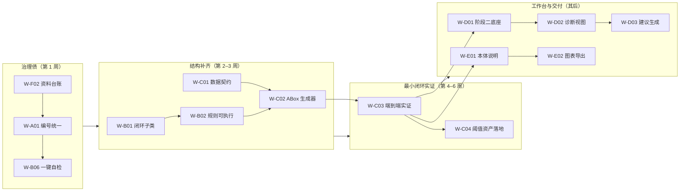
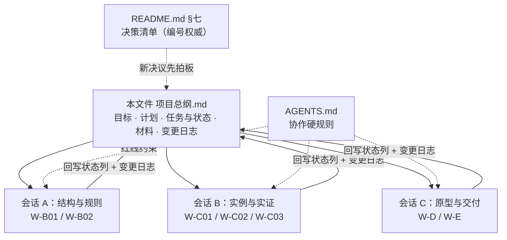

# 城市体检与更新本体研究 · 项目总纲

> **版本**：v3-20261107 ｜ **现状快照**：2026-11-07（实测核对，非引述旧文档）  
> **本文件是什么**：项目**目标 · 计划 · 任务定义（W-xx）· 材料清单 · 协同协议 · 现状与进度 · 变更日志**的唯一出处。  
> 由原 `工作进度.md`（v2）与 `项目规划与过程管控-v1-20261107.md`（v1）于 **2026-11-07 合并而成**；两份旧文件停用，实质内容已全部吸收，重复项已去重（备份在 `_bak_20261107/`）。  
> **本文件不管什么**：决议结论（→ [`README.md`](README.md) §七 决策清单，编号权威）、AI 协作红线（→ [`AGENTS.md`](AGENTS.md)）。  
> **一句话用法**：开工前读 §〇 与 §一，认领 §五 的某个 W 编号；收工按 §1.3 回写本文件（WBS 状态列 + §十 变更日志 + §9.2 待核）。

---

## 〇、结论先行（给大王的六条）

1. **项目已越过「能不能建出来」的阶段，卡在「能不能算」**。本体 107 类 / 1595 三元组 / SHACL 20 条约束 / SPARQL 6 条查询均已自洽且可重跑；阶段一原型也能演示。但**业务实体实例至今为 0**（92 个 ABox 全是指标、维度、分类这类元数据个体），所以「体检→问题→更新」这条闭环**从未用真实数据跑通过一次**。这是当前唯一的真差距。
2. **继续往原型上加功能，边际收益已经很低**。原型现在能“看”不能“算”：没有实例数据，点开一个社区看不到它的指标值、问题与项目。**建议主线从「做界面」转为「做一次端到端最小闭环实证」**——哪怕只做 1 个社区 × 10 项指标 × 1 条问题链，把链条跑通并留证。
3. **主干闭环 5 个类至今零子类**，`severity` 还只是数据属性，`EvaluationRule` 族没有一条可执行规则。**一旦接入实例数据就会先撞在这里**——评估结果没分级、问题没分型、建议没分类，SHACL 就无从校验、“快速诊断”也无从落档。这是接数据前必须先补的结构，不是可选项。
4. **有三笔治理债必须在并行开工前还掉**：① **编号重号四处**（报告 A1–A7 / 原型决议 D1–D6 / 概念清单 A1·D1 / 待决 D-1–D-4），跨会话必然串号；② **没有一键自检**，全部产物吊在 3 个生成脚本上，脚本一坏整链失守；③ **`01-资料/资料台账.md` 至今未建**，而它是本项目可信度的地基（`01-资料/README.md` 自己列为待建）。
5. **需大王拍板 8 件事**（§九 Q10–Q17），其中 3 件是硬卡口、不定就动不了：**主线是否转端到端实证（Q10）**、**样例数据由谁造（Q11）**、**主干闭环按什么分型（Q12）**；其余 5 件可后置，但建议顺手一并定了。
6. **治理已收口（2026-11-07）**：原「进度」与「规划」两份文件逐条镜像同一批任务（32 项任务写两遍、待拍板写两遍、已交付成果两张近似表）。今日合并为本文件——**任务只在一处登记**（§五 WBS 一张表兼「定义 + 状态」），从此不再有第二份进度。

---

## 一、这份文件怎么用

### 1.1 三份文档的分工（防重复维护）

| 文档                 | 管什么                                                   | 不管什么                               |
| ------------------ | ----------------------------------------------------- | ---------------------------------- |
| **本文件**（`项目总纲.md`） | 目标、计划、**任务定义与状态（W-xx，一张表兼两用）**、现状快照、材料清单、风险、协同协议、变更日志 | 不定义决议结论（只引用编号）；不重复 `AGENTS.md` 的规则 |
| `README.md` §七     | **决策清单**（编号权威，只增不改号）                                  | 不管执行进度                             |
| `AGENTS.md`        | AI 协作**硬性规则**（术语口径、引用规则、命名规范）                         | 不管进度与计划                            |

> 关系：本文件说「要做哪些事、做成什么样、做到哪一步」；`README.md` §七 说「哪件事已经拍过板」；`AGENTS.md` 说「不许怎么做」。
>
> **已退役（2026-11-07 合并入本文件）**：`工作进度.md`、`项目规划与过程管控-v1-20261107.md`。旧内容原样留档在 `_bak_20261107/`；旧编号（T1–T11 / D-1–D-4 / 报告 A1–A7）映射见附录 A。

### 1.2 开工规程（任何会话接手前必读）

1. **先认领编号**：我要做的是 §五 里的哪个 W 编号？没编号的任务先报编号，别直接干。
2. **查输入是否齐备**：任务表「输入」列 + §六 材料清单。缺料就停在「出规格 / 出草案」，别自造依据。
3. **查阻塞**：§七 风险表 + §九 待拍板。被 M1/M2/M3 卡住的任务不要硬推。
4. **查依赖**：任务表「依赖」列，前置未完成不启动。

### 1.3 收工规程（做完必须做的三件，全在本文件内闭环）

1. **§五 WBS 表更新状态列**（只改状态，不改任务定义；定义要改先报）；
2. **§十 变更日志追加一行**（日期 / 事项 / 产物·落点 / 验收证据）；
3. **新增的【待核】登记到 §9.2**；产物落点与命名按 §8.2 执行；**涉本体的必须跑一遍 `_check_all.py` 且全绿**（见 §5.7）。

### 1.4 五条红线（违反即返工）

1. **结构性变更**（类的增删改、属性值域变更）先报影响范围 → 大王确认 → 再动 `类与层级.md` → 再跑生成链。
2. **不编造条款号、指标编号、阈值数值、发布日期**；给不出来一律标【待核】。
3. **地方交付物只能作实例佐证 / 口径参考**，引用标【地方实操】，不得当标准依据。
4. **不越过决策清单自定新决议**；新决议先入 §九 待拍板，拍板后由大王编号进 `README.md` §七。
5. **对外发布前四项敏感复查**：真实地名 / 第三方原件 / 本地绝对路径 / 用户名·主机名。

---

## 二、项目目标与验收口径

### 2.1 一句话目标

给「体检查出的问题」到「更新项目」之间补上**一层可计算的语义**，使体检指标、问题短板、更新项目三者可追溯、可推理。

### 2.2 三层目标 + 验收口径（可判定的才算验收）

| 层          | 目标                     | 验收口径（可判定）                                                               | 现状                         |
| ---------- | ---------------------- | ----------------------------------------------------------------------- | -------------------------- |
| **L1 概念层** | 术语统一、口径可引              | 概念清单每条都有来源文件名，或明确标【待核】；五级空间单元口径不混用                                      | ✅ 基本达成（`02-术语与概念/概念清单.md`） |
| **L2 模型层** | 类 / 属性 / 约束 / 查询机读化且自洽 | `pyshacl` CONFORMS=True；悬挂引用 0；三次重跑 md5 一致；每条 URI 可回溯到源 md              | ✅ 达成（2026-10-12 已闭环）       |
| **L3 实例层** | **至少一个空间单元的完整闭环可跑通**   | 给定 1 个社区 + 一组指标测值 → 能算出评估结果 → 生成问题 → 关联整治建议 → 挂到更新项目；SPARQL 能答、SHACL 能校 | ❌ **未开始（核心差距）**            |
| **L4 展示层** | 对外可演示、可评审              | 离线可开、三视图可用、能演示“从问题追到项目”                                                 | 🔄 阶段一可演示，但只能“看”不能“算”      |

### 2.3 本期明确不做（防范围蔓延）

| 不做                  | 依据                                   |
| ------------------- | ------------------------------------ |
| 房屋安全体检（单体建筑结构鉴定）    | `README.md` §三 范围 / `AGENTS.md` 术语口径 |
| 土地一级开发、房地产市场监管      | 同上                                   |
| 绑定 CIM 平台数据模型       | 决策清单第 3 条                            |
| 对齐 BFO / CCO 上层本体   | 决策清单第 4 条（⏳ 待决，本期挂起）                 |
| 图数据库（Neo4j）路线       | 决策清单第 9 条（RDF→属性图有语义损耗）              |
| 智能应用（LLM 诊断 / 建议生成） | 原型决议 D6（暂缓），待 L3 打通后再议               |

---

## 三、现状快照（2026-11-07 实测）

### 3.1 里程碑总览

| 阶段              | 目标                      | 状态                   | 关键产物                                        | 备注                         |
| --------------- | ----------------------- | -------------------- | ------------------------------------------- | -------------------------- |
| **P0** 项目骨架     | 目录、协作约定、术语强制口径          | ✅ 完成                 | `README.md`、`AGENTS.md`、`WorkBuddy项目配置.md`  | —                          |
| **P1** 依据调研     | 政策 / 标准 / 概念演进 / 立法进展   | ✅ 完成                 | `城市体检与更新调研计划/results/` 19 份 JSON + 总清单 77 件 | 复核摘要份数口径待统一（W-F04）         |
| **P2** 术语收口     | 概念清单（中英 / 定义 / 上位 / 来源） | 🔄 约 85%             | `02-术语与概念/概念清单.md`                          | 4 项待办（W-A02/A03/A04/A05）   |
| **P3** 本体建模     | 类 / 属性 / 约束 / 查询 + 机读产物 | ✅ 完成（L2 层）           | `03-本体模型/` 五件 + 3 生成器                       | 结构短板见 §4.1 R2              |
| **P4** 指标映射     | 55 项基础指标 → 类与属性         | ✅ 完成                 | `04-指标映射/`（同源双产物）                           | 2 项待办（W-A05 / W-B04）       |
| **P5** 样本市实证    | 地方成果件内容梳理与意义分析          | ✅ v2（约 70%）          | `05-产出/报告/…-v2-20261010.md`                 | 4 项待办（W-A02/A03/A05/W-C05） |
| **P6** 高保真原型    | 可视化交互 + 未来智能应用          | 🔄 **阶段一 ✅ / 阶段二 ⏭** | `05-产出/原型方案/原型/`                            | 阶段二缺数据（W-C01 起）            |
| **P7** 公开发布     | 脱敏 + git 公开仓库           | ✅ 已同步（成果提交 `c313989`·11-21；最新见 git log） | GitHub `urban-renewal-ontology`  | 周期性复查（W-E03）               |
| **P8** 实例化与诊断闭环 | **把闭环用数据跑通**（本轮新增）      | ⏭ 未启动                | —                                           | **建议作为主线**，待 Q10 拍板        |
| **P9** 对外交付与评审  | 本体说明、图表、评审材料            | ⏭ 未启动                | —                                           | 优先级取决于 Q-M6（评审场合）          |

### 3.2 硬指标（本次实测）

| 项                   | 数值                                                                                                                                  | 来源                                   |
| ------------------- | ----------------------------------------------------------------------------------------------------------------------------------- | ------------------------------------ |
| OWL 三元组             | **1595**                                                                                                                            | `03-本体模型/城市体检-更新本体.ttl`（rdflib 解析实测） |
| TBox 类              | **107** = 106 概念类 + 1 技术构件（`DataObjectRoleUnion`）                                                                                   | 同上                                   |
| 对象属性 / 数据属性         | **33 / 57**                                                                                                                         | 同上                                   |
| `rdfs:subClassOf` 边 | **83**                                                                                                                              | 同上                                   |
| ABox 个体             | **92**（Indicator 55 / IndicatorCategory 13 / CollectionMethod 9 / FormulaType 7 / Dimension 5 / TreatmentType 2 / PolicyDocument 1） | 同上                                   |
| SHACL               | **5 个目标类形状 / 20 条约束**，`pyshacl` CONFORMS=True，负向测试有效                                                                                | `城市体检-更新约束.shacl`                    |
| SPARQL 查询模板         | **6 条**（Q1 指标全览 / Q2 反查贯通 / Q3 维度计数 / Q4 多对象公式 / Q5 问题→建议→项目 / Q6 阈值溯源）                                                             | `常用查询.sparql`                        |
| 指标映射                | **55 项 / 50 个数据对象 / 67 次引用 / 0 异常**                                                                                                 | `04-指标映射/55项指标.yaml`                 |
| 原型节点                | 107 类（默认总览）/ 199 节点（叠加 ABox）                                                                                                        | `原型/README.md`                       |
| 调研文件总量              | **77 件**（含废止 9 项）                                                                                                                   | `results/现行有效文件总清单.md`               |

### 3.3 三条工作线的完成度评估

| 工作线       | 完成度                       | 判断理由                                                     |
| --------- | ------------------------- | -------------------------------------------------------- |
| 依据调研（P1）  | **95%**                   | 19 份 JSON 覆盖政策演进、概念、标准、立法；台账已建（W-F02 ✅ 11-07）；剩份数口径统一（W-F04）   |
| 术语收口（P2）  | **85%**                   | 核心概念 + 五级空间单元 + 13 分类已收口；编号重编（W-A05）未做、街区面积口径未修（W-A02）   |
| 本体建模（P3）  | **80%**（L2 层 95%，L3 层 0%） | 机读产物自洽度很高；但**主干闭环零子类、规则不可执行、零业务实例**，模型“骨架硬、血肉空”          |
| 指标映射（P4）  | **95%**                   | 55 项零异常，同源生成；仅 codeScheme（W-A05 连带）与 54/55 值域复核（W-B04）未做 |
| 实证研究（P5）  | **70%**                   | 口径与建模硬事实已提炼；A1/A3/A4/A6 四项未执行，T 系列归属待决                   |
| 高保真原型（P6） | **45%**                   | 阶段一浏览能力完整、视觉规范到位；**算不了**，阶段二全未启动                         |
| 公开发布（P7）  | **90%**                   | 仓库已公开并同步；剩周期性脱敏复查                                        |

---

## 四、差距与主线判断

### 4.1 三个真问题（结构性缺口 S1–S3，不是待办）

| #      | 问题                   | 证据                                                                                                                                    | 后果                                                |
| ------ | -------------------- | ------------------------------------------------------------------------------------------------------------------------------------- | ------------------------------------------------- |
| **S1** | **业务实体实例 = 0**       | 92 个 ABox 全为元数据类型个体；无空间单元实例、无指标测值                                                                                                     | 项目最核心的主张（可计算闭环）至今只是“设计上成立”，**未被任何数据验证**；原型无法演示“算” |
| **S2** | **主干闭环零子类 + 规则不可执行** | `AssessmentResult` 无分级子类（三档仅作 `grade` 值）；`Problem` 无类型细分，`severity` 仅数据属性；`EvaluationRule` 族无一条规则实例；无 `referenceValue` / `ratingBand` | 接数据即撞墙：SHACL 无法校验“问题是否成立”，诊断无法落档，建议无法分型           |
| **S3** | **编号体系混乱**           | 同一字母四套含义：报告 A1–A7（行动）、原型 D1–D6（决议）、概念清单/指标映射 A1·A6·D1·D2（待办）、待决 D-1–D-4；`工作进度.md` 另有 T1–T11                                           | 多会话并行必然串号；本文件以 **W-xx** 统一收口（§9 附录 A 映射） **已收口**（2026-11-07，见附录 A） |

### 4.2 差距表（能力视角）

| 能力       | 现在            | 目标（本期）                                              | 差距             | 对应任务          |
| -------- | ------------- | --------------------------------------------------- | -------------- | ------------- |
| 概念口径统一   | 两套编号并存，未做重编对照 | 55 ↔ 60 项可互译，且注明版本                                  | 缺官方对照材料 + 重编工作 | W-A05（卡 M3）   |
| 类结构完整度   | 主干闭环 5 类零子类   | 结果分级 / 问题分型 / 建议分类至少各一层                             | 未设计分型维度        | W-B01（卡 Q13）  |
| 规则可执行    | 只有规则类，无实例、无区间 | 至少 10 项指标带 `referenceValue` + 四档 `ratingBand`，规则可判定 | 阈值资产未建模        | W-B02 + W-C04 |
| 实例数据     | 0（11-07）    | 1 个社区 + 10–15 项测值 + 3 个问题 + 建议 + 项目                 | ✅ 11-20：主库 3599 栋/53 社区/404 小区、3 条闭环链、40 规则、130 档位 | W-C01 → W-C02 ✅ |
| 闭环可验证    | 设计上成立         | SPARQL Q5 能答出“社区A的问题→建议→项目”，SHACL 能校                | ✅ 11-20：端到端实证 3 链、反例被 SHACL 拦、正例 CONFORMS | W-C03 ✅      |
| 诊断能力（原型） | 无             | 输入测值 → 出诊断卡                                         | ✅ 11-20：原型「智能诊断」视图、浏览器本地判级+分位、渲染目视过 | W-D02 ✅      |
| 对外说明     | 无独立文档         | 本体模型说明（对外版）+ 类图                                     | ✅ 说明 11-20 + 类图 11-21（3源+6图） | W-E01 ✅ / W-E02 ✅ |
| 一键自检     | ✅ 已落地（11-07） | `_check_all.py` 六步：链 / 确定性 / 计数 / SHACL / SPARQL / 基线 | — | W-B06 ✅ |

### 4.3 主线判断（老奴的建议，待 Q10 拍板）

**建议主线：P8 实例化与诊断闭环，暂缓原型加功能。**

三条理由：

1. **验证优先于美化**。现在最贵的风险不是“界面不够炫”，而是“模型经不起数据”。一个社区的真实数据进来，立刻能检验 107 个类里哪些是废的、哪些缺属性——这是任何评审都替代不了的硬证据。
2. **顺序上不可颠倒**。阶段二（SPARQL 端点 + 诊断视图 + LLM）全部依赖实例数据；没有数据，Oxigraph 装了也是空转，LLM 接了也只能编。
3. **原型的边际价值已递减**。三视图 + 类树 + 检索 + 详情卡已覆盖“浏览”需求；再加视图只是换皮。**把“能算”补上，同一次演示的说服力提升一个量级**。

---

## 五、执行计划

### 5.1 路线图



### 5.2 阶段闸门（Gate：不过不进下一阶段）

| 闸门           | 判定标准（可验证）                                                                                  | 对应任务                  |
| ------------ | ------------------------------------------------------------------------------------------ | --------------------- |
| **G0 治理就绪**  | 全项目任务编号唯一（无重号）；`_check_all.py` 一条命令跑通重跑链 + SHACL + SPARQL；`资料台账.md` 登记 ≥ 现有原件数             | W-A01 / W-B06 / W-F02 |
| **G1 结构就绪**  | `Problem` 有分型子类、`AssessmentResult` 有分级、`EvaluationRule` 有 ≥1 条可执行实例；SHACL 新增相应约束且 CONFORMS | W-B01 / W-B02         |
| **G2 闭环成立**  | 1 个社区 + 10–15 项测值的实例数据入库；SPARQL Q5 能答出完整链；至少 1 条反例被 SHACL 拦住（**✅ 2026-11-20 达成**：CM_S01 14项、3条全链、反例被拦） | W-C02 ✅ / W-C03 ✅    |
| **G3 可演示诊断** | 输入测值 → 自动出诊断卡（指标达标判定 + 问题清单 + 建议），前端可视化（**✅ 2026-11-20 达成**：原型新增"智能诊断"视图，15 项测值/8 项可判级/3 条闭环链，浏览器本地执行真实规则比较；渲染截图目视核对通过） | W-D01 ✅ / W-D02 ✅    |
| **G4 可对外交付** | 本体说明 + 类图 + 演示链接齐备，四项敏感复查通过（**✅ 2026-11-21 达成**：说明✅、类图✅、在线链接✅、四项敏感复查全绿、git 已同步 0/0） | W-E01 ✅ / W-E02 ✅ / W-D04 ✅ / W-E03 ✅ |

### 5.3 任务清单（WBS）

> 状态口径（全项目统一）：`✅ 完成`／`🔄 进行中`／`⏭ 待办`／`⏸ 暂缓`／`⏳ 待决`。  
> 「旧编号」列指向原 `工作进度.md` / 报告 v2 / 原型决议的编号，映射见附录 A。

#### W-A 术语与口径收口

| #         | 任务                           | 目的与验收                                                                         | 输入                        | 产出落点                           | 依赖        | 状态              |
| --------- | ---------------------------- | ----------------------------------------------------------------------------- | ------------------------- | ------------------------------ | --------- | --------------- |
| **W-A01** | **编号体系统一 + 文档索引** | 附录 A 建为「编号体系」（现行 7 族 + 历史 9 族 + 3 条硬规则）；8 份使用旧编号的文档加编号族声明。**验收口径已修正**：原定「全项目再无重号」不可达（历史成稿不可原地重编），改为「任一编号可经总表唯一还原，跨文档引用须带出处」 | 本文件附录 A | 附录 A + 8 份文档头 | — | ✅ 2026-11-07 |
| W-A02     | 街区面积口径修正                     | 明确「街区维度实操 = 街道」；1–5 km² 保留为**重庆导则口径**并分列                                      | 报告 v2 §五、`概念清单.md` §二     | `概念清单.md` §二 + §九           | —         | ✅ 2026-11-20（概念清单残留"阈值待核"已清、口径已分列；原 T3/A3） |
| W-A03     | 2025↔2026 口径变更登记             | 小区↔社区、停车泊位「缺口数」↔「小区数」两处变更留痕可查                                                 | 报告 v2 附录 A                | `概念清单.md` §八                   | —         | ⏭（原 T3/A4）      |
| W-A04     | 概念清单补新增术语                    | `IndicatorCategory` / `RemediationSuggestion` / `Land` / `Building` 等已入条目复核补齐 | 概念清单 §九·§十                | `概念清单.md`                      | W-A05（部分） | ⏭（原 T4/D1）      |
| **W-A05** | **同事 60 项制 ↔ 我方 55 项编号重编对照** | 出一张双列对照表 + `Indicator.codeScheme` 字段设计；两项须可机械互译（注：日常按名对齐已够用；本任务是**正式对照表**，M3 官方材料未到位，尚未开工） | 报告 v2 附录 A、`55项指标.yaml`   | 新建 `04-指标映射/编号对照-2025↔2026.md`（**当前不存在**） | **M3 材料** | ⏭ 卡外部材料（原 T2 = A1+A6） |
| W-A06     | `dataSource` 举例口径统一          | 「平台底表」与「系统对接」二选一，全项目一致                                                        | `类与层级.md`、`属性与关系.md`、录入模板 | 上述三处                           | —         | ✅ 2026-11-20（三处统一为"系统对接"，原表述标作废） |

#### W-B 本体结构演进

| #         | 任务                             | 目的与验收                                                                                                                      | 输入                         | 产出落点                               | 依赖         | 状态         |
| --------- | ------------------------------ | -------------------------------------------------------------------------------------------------------------------------- | -------------------------- | ---------------------------------- | ---------- | ---------- |
| **W-B01** | **主干闭环子类细化**（结构性变更，须报批）        | ① `AssessmentResult` 分三级子类；② `Problem` 有分型维度（见下“设计要点”）；③ `RemediationSuggestion` 分「限时解决 / 尽力解决」二类；④ SHACL 相应约束补齐且 CONFORMS | `类与层级.md` §三、报告 v2 §四      | `类与层级.md`、`属性与关系.md`、`_gen_ttl.py` | **Q12 拍板** | ✅ 2026-11-17（报批方案全项通过：4+3+2=9 子类；概念类 111→120；pyshacl CONFORMS；8 Problem 归位 NeighborhoodProblem） |
| **W-B02** | **规则族可执行化**                    | 结构已就位（2026-11-19：唯一 `EvaluationRule` + `EvaluationMethod`/`EvaluationOutput` 词表 + `EvaluationReference`/`RatingBand`/`DerivedRatio` + 17 属性 + grade 四档）；**36 条规则实例已接入**（11-19：18 公开标准+18 地方实操，130 档位）；前端原型待跑（大王 11-19 挂待办） | 样本市自评表（四档区间）、手册附件一、`55项指标.yaml`  | 三件 md + ttl/shacl + ABox 实例增量           | W-B01      | ✅ 2026-11-19（结构+36规则实例；前端原型另挂待办）★ |
| W-B03     | `aggregationRule` 属性           | 比率型指标不可跨层加总的问题有显式表达（属性 + 约束）                                                                                               | 待核项清单                      | `属性与关系.md`、ttl                     | W-B01      | ⏭          |
| W-B04     | 指标 54 / 55 `computedFrom` 值域复核 | 确认「体检问题」「更新项目」两指标的取值域是否需纳入新类                                                                                               | `55项指标.yaml`               | 同上                                 | W-B01      | ⏭（原 T5/D2） |
| W-B05     | 主干闭环 Mermaid 图更新               | 图与 §三 正文一致，含 `triggers` 兼容路径                                                                                               | `类与层级.md` §三               | 同上                                 | W-B01      | ⏭（原 T6/D4） |
| **W-B06** | **一键自检脚本 `_check_all.py`** | 六步：重跑链 → 确定性双跑（sha256 逐文件）→ 结构计数 → `pyshacl` → 6 条 SPARQL → 基线比对；任一失败退出码 1。基线外置 `_baseline.json`（不写死数字），`--update` 重建 | 3 个生成器 + 产物 | `03-本体模型/_check_all.py`、`_baseline.json` | — | ✅ 2026-11-07（含 2 项负向测试） |
| W-B07     | 命名空间定稿                         | 大王 2026-11-20 拍板：**保持现状** `https://ontology.cset-digital.cn/urban-renewal#`（URI 作标识符不求可解析）                                  | 待核项                        | 全部产物（无需替换）                  | M4         | ✅ 2026-11-20（决议=不换） |


> **W-B01 设计要点（供讨论，不是结论）**
>
> - 分型维度有三条可选路线：**① 按维度分**（住房 / 小区 / 社区 / 街区 / 城区五类问题——与指标轴天然对齐，但粒度粗）；**② 按严重度分**（轻微 / 中等 / 严重——直接服务预警排序，但需先定 `severity` 档位边界）；**③ 两者叠加**（维度作 `Problem` 的一等分型、严重度作属性或独立分级类——表达力最强，类数增长也最快）。**老奴倾向 ③**：维度分型支撑“按领域出问题清单”，严重度保留为可计算属性，避免类爆炸。
> - `AssessmentResult` 三档（达标 / 基本达标 / 不达标）**已于 2026-10-09 决议维持**，此处只是把“值”升级为“类”，需确认是否有下游依赖 `grade` 字符串（`_to_graph_json.py`、原型详情卡、SHACL 各一处）。
> - 「限时解决 / 尽力解决」**判定规则未明【待核】**，W-B01 只建结构，规则留给 W-B02。

#### W-C 实例化与实证

| #         | 任务                          | 目的与验收                                                                             | 输入                                  | 产出落点                                          | 依赖          | 状态   |
| --------- | --------------------------- | --------------------------------------------------------------------------------- | ----------------------------------- | --------------------------------------------- | ----------- | ---- |
| **W-C01** | **实例数据契约（数据规格）**            | 定义空间单元 / 指标测值 / 问题 / 建议 / 项目五类实例的字段与约束；出 1 份规格 + 1 套合成样例（3 个社区，构造数据，明确标“虚构”）      | 本体属性表、`55项指标.yaml`                  | 新建 `06-实例数据/README.md` + `数据契约-v1.md` + `样例/` | W-B01；Q11   | ✅ 2026-11-08 |
| **W-C02** | **ABox 生成器 `_gen_abox.py`** | 样例数据（YAML）→ 实例三元组并入 `.ttl`；同源生成 + 防漂移断言（实例引用的类与属性必须已声明）；重跑幂等                      | W-C01 契约                            | `03-本体模型/_gen_abox.py`、ttl                    | W-C01、W-B02 | ✅ 2026-11-08（第一步：四类源表 → 74,995 三元组） |
| **W-C03** | **端到端最小闭环实证**               | 1 个社区 × 10–15 项指标 → 评估结果 → 3 个问题 → 建议 → 项目；SPARQL Q5 能答全链；SHACL 能拦住 1 条构造反例；出实证报告 | W-C02 产物                            | `05-产出/报告/最小闭环实证-v1-2026xxxx.md`              | W-C02       | ✅ 2026-11-20（CM_S01 14项测值→3条完整链；正例CONFORMS、反例"问题缺locatedIn"被拦；G2 四条件全达成） |
| W-C04     | 阈值资产落地                      | 自评表「全国平均 / 参考值 + 四档区间」结构化，补我方 47 项「不适用」                                           | `01-资料/样本成果/城市体检报告案例/城市体检自评表.pdf` | `04-指标映射/` 新增阈值表                              | W-B02       | 🔄 主体已落地（2026-11-19 两批共36指标四档区间入图；余：47项"不适用"清单未单独出表） |
| W-C05     | 样本市口径对外版                    | 报告 v2 的地方实例表述改为可公开口径，供对外引用                                                        | 报告 v2                               | `05-产出/报告/` 新版本                               | W-A05       | ⏳ 待决 |

> **W-C01 的关键判断**：**不等样例数据就能开工**。先出“数据契约”（要哪些字段、什么约束、什么量级），再出合成样例。这样即便大王暂时没时间整理真数据，链条也能先跑通；真数据到位后只是替换数据文件，不动结构。**这是把“卡在等材料”变成“并行推进”的关键一步。**

#### W-D 原型与智能应用

| #     | 任务                  | 目的与验收                                                                     | 输入                 | 产出落点              | 依赖         | 状态          |
| ----- | ------------------- | ------------------------------------------------------------------------- | ------------------ | ----------------- | ---------- | ----------- |
| W-D01 | 阶段二底座（SPARQL + 校验层） | 本轮采用**零依赖前端方案**：规则与测值导出为 `data/diagnosis.js`，浏览器本地执行比较，不上后端；Oxigraph/薄后端留待后续（G4 对外交付前再定） | `常用查询.sparql`、决策 9 | `05-产出/原型方案/原型/data/diagnosis.js` | W-C03      | 🔄 前端判定已实现·后端底座后置 |
| W-D02 | 诊断视图                | 选社区 + 测值 → 出诊断卡（达标判定 + 问题清单 + 建议），复用现详情面板                                 | W-C03 实证链          | `05-产出/原型方案/原型/index.html`（新增"智能诊断"视图） | W-D01      | ✅ 2026-11-20 |
| W-D03 | 建议生成 + 可视化          | 筛选条件 → `Problem→RemediationSuggestion` 反查 → 生成建议 + 出图                     | W-D02              | 同上                | W-D02、模型通道 | ⏸ 暂缓（D6）    |
| W-D04 | 原型在线发布              | 静态版发布为在线链接，供评审 / 同事访问                                                     | `原型/index.html`    | 在线链接              | —          | ✅ 2026-11-21（sharecode 链接，verified） |
| W-D05 | 原型 UI 打磨            | 大屏 / 投影适配、键盘可达性、打印友好                                                      | 视觉规范               | 原型                | W-D02      | ⏸ 低优先       |

#### W-E 交付与发布

| #         | 任务              | 目的与验收                                                            | 输入                         | 产出落点                                  | 依赖          | 状态       |
| --------- | --------------- | ---------------------------------------------------------------- | -------------------------- | ------------------------------------- | ----------- | -------- |
| **W-E01** | **本体模型说明（对外版）** | 精简版完成：是什么/为什么/怎么验证/怎么看/边界五节，每个论断标可回溯文档条目；权威数字核自机读产物 | `类与层级.md`、`属性与关系.md`、报告 v2、各 TTL | `05-产出/报告/城市体检与更新本体说明-v1-20261120.md`（5440字符·CRLF=0） | W-B01、W-C03 | ✅ 2026-11-20（精简版·先完成再完美） |
| W-E02     | 类图 / 关系图导出      | 3 张图 × (Mermaid源+2倍分辨率PNG)：主干闭环全链/子类、指标内核规则链/词表、空间层级五级/分尺度；6张PNG均目视核对无截断 | 模型文档                       | `05-产出/图表/`（3 md + 6 png + README）  | W-B01       | ✅ 2026-11-21（原 T11） |
| W-E03     | git 同步与脱敏复查     | 四项敏感复查 + CRLF 检查 + 中文 commit + push（必 `http.sslBackend=openssl`） | —                          | 公开仓库                                  | —           | ✅ 2026-11-21（四大复查全绿、96文件commit c313989、push 0/0；挡8过程稿+4路径脚本、改5核心文件脱敏） |
| W-E04     | 评审材料            | 依 §六 M6 的场合定形态（一页纸 / PPT）。**PPT 须遵用户级《PPT制作要点.md》V3.3，逐闸门停**     | W-E01                      | `05-产出/`                              | M6          | ⏳ 待决     |

#### W-F 项目治理与资料

| #         | 任务                 | 目的与验收                                            | 输入                    | 产出落点                       | 依赖  | 状态                  |
| --------- | ------------------ | ------------------------------------------------ | --------------------- | -------------------------- | --- | ------------------- |
| **W-F01** | **本项目总纲**          | 目标 / 计划 / 任务 / 材料 / 协同协议 / 进度 / 日志合成一份，其他会话可直接接手 | 全项目盘点                 | `项目总纲.md`                  | —   | ✅ 2026-11-07        |
| W-F02 | 补建 `资料台账.md` | 在库原件 10 件逐项登记（机关 / 文号 / 日期 / 状态 / 涉及概念）；确立「在库原件 vs 文献总清单 77 件」两条线；列出 6 项缺口原件 | `01-资料/` 实际文件 + 调研总清单 | `01-资料/资料台账.md`（并修正 `01-资料/README.md` 子目录） | — | ✅ 2026-11-07 |
| W-F03     | `_extracted/` 归属处置 | 明确抽取产物是否迁出 `01-资料/`（该目录规定“只放原件”）                 | 大王示下                  | 目录调整                       | Q15 | ⏳ 待决（原 T7/D-3）      |
| W-F04     | 调研复核摘要份数口径         | 原始记录不可考，README 现无份数表述、无对应文件；按已消项处理     | —                     | —                              | —   | ✅ 2026-11-20 消项     |
| W-F05     | 三分离落地检查            | **三份文档**（本总纲 / 决策清单 / AGENTS）无重复定义，交叉引用有效        | 三份文档                  | 本文件 §1.1                   | —   | ✅ 2026-11-07（合并后复核） |
| W-F06     | **校验工具链升级**（远期·大王 11-20 示下记录） | 解决大图 pyshacl 全量校验超时：AssessmentResult 3941 target × rdflib 无索引 SPARQL 致 >120s。选项：分片校验 / 换 Oxigraph 等有索引引擎（与 W-D01 后端选型协同）/ 抽样+全量断言 | 性能根因实验（日志 §30） | 校验脚本升级 + 全量一致性机器证明 | W-D01    | ⏳ 远期待办（不阻塞 G4；当前以 `_check_all.py` 增量校验+生成器断言替代） |

### 5.4 本轮勾选清单（G0–G1，共 10 项）

> 只列**当前这一批**，避免与 §5.3 全量表重复；后续批次完成后重写本清单。验收口径见 §5.3。

**G0 · 治理就绪（第 1 周）**

- [x] **W-A01** 编号体系统一 + 文档头索引
- [x] **W-B06** 一键自检 `_check_all.py`
- [x] **W-F02** 补建 `01-资料/资料台账.md`
- [x] W-F04 调研复核摘要份数口径（11-20 消项）
- [ ] W-A02 街区面积口径修正
- [ ] W-A03 2025↔2026 口径变更登记
- [ ] W-A06 `dataSource` 举例口径统一

**G1 · 结构就绪（第 2–3 周）**

- [ ] **W-B01** 主干闭环子类细化（**待 Q12**）
- [ ] **W-B02** 规则族可执行化
- [x] **W-C01** 实例数据契约 + 合成样例（✅ 2026-11-08）

> 其余 22 项的状态一律以 §5.3 表格为准；本清单不另设状态，做完即在 §5.3 把状态改为 ✅ 并在此打勾。

### 5.5 排序理由（为什么是这个顺序）

| 顺序 | 做的事                                 | 为什么排这里                                     |
| -- | ----------------------------------- | ------------------------------------------ |
| 1  | W-A01 / W-B06 / W-F02（治理债）          | 半天到一天的活，却是后面所有并行开工的**索引基础**与**安全网**；越晚做越贵  |
| 2  | W-B01 → W-B02（结构）                   | 接数据的前置条件；不先补子类，数据一进来就要返工重建                 |
| 3  | W-C01 → W-C02（数据规格 + 生成器）           | **不依赖外部材料**，可与 W-B01 并行；把“等大王给数据”从关键路径上摘下来 |
| 4  | W-C03（端到端实证）                        | 项目立命之本；一次跑通即可对外宣称“闭环成立”                    |
| 5  | W-D01 → W-D02（工作台）                  | 有数据才有意义；此前做只是空转                            |
| 6  | W-E01 / W-E02（交付）                   | 需要 W-B01、W-C03 的结论支撑，早写会返工                 |
| 后排 | W-A05（编号重编）/ W-C04（阈值）/ W-B07（命名空间） | 均卡外部材料（M3 / M4），不阻塞主线                      |

### 5.6 建议窗口（按周推进，**非承诺日期**）

| 窗口                   | 内容                                        | 出口             |
| -------------------- | ----------------------------------------- | -------------- |
| 第 1 周（11/10–11/16）   | W-A01、W-B06、W-F04、W-F02、W-A02、W-A03、W-A06 | 闸门 **G0**      |
| 第 2–3 周（11/17–11/30） | W-B01（报批后）、W-B02、W-C01                    | 闸门 **G1**      |
| 第 4–6 周（12/01–12/19） | W-C02、W-C03、W-C04                         | 闸门 **G2**      |
| 12 月下旬起              | W-D01、W-D02、W-E02、W-E01                   | 闸门 **G3 / G4** |

> 说明：本项目是研究性工作，节奏由大王的实际档期决定；此表只解决“同时开多个会话时不打架”的问题，不作交付承诺。

### 5.7 数据管道与重跑链（运维须知）

**唯一数据源 → 机读产物**。改结构必须先改 md，脚本带双向防漂移断言，对不上就报错、不写产物：

```text
类与层级.md ──┐
属性与关系.md ├─→ _gen_ttl.py ─→ .ttl / .shacl / .sparql
55项指标.yaml ┘                      │
                                     └─→ _to_graph_json.py ─→ 原型 data/ontology.{json,js}
类与层级.md 附录 A ←── _gen_class_list.py（幂等，只改带界标的受控区块）
```

**重跑链（三步，顺序不可颠倒）**：`_gen_ttl.py` → `_to_graph_json.py` → `_gen_class_list.py`。

**一键自检（已落地，改完必跑）**：

```bash
python 03-本体模型/_check_all.py            # 默认含确定性双跑，约 7 秒
python 03-本体模型/_check_all.py --no-twice # 快一档
python 03-本体模型/_check_all.py --update   # 产物确有正当变更后重建基线
```

六步：重跑链 → 确定性双跑（sha256 逐文件）→ 结构计数（全动态，无写死清单）→ `pyshacl` → 6 条 SPARQL → 基线比对（`_baseline.json`）。任一失败退出码 1。

**三条不能忘的口径**：① 主干闭环 = 体检活动 → 评估结果 → 问题 → 建议 → 项目（`triggers` 为直通兼容路径）；② `Dimension`(5) 与 `IndicatorCategory`(13) **平行独立**，分类不挂在维度之下（用 `belongsToDimension`）；③ `DataObject` 是**角色类**，`computedFrom` 值域为并集，且**不含** `RemediationSuggestion`。

**历史脚本**：`_apply_0930.py` / `_apply_0930b.py` / `_apply_1010.py` / `_reflow_props.py` / `_fix_p2_0930.py` / `_verify*.py` 均为一次性批处理，**已执行完，勿再跑**（W-B06 会把它们排除在自检之外）。

---

## 六、材料清单

### 6.1 已有材料（按类，含可信度定级）

定级口径：**A = 可作标准依据**（公开标准 / 官方文件原件）｜**B = 仅作参考**（同事成果、地方实操）｜**C = 加工件**（我方抽取与整理，需回溯原件）。

| 类别          | 材料                                                                                                                    | 位置                                        | 状态                                       | 定级         | 用途                    |
| ----------- | --------------------------------------------------------------------------------------------------------------------- | ----------------------------------------- | ---------------------------------------- | ---------- | --------------------- |
| **依据·手册**   | 新疆城市体检工作手册（2026 年版）· 全量版 / 指标版 PDF                                                                              | `01-资料/体检手册/`                             | 原件齐（8.7 MB / 4.8 MB）                     | **A**      | 55 项指标口径、T 系列来源       |
| **依据·国家标准** | 调研总清单收录 77 件（含废止 9 项）                                                                                                 | `城市体检与更新调研计划/results/现行有效文件总清单.{md,json}` | 清单齐，**原件多数未入库**                          | A（清单）/ —   | 引用前核对、条款溯源            |
| **依据·同事成果** | `cbim_ontology(1).owl`（v7.0）+ `cbim_shacl.ttl`                                                                        | `01-资料/同事交付/`                             | 已读并避坑（60 项制 = 2025 手册官方编号；部分 SHACL 为占位桩） | **B**      | 类设计借鉴；**不得当标准依据**     |
| **实证·地方成果** | 住房维度专题报告 / 小区（社区）维度专题报告 / 街区维度参考 / 城区维度参考（.doc/.docx）                                                                 | `01-资料/样本成果/城市体检报告案例/`                  | 三份件齐                                     | **B** 地方实操 | 建模硬事实来源；引用标【地方实操】     |
| **实证·阈值资产** | 城市体检自评表 PDF（每项带全国平均 / 参考值 + 四档区间）                                                                                     | 同上                                        | 原件齐（扫描件，已分片识读）                           | **B** 地方实操 | 补 47 项「不适用」→ W-C04    |
| **实证·抽取产物** | `城区维度_正文.md`（29 KB）/ `街区维度_正文.md`（28 KB）/ pdf_chunks 12 片 / pdf_zoom 3 片                                              | `01-资料/样本成果/_extracted/`                | 加工件                                      | **C**      | 检索与引用；归属待定（W-F03）     |
| **调研成果**    | 18 份主题 JSON + 总清单 + 2 份复核摘要（`_复核_前12批.md` / `_复核_第3批.md`）                                                             | `城市体检与更新调研计划/`                            | 齐                                        | **C**      | 政策与标准底账               |
| **术语**      | `概念清单.md`（24 KB，十节 + 待核 §八）                                                                                           | `02-术语与概念/`                               | 齐                                        | —          | 口径唯一出处                |
| **本体·文档**   | `类与层级.md`（59 KB，含附录 A 全量 107 类）/ `属性与关系.md`（46 KB）                                                                    | `03-本体模型/`                                | 齐                                        | —          | 改结构的第一现场              |
| **本体·机读**   | `.ttl`（64 KB）/ `.shacl`（4.5 KB）/ `.sparql`（2.7 KB）                                                                    | `03-本体模型/`                                | 齐，CONFORMS                               | —          | 交付物主体                 |
| **本体·生成器**  | `_gen_ttl.py` / `_to_graph_json.py` / `_gen_class_list.py`                                                            | 同上                                        | 齐，重跑幂等                                   | —          | 唯一数据管道                |
| **本体·自检** | `_check_all.py`（六步自检）+ `_baseline.json`（计数与哈希基线） | 同上 | 齐，全绿；负向测试有效 | — | 改完必跑；`--update` 重建基线 |
| **资料·台账** | `资料台账.md`（在库原件 10 件：依据 2 / 参考 8；加工件 7 项；缺口 6 项） | `01-资料/` | 齐（该目录不入库） | **B/C** | 引用前查原件是否在库 |
| **本体·历史脚本** | `_apply_0930.py` / `_apply_0930b.py` / `_apply_1010.py` / `_reflow_props.py` / `_fix_p2_0930.py` / `_verify*.py`（3 个） | 同上                                        | 一次性批处理，已执行完                              | —          | 变更留痕，勿再跑（W-B06 应将其排除） |
| **指标**      | `55项指标.yaml`（唯一数据源）+ 映射表 / 录入模板 / 拆解结果 / 数据对象拆解 / 校验清单                                                                | `04-指标映射/`                                | 齐，0 异常                                   | —          | 指标层唯一出处               |
| **指标·脚本**   | `_gen_map.py` / `_check_55.py`                                                                                        | 同上                                        | 齐                                        | —          | 同源生成与校验               |
| **调研·脚本**   | `_review.py` / `_review3.py`                                                                                          | `城市体检与更新调研计划/`                            | 齐                                        | —          | 复核摘要生成                |
| **原型**      | `原型/index.html`（52 KB 单文件）+ `data/ontology.{json,js}` + README                                                        | `05-产出/原型方案/原型/`                          | 阶段一交付，离线可开                               | —          | 演示主体                  |
| **原型·规范**   | `视觉规范-现代中性-语义域配色-v1-20261011.md` + 三款风格样例                                                                             | `05-产出/原型方案/`                             | 齐                                        | —          | 六域配色与 6 条红线           |
| **原型·评估**   | `G6-A与B对比-20261012.md` + `g6-spike/`（8 条断言）                                                                           | 同上                                        | 齐（g6.min.js 1.38 MB 不入库）                 | —          | 阶段二底座选型依据             |
| **原型·截图**   | 原型截图 6 张 + G6 对照 6 张 + 风格样例 3 张                                                                                       | 同上                                        | 齐                                        | —          | 证据留档                  |
| **报告**      | `样本市2025体检成果研究…-v1-20260930.md` / **-v2-20261010.md**（31 KB）                                                          | `05-产出/报告/`                               | v2 为准                                    | **C**      | 实证口径与建模硬事实            |
| **方案**      | `本体高保真原型_实施路线方案-v1-20261010.md`                                                                                       | `05-产出/原型方案/`                             | 齐                                        | —          | A/B/C/D 方案与阶段清单       |

### 6.2 缺口材料（**这部分决定哪些任务能开工**）

| #      | 材料                                                                                                 | 谁提供                   | 卡住什么                                            | 优先级    | 临时替代方案                                               |
| ------ | -------------------------------------------------------------------------------------------------- | --------------------- | ----------------------------------------------- | ------ | ---------------------------------------------------- |
| **M1** | **建办科〔2026〕16 号 附件1 原件**（或正式文号的可核来源）                                                               | 大王                    | `README.md` §七 决策 2 的依据链；指标 55 项原文核对；文号【待核】无法消项 | 高      | 沿用现口径并持续标【待核】；不影响建模（指标原文已转录入模板）                      |
| **M2** | **「样本市样例数据」一套**（空间单元实例 + 指标测值）                                                                     | 大王（2026-10-11 已表态会整理） | L3 全部；P8 主线                                     | **最高** | **W-C01 先出数据契约 + 合成样例**（构造数据，明确标“虚构”），真数据到位后替换文件不动结构 |
| **M3** | 2025 手册 60 项 ↔ 2026 附件1 55 项**官方对照**（或授权我方重编）                                                      | 大王 / 我方重编             | W-A05 编号重编、`codeScheme`                         | 中      | 报告 v2 附录 A 已有初步对照，可先作“草案对照”                          |
| **M4** | 七项待核参数定值（**✅ 2026-11-20 全部消项**）：`severity` 档位 / 指标52层数阈值(住宅≥10·公建≥7) / `treatmentType` 二者择一 / 命名空间保持现状 / T系列单列地方特色 / 街区面积分列重庆导则 / 调研摘要份数不可考消项 | 大王                    | W-B01、W-B02、W-B07                               | 中      | **已全部定值**，见 §9.2 勾选行与 §十 11-20 变更行                    |
| **M5** | **`01-资料/资料台账.md`**（新建）                                                                            | 我方（W-F02）             | P1 收口、可信度地基                                     | 高      | 无（可直接开工，不依赖外部）                                       |
| **M6** | 对外评审的**场合 / 受众 / 时间**                                                                              | 大王                    | W-E04 形态与优先级；P9 排期                              | 中      | 按“内部先讲、对外后讲”准备                                       |
| **M7** | 成品界面的**视觉终审**（决策 7 定的是风格方向，不是成品）                                                                   | 大王                    | W-D05                                           | 低      | 按视觉规范执行，交付时一并请审                                      |

### 6.3 材料使用纪律（三条）

1. **A 级可引作依据，B 级只能标【地方实操】/【同事成果】，C 级必须能回溯到原件**——报告里每个数字都要能指到这三类之一。
2. **原件不在库内的，一律不写条款号**（如把“建办科〔2026〕16 号附件1”写成确定依据时，同句必须带【文号待核】）。
3. **地方实例数值入公开物前必须泛化**（地名→样本市、街道→A–E、实测值删除只留量级）。`01-资料/` 下真实子目录名含地名，**本文件一律写作 `样本成果`**（该目录本身不入库，写全名无检索价值、只增泄露面）。

---

## 七、风险与阻塞登记

| #      | 风险                       | 触发条件         | 影响                       | 缓解                                                | 状态                                     |
| ------ | ------------------------ | ------------ | ------------------------ | ------------------------------------------------- | -------------------------------------- |
| **R1** | 实例数据长期不到位                | 大王档期紧        | P8 全线停摆，只能做合成数据          | W-C01 先行 + 合成样例；**关键路径不押在 M2 上**                  | 🔴 活跃                                  |
| **R2** | 规则不可执行                   | 接数据时才发现      | 诊断无法落档，SHACL 校不了“问题成立与否” | W-B01 / W-B02 前置                                  | 🟡 已列入计划                               |
| **R3** | 编号重号导致串号                 | 多会话并行        | 改错文件、重复劳动                | W-A01 统一为 W-xx + 文档头索引                            | 🟢 已收口（W-A01，11-07）                                 |
| **R4** | 地方件被误当标准依据               | 引用图省事        | 学术与合规风险                  | 三级定级 + 引用纪律（§6.3）                                 | 🟢 已有纪律                                |
| **R5** | LLM 通道（阶段二）不可用 / 成本失控    | W-D03 启动     | 智能应用落不了地                 | D6 暂缓；启动前专项确认模型与通道                                | ⏸ 暂缓                                   |
| **R6** | **单点依赖**：全部产物吊在 3 个生成脚本上 | 脚本被误改 / 环境变动 | 重跑链断，产物无法复现              | **W-B06 一键自检**；历史 `_apply_*.py` 明确标记“勿再跑”         | 🟢 已落地（W-B06，11-07）                               |
| **R7** | 文档漂移（多文档重复定义口径）          | 各会话各写一份      | 口径分叉，评审被质疑               | §1.1 四份文档分工 + §1.3 收工三件                           | 🟢 本轮建立                                |
| **R8** | 本地与网盘 / 多机版本不一致          | 换机器开工        | 基于旧版改，白干                 | **以本地为准**；开工先 `git status` + 看 mtime；批注用 diff 法判定 | 🟢 已有约定（网盘副本现停在 09-08 骨架版，**不可作工作副本**） |
| **R9** | 公开仓库误传敏感内容               | 手工加文件        | 脱敏约定被破坏                  | W-E03 四项复查 + `.gitignore` 四条例外                    | 🟢 已有纪律                                |

---

## 八、会话协同协议

### 8.1 一图看懂协作方式




### 8.2 产物命名与落点

| 产物类型       | 落点                     | 命名规则                           |
| ---------- | ---------------------- | ------------------------------ |
| 术语 / 本体文档  | `02-术语与概念/`、`03-本体模型/` | 沿用现有文件名，不新建平行文档                |
| 机读产物       | `03-本体模型/`             | 由脚本生成，**不手工编辑**                |
| 指标与阈值      | `04-指标映射/`             | `<主题>-v<版本>-<日期>.md`           |
| 实例数据（本轮新建） | `06-实例数据/`             | `数据契约-v<版本>.md`、`样例/<批次>.yaml` |
| 报告 / 说明    | `05-产出/报告/`            | `<主体名>-v<版本>-<YYYYMMDD>.md`    |
| 图表         | `05-产出/图表/`（待建）        | 源文件（.mmd）与导出图同名不同扩展名，都留        |
| 原型         | `05-产出/原型方案/`          | 阶段一不动；阶段二入 `工作台/`，不覆盖旧版        |

### 8.3 结构性变更报批格式（模板）

> 派发给大王时只用这五行，别写长文：
>
> **变更**：在 `<父类>` 下新增 `<子类数>` 个子类：`A` / `B` / `C`  
> **理由**：<一句话，指到具体证据，如某指标算不出来 / 某实例无处安放>  
> **影响面**：`类与层级.md` 附录 A（+N 类）、`.ttl`（类数 107→N）、`.shacl`（+M 条约束）、原型（节点数 107→N）、`_to_graph_json.py`（六域映射是否需改）  
> **验证**：`pyshacl` CONFORMS；重跑链三次 md5 一致；原型渲染核对  
> **待核**：<分型维度等未定项>

### 8.4 新会话开场话术（可直接粘贴）

```text
本会话处理「城市体检与更新本体研究」项目的 <W-xx 任务编号>。

请先读（按序）：
1. `<项目根>/项目总纲.md` 的 §〇（结论）、§一（规程）、§五（任务表）
2. §5.3 中该 W 编号那一行的「目的与验收 / 输入 / 产出落点 / 依赖」
3. §六 材料清单（核输入是否齐备）、§七 风险（是否被阻塞）
4. AGENTS.md（术语与引用红线）

约束：只做该 W 编号范围内的事；结构性变更先按 §8.3 报影响面；不编造条款号与阈值；
完成后按 §1.3 回写：§5.3 状态列 + §十 变更日志（新增待核记 §9.2）。
```

### 8.5 “完成”的定义（DoD，缺一不算完）

1. 产物已落盘到 §8.2 规定的位置，命名合规；
2. 涉本体的：`_check_all.py` 通过（W-B06 落地前：重跑链 + `pyshacl` + SPARQL 手动跑通）；
3. 涉前端的：**自己渲染一遍 + 截图目视核对**（语法检查不算）；
4. **§5.3 状态列已更新，§十 变更日志已追加一行**；
5. 受影响的文档口径已同步（不留“两处说法不一致”）；
6. 新增的【待核】已登记到 **§9.2**。

---

### 8.6 批注、备份与同步（操作要点）

**① 批注消化**：以本地文件为准（网盘副本常滞后）；判别「真批注 vs 旧文」用**与上轮自建备份 `diff`**——新增且 `.bak` 中不存在者才是批注；表格竖线偏移法对「最简写法表格」失效。消化后删正文批注，改在文档头留「（日期 + 批注）」。

**② 备份与换行**：改前 `cp` 到 `_bak_YYYYMMDD/`，改后 `diff` 复核 + 查 CRLF=0 + 表列一致。Python 写文件必须 `open(p, 'w', encoding='utf-8', newline='\n')`。**注意：Windows 下的 Edit 类工具会把整文件转成 CRLF**，批量改完必须重新归一为 LF 再校验（本项目多次踩到）。

**③ git 同步**（公开仓库 `urban-renewal-ontology`，仓库根 = 项目根）：敏感四项复查 → CRLF 检查 → 中文 commit → push。**推送必须**：

```bash
GIT_TERMINAL_PROMPT=0 git -c http.sslBackend=openssl push origin main
```

两道理由：credential helper 是 `helper-selector`，直接 push 会弹 GUI 凭证框并挂住（终端无任何输出，极易误判为网络问题）；**schannel 在代理下与 GitHub 的 TLS 重协商会卡死**，症状是 `send-pack: unexpected disconnect while reading sideband packet` / `CONNECT tunnel failed, response 502` / 经代理 `curl https://github.com` 超时。**排查顺序：先换 TLS 后端，再查网络**；不要用 `-c http.proxy=` 禁用代理（直连确被挡）。

**④ `.gitignore` 四条例外**：`01-资料/`、`_bak_*`、`.workbuddy/`、`05-产出/原型方案/g6-spike/g6.min.js`（第三方库，1.38 MB）。

---

## 九、待拍板与待核

### 9.1 待拍板（Q10–Q17）

> 拍板后由大王编号进 `README.md` §七（编号只增不改）。本表编号 **Q10 起**，接续决策清单第 9 条。

| #       | 事项                                   | 选项                                        | 老奴建议                                                | 卡住什么         | 优先级    |
| ------- | ------------------------------------ | ----------------------------------------- | --------------------------------------------------- | ------------ | ------ |
| **Q10** | **主线是否转为「端到端最小闭环实证」**（P8），暂缓原型加功能    | ① 是，按 §五 顺序 ② 先继续做原型 ③ 两条并行               | **①**：现在最贵的风险是“模型经不起数据”，不是“界面不够炫”                   | 全部排期         | **最高** |
| **Q11** | **样例数据由谁造**                          | ① 大王整理真数据 ② 我方造合成样例 + 大王校核 ③ 先用公开统计年鉴构造   | **②**：W-C01 契约 + 合成样例可立即开工，把“等材料”从关键路径摘下来；真数据到位只换文件 | W-C01 能否本周启动 | **最高** |
| **Q12** | **主干闭环按什么分型**                        | ① 按维度（住房/小区/社区/街区/城区）② 按严重度（轻/中/重）③ 两者叠加  | **③**：维度支撑“按领域出问题清单”，严重度留作可计算属性，避免类爆炸               | W-B01 设计     | **高**  |
| Q13     | 是否新增 P8 / P9 里程碑并全面采用 W-xx 任务编号      | ① 是 ② 只加里程碑不改编号                           | **①**：重号是并行开工的定时炸弹                                  | 跨会话协同        | 高      |
| Q14     | 自治区特色 **T 系列**指标是否纳入我方本体（两件中归属维度不一致） | ① 纳入并设独立分类 ② 不纳入，仅作备注 ③ 单列“地方特色指标”层       | **③**：既不污染国家标准轴，又保留地方扩展口                            | 指标分类 13→14？  | 中      |
| Q15     | `_extracted/` 抽取产物是否迁出 `01-资料/`      | ① 迁至 `05-产出/中间件/` ② 留在原地下沉 `99-加工件/` ③ 不动 | **①**：`01-资料/README.md` 明写“只放原件”，规则要么执行要么改          | 目录整洁度        | 中      |
| Q16     | 是否本轮补建 `资料台账.md`                     | ① 是（W-F02）② 后置                            | **①**：77 件依据没有台账，“每条都能溯源”就是空话                       | P1 收口、对外可信度  | 中      |
| Q17     | 上层本体对齐（BFO / CCO）时点                  | ① 继续挂起 ② 对外交付前对齐 ③ 本期不做                   | **①**：本期自建轻量本体已够用，对齐是“要不要发论文”级别的问题                  | 决策清单第 4 条    | 低      |

### 9.2 待核（信息缺口，不阻塞）

- [ ] 「建办科〔2026〕16 号」**文号本身**（沿用项目既有结论，不阻塞映射）→ 关联 M1
- [x] `severity` 数值化的**档位边界**（0<X≤0.2 轻微 / 0.2<X≤0.6 中等 / X>0.6 严重）——2026-11-17 大王批复采用候选值，标【待核·建议】写入 `类与层级.md` §三；SHACL 仍只约束 [0,1]，不写死档位 → W-B01 已落地
- [ ] `AssessmentResult.grade` 口径——**已决议维持三档**（达标 / 基本达标 / 不达标），仍标待核
- [x] `treatmentType`（限时解决 / 尽力解决）判定规则——**二者择一·互斥**（大王 2026-11-20 定；SHACL 形状 maxCount 1 + sh:in，负向测试双值/非法值均被拦；现有25条实例无此字段属可选，不破坏）
- [x] 命名空间 `https://ontology.cset-digital.cn/urban-renewal#`——**保持现状**（大王 2026-11-20 确认；URI 作标识符不求可解析；前提 cset-digital.cn 为可长期使用域）→ W-B07 消项
- [x] 指标 52「高层民用建筑」层数阈值——**住宅 `floorCount`≥10 / 公建≥7**（大王 2026-11-20 定，选甲；国标 GB50352-2019 §3.1.2：住宅>27m、公建>24m 非单层，条文说明给层数口径；7 处文档已同步；无建筑高度字段故按层数近似）→ M4 消项
- [x] 2025 手册城区序列 40、43 缺号——2026 编号已按名称对齐，非阻塞（大王 11-20 一并确认消项）
- [x] 「街区面积 1–5 km²（重庆导则）」口径——已决：街区维度实操=街道，1–5 km² 分列为重庆导则口径（大王此前批注，11-20 清单同步）
- [ ] 比率型指标**不可跨层加总**——模型缺 `aggregationRule`（`Indicator` 尚无该属性）→ 关联 W-B03
- [ ] `类与层级.md` / `属性与关系.md` 中 `dataSource` 举例仍写「平台底表」，录入模板用「系统对接」→ 关联 W-A06
- [x] 调研复核摘要份数——原始记录已不可考，README 现文只写「复核摘要」无份数表述、磁盘亦无对应文件；按**已消项**处理（大王 11-20 认），W-F04 关单
- [x] **楼栋实例数口径**——✅ 2026-11-20 晚按新权威表 `楼栋数据.xlsx` **重建主库**：Building 3599 全部入图（三键100%命中、跳过0），名义总量与实例数统一；主库三元组 112074→113357、合并图→117715；此前主库vs台账4处差异消失
- [ ] **资料台账目前仅在本地**（`01-资料/` 整体不入库）→ 对外不可见；是否出一份脱敏版入库，待定
- [ ] 城区 39 条计算规则的 **7 处口径冲突**（32/33 统计范围自相矛盾、47 一双指标两分母、43 公式未除面积却含 /km²、42 死亡率分母为项目数、T7「覆盖率」同名不同构、38/45 适用性限定、6 条手册未列分式）→ 见 `04-指标映射/城区指标计算规则与共性因子-v1.md` §六，均【待核】不阻塞

---

## 十、变更日志（按日期倒序）

> 项目全部实质工作的流水，**唯一登记处**（原 `工作进度.md` §四 与「已完成事项表」合并于此）。完成一件 → 追加一行。
>
> 版本沿革：`工作进度.md` v1-20261012 → v2-20261107；`项目规划与过程管控` v1-20261107；两者 **2026-11-07 合并为本文件 v3-20261107**。

| 日期             | 事项                                                                                                                     | 产物·落点                                                      | 验收证据                                                                                                                           |
| -------------- | ---------------------------------------------------------------------------------------------------------------------- | ---------------------------------------------------------- | ------------------------------------------------------------------------------------------------------------------------------ |
| **2026-11-17** | **W-B01 主干闭环子类细化（结构性变更·大王报批四项全准）**：出报批方案 `03-本体模型/W-B01主干闭环子类细化-报批方案-v1.md`，大王勾定四项全做 / 实例归位 / 档位候选值 / 4类命名。落地——`_gen_ttl.py` 的 `SUB` 加 9 子类：`Problem` 按维度 4 类（`HousingProblem`/`QuarterProblem`/`NeighborhoodProblem`/`UrbanDistrictProblem`，Q12=③，严重度留属性）、`AssessmentResult` 按等级 3 类（`CompliantResult`/`BasicCompliantResult`/`NonCompliantResult`，与既有 R5/R6 按算法子类**正交非互斥**）、`RemediationSuggestion` 二分 2 类（判定规则【待核】留 W-B02）。先改 `类与层级.md` §一/§三（含 Mermaid + 档位候选值）解断言，再重跑三步链。概念类 **111→120**（+9）、三元组 2257→2284（+27=9×3）。真实版生成器把 8 个 Problem（非零 AR 数，非 12 对象数）归位 `NeighborhoodProblem` | `03-本体模型/`（`_gen_ttl.py`、`城市体检-更新本体.ttl`、`城市体检-更新约束.shacl`、`类与层级.md`、`W-B01主干闭环子类细化-报批方案-v1.md`、`_baseline.json` 已 `--update` 重建）；`06-实例数据/街区更新闭环/`（真实版生成器/TTL 344 三元组）；备份 `_bak_20261117b/` | `_check_all.py` 全链自检 6/6 全过（含确定性双跑 sha256 一致、**pyshacl CONFORMS: True**、SPARQL、基线重建后复跑全绿）；9 新类均声明且单继承；独立复核：合并图 114702 三元组、NeighborhoodProblem 实例 8、整链 77 行；真实版生成器全断言过（含 W-B01 归位断言、CI_C_6=0、脱敏 0 真名、CRLF=0）；Q5/Q7/Q8 空结果为依赖业务实例之预期提示（非失败） |
| **2026-11-21** | **G4 对外发布完成（G0–G4 全过闸）**：大王授权对外。①**四项敏感复查**：全量扫描 208→166 待跟踪文件——新增文件 0 真名/0 用户名/0 绝对路径/0 第三方原件；已跟踪 8 处地名命中均合规（公开立法《哈密市城市更新条例》保留原名、脱敏约定说明、总纲治理记录）。②**脱敏处置**：`.gitignore` 挡 8 个过程稿目录（route1_pilot/route2_mock_v2/四表范围对照表/城区29项/指标11-mock/社区维度试点/街道尺度停车推算/对齐方案v2）+ 4 个硬编码绝对路径脚本；5 个核心文件改写（3 生成器路径动态发现、SOP/举例泛化）；3 生成器重跑断言全绿。③**git 同步**：96 文件中文 commit `c313989`，OpenSSL TLS 后端 push 成功、0/0 同步。④**在线发布**：原型静态页发布成功（verified=true，URL 见交付）。CRLF=0、前端产物独立复查零真名。**备份** `_bak_20261121_publish/`（6 文件） | 总纲 G4✅、W-D04✅、W-E03✅、P7 同步号→c313989；`.gitignore` 增规则；5 文件脱敏改写 | 四大复查全绿、push 0/0、在线链接 verified；G0–G4 全达成 |
| **2026-11-21** | **W-E02 类图/关系图导出完成**：建 `05-产出/图表/`——3 份 Mermaid 源（可改）+ 6 张 2 倍分辨率 PNG（可评审）+ README 索引。三图：①主干闭环（全链19节点+四类子类细化，含`triggers`兼容路径）；②指标内核（指标→评价规则→参考值→档位→空间尺度 + 三组受控词表4/2/5成员）；③空间层级（五级`locatedIn`传递链 + 分尺度各评各的）。数字全部机读核对（123概念类/47对象属性/102数据属性/40规则/130档位/56核查项/3599楼栋），口径按项目术语（体检≠房屋安全体检、社区小区街区不互换）。**渲染要点**：npm mermaid 装临时目录（不入项目）、Edge 无头 `--force-device-scale-factor=2`、图1改回LR并给3200px宽避免截断、按内容裁去空白；6张图全部目视核对（完整无截断/标签清晰/无重叠）、文本CRLF=0。G4 三件中说明+类图已齐，仅差演示链接+敏感复查（待授权） | `05-产出/图表/`（3 md + 6 png + README.md）；总纲 W-E02✅、G4进度更新、能力表对外说明行同步 | 3图6张均渲染目视通过、数字机读一致；G4剩对外授权 |
| **2026-11-20** | **主库按新权威表重建（大王授权）**：`_gen_abox.py` 数据源切到 `楼栋数据.xlsx`，楼栋段重写为调用共享模块 `_shared_楼栋台账.py`（合并单元格填充+指标名定位列），32 个本体核查项按新表"指标号.子项号"精确映射（1.x→H1…6.x→H5…9.x→H8；非成套5.x与节能8.2/8.3无对应CI不映射）。**结果**：Building **3599**（三键100%命中、跳过0，URI BD_B0001–3599连续）、核查项命中12818、指标1对账差异0、指标1-8结果3232、主库三元组112074→**113357**、合并图→**117715**。**连锁收益**：主库测值与权威台账4处差异（楼道44vs51/管线40vs42/适老47vs53/数字化21vs31）全部消失，两套数据同源。**验证**：确定性双跑sha256一致(a05c23e9…)、指标1对账0、脱敏0真名(TTL+源码)、全链自检全绿、端到端实证重跑全绿(测值14项/3链/反例被拦)、诊断数据重跑全绿(分位25/53)、无头Edge渲染目视(指标1-8均正常判级)。**踩坑**：初写核查项三元组漏谓词`failsCheckItem`致ValueError、已补；11万三元组pyshacl与_verify_abox均超时(SIGTERM)——环境限制第三次确认。说明文档数字同步(3469→3599、主库/合并图三元组)。备份 `_bak_20261120e/`(3文件) | `06-实例数据/_gen_abox.py`(楼栋段重写)、`abox/城市体检实例.ttl`(113357)、`校验/实例接入对账.csv`、`01-资料/…/_脱敏映射/编号映射.csv`(重写)；下游端到端实证/诊断数据/原型data重跑；`05-产出/报告/城市体检与更新本体说明-v1-20261120.md`(数字更新) | 3599栋全入图、口统统一、确定性/脱敏/自检/渲染全过 |
| **2026-11-20** | **楼栋口径澄清（大王质疑触发）**：大王指出说明文档"3469楼栋"与权威3599不符。查明**两者都是真的、口径不同**——3599=权威台账 `楼栋数据.xlsx` 名义楼栋总量（评价占比分母）；3469=主库实际 `Building` 节点数（重跑 `_gen_abox.py` 打印"楼栋3469、小区名对不上目录跳过128条"，旧表3599−2空行−128跳过=3469，URI BD_B0001–3469连续无缺口）。**新待办**：主 ABox 仍按旧表+旧名匹配生成，未随 11-20 权威表切换重建；后续应重接为3599节点（或明确"名义/实例"双口径），属数据层变更待授权。本次仅修正说明文档 §一规模速览的口径注释（明确 3599分母/3469实例），主库 TTL 未改（重跑确定性 sha256 851911fbbcc01220）；CRLF=0 | `05-产出/报告/城市体检与更新本体说明-v1-20261120.md` §一（口径注释）；待办入 §9.2 | 两口径查证清楚，文档不再误导 |
| **2026-11-20** | **W-E01 本体模型说明精简版完成**：按大王"越简单越好、先完成再完美"写 `05-产出/报告/城市体检与更新本体说明-v1-20261120.md`（5440字符·CRLF=0），五节——是什么（四文件类型+权威规模表）／为什么（四条建模主线：按名对齐·主干分层·并集类硬规则·规则可执行分尺度）／怎么验证（一致性·可重复·闭环可查三层+一键自检命令）／怎么看（原型4视图）／边界（待核全清·未挂上层本体·楼栋级暂缓）；每个论断标可回溯文档条目。**数字全部核自机读产物**：TBox 2385三元组/148类(123概念+25并集)/47对象属性/102数据属性/55指标/56核查项；SHACL 13形状314三元组；合并图116432三元组(主库112074)；53社区/404小区/3469楼栋/3959结果/40规则/40参考值/130档位/11问题/25建议/25项目。**自查纠错**：初写"共7个视图"不准（README的7项是能力数，导航实际4视图）→改为"4视图+内置交互"；Problem11=实证3+街区8、建议25=3+22 复核自洽。未碰本体/数据/git | `05-产出/报告/城市体检与更新本体说明-v1-20261120.md`（新）；总纲 W-E01✅、G4 进度注 | 五节结构完整、数字机读核对、CRLF=0；G4 尚缺类图+演示链接+敏感复查（待授权） |
| **2026-11-20** | **七项待核参数全部消项（M4 关闸）**：大王逐项拍板——①`severity` 档位（11-17 已批候选值）；②**指标52 层数阈值选甲**：住宅 `floorCount`≥10 / 公建≥7——国标 **GB 50352-2019 §3.1.2** 明文"住宅>27m、公建>24m 非单层为高层，>100m 超高层"，GB 50016-2014(2018) 同口径；本体现无"建筑高度"字段、台账只有层数，故按条文说明的层数口径落地（7 处文档同步：属性与关系、类与层级×2、录入模板、数据对象拆解、校验清单、指标映射表）；③`treatmentType` **二者择一互斥**（原"可多选"作废）——SHACL 新增形状 `maxCount 1` + `sh:in{限时解决,尽力解决}`，**不设 minCount**（现有25条建议实例均无此字段，属可选，不破坏）；负向测试：双值/非法值均被拦、单值/无值通过；④**命名空间保持现状** `https://ontology.cset-digital.cn/urban-renewal#`（URI 作标识符不求可解析）；⑤T系列单列地方特色（Q14③，早决）；⑥街区面积分列重庆导则（W-A02，早决）；⑦调研摘要份数不可考、README现无份数表述→消项。SHACL 三元组 303→314、形状+1、目标类+1。**验证**：生成器断言过、pyshacl CONFORMS、互斥4项负向测试全过、全链自检6/6（基线重建）、CRLF=0。备份 `_bak_20261120d/`（7文件）。 | `03-本体模型/`（`_gen_ttl.py`、`城市体检-更新约束.shacl`、`类与层级.md`、`属性与关系.md`）；`04-指标映射/` 4 文件（阈值7处）；总纲 §9.2 六行勾选 + M4/W-F04 状态 + §十本行 | M4 七项全消项；treatmentType 互斥约束生效且不破坏现有实例 |
| **2026-11-20** | **权威楼栋表切换 + 四处【待核】收口（大王拍板）**：大王指出旧 `楼栋数据汇总表.xlsx` 非最终版，指定 `楼栋数据.xlsx` 为权威。新表结构完全不同（表头行1=维度/行3=指标名、数据行4起、街道/社区/小区合并单元格稀疏填写须向下填充、隐患列按指标名定位），老奴建共享模块 `06-实例数据/_shared_楼栋台账.py` 固化读取逻辑。**权威统计**：楼栋3599、结构隐患分子**255（与自评表一致，旧表251系旧表数据问题）**、街道5（888/861/533/439/878）、社区**53（无支油区）**、小区**404**、CM_S01可园61栋/1隐患。**四处待核结论**：①楼栋级暂缓（布尔vs四档不同构，大王确认）；②52/54→**53/53全对齐**（新表无支油区、新盛社区写法统一）；③小区分母=1的76个小区（大王：不设最小样本门槛，保持现状）；④251vs255→**255为准**。**改动**：两个生成器（分尺度样板v2+诊断导出）改调共享模块；类与层级.md §2.9.3 分母口径段改为权威表；README分位改 第25/53·前46.2%；基线重建。**验证**：共享模块自检断言（3599/53/404/255/无支油区）、样板生成器15断言全过、pyshacl CONFORMS、全链自检全绿、无头Edge渲染目视（第25/53显示正确）、CRLF=0、脱敏0真名。注：总纲前一条分尺度变更行里的 54社区/400小区/251分子/第24/52 是旧表时代记录，**以本行为准** | `06-实例数据/_shared_楼栋台账.py`（新增共享模块）；`_gen_分尺度样板_v1.py`→v2、`_export_diagnosis_data.py`→共享版、`城市体检实例-分尺度样板.ttl`（60三元组重生成）、`data/diagnosis.js`（分位53）；`类与层级.md` §2.9.3、`README.md` 分位段 | 权威口径全部断言过；分位 CM_S01=1.64%排25/53·百分位46.2%；与自评表分子255吻合 |
| **2026-11-20** | **分尺度评级结构性变更落地（大王 D1–D4 全批）**：依据 `03-本体模型/分尺度评级-结构性变更报批方案-v1.md`。**本体**：+`SpatialScale` 词表（5 成员·英文 URI/中文 label）+`appliesToScale`（EvaluationReference→SpatialScale·1..1）+`reusesBandsOf`（档次共用）+`appliesTo`→`sourceScope` 改名归位；SHACL 加参考值尺度约束（初写 sh:in 指向类属错误，改为 sh:class，词表类无 owl:oneOf）。**实例**：36 条原规则回填 `sourceScope`+`appliesToScale=S_DistrictScale`；新建指标1四级样板（城区/街道/社区/小区各1规则+参考值，`reusesBandsOf ERef_P1` 不复制档位，60 三元组，档次共用）。**前端**：诊断视图指标1显示"同级分位 第24/52（前45.1%较优）"（52社区匿名代号，脱敏断言过）。**数据实证**：五级分母同源可算（城区3599/街道5个/社区54个/小区400个）；CM_S01 社区占比1.64%。概念类 122→123、全类 147→148、三元组 2385、对象属性 45→47、个体 154→159。**验证**：防漂移断言双向过、三步链确定性双跑、pyshacl CONFORMS（40参考值全满足尺度约束）、全链自检6/6（基线重建）、无头Edge渲染诊断视图+图谱回归目视核对（注意渲染目录ontology.js曾不同步导致假象，同步后确认148/47/102/159）、CRLF=0、零真名。**待核**：楼栋级尺度（布尔vs四档不同构）暂缓、52/54社区映射差2个、小区级分母最小为1（占比失真风险）、城区分子251 vs 自评表255微差。备份 `_bak_20261120c/`（10文件） | `03-本体模型/`（类与层级.md §2.9.3、属性与关系.md、_gen_ttl.py、本体ttl、shacl、_baseline.json）；`06-实例数据/评价规则实例/`（2生成器改+`_gen_分尺度样板_v1.py`+`城市体检实例-分尺度样板.ttl`(60)）；`06-实例数据/端到端实证/_export_diagnosis_data.py`（分位导出+脱敏断言）；`05-产出/原型方案/原型/`（index.html+diagnosis.js+README）；本地真值 `01-资料/…/_脱敏映射/分尺度样板真值对照.csv`（不入库） | 独立复核：各尺度参考值 城区37/街道1/社区1/小区1、档次共用4、sourceScope=40（原appliesTo全改无遗漏）；分位 CM_S01=1.64%排24/52；档位判定1.64%→很好、83.61%→不足 |
| **2026-11-20** | **G3 诊断分母尺度纠错（大王指正·社区分子分母同尺度）**：大王指出 G3 诊断视图虽分子取 CM_S01 社区隐患数（社区尺度），分母却用了 3599（全市楼栋数）——尺度错配，1/3599=0.03% 无意义。修正：分母改为**该社区住宅总栋数**（CM_S01=61 栋，运行时从楼栋台账按社区动态统计，源码零真名），分子同源取台账复算值，占比=隐患数/61×100。实证：CM_S01 共61栋11小区；8项隐患台账复算 结构1/燃气1/楼道51/围护4/管线42/适老53/节能19/数字化31，占比 1.64/1.64/83.61/6.56/68.85/86.89/31.15/50.82%。**新暴露【待核】**：主库小区聚合值与台账 4 处不一致（楼道44vs51、管线40vs42、适老47vs53、数字化21vs31），已以台账为准留痕。**方法论边界【待核】**：四档区间本身是全市口径标定（全国平均值锚点），社区占比套全市标尺是否需社区级重新标定，待大王定，不擅改。3599 仅保留在"占比化实例还原全市自评表"那批（正确·尺度不同） | `06-实例数据/端到端实证/_export_diagnosis_data.py`（分母动态统计+同源断言+零真名）；`05-产出/原型方案/原型/data/diagnosis.js`（denominator=61、note 标社区尺度）；`index.html`（文案"本社区61栋"）；`README.md` §尺度对齐改写 | 独立复核：8 项占比反算分子全部吻合（自洽 True）、denominator=61、diagnosis.js 无数据性 3599（仅 note 对比说明）；无头 Edge 重渲染目视核对（指标1 1.64%→很好、指标3 83.61%→不足，判级随社区占比正确变化）；node 语法过、CRLF=0 |
| **2026-11-20** | **G3 可演示诊断落地（原型新增智能诊断视图）**：大王拍板干 G3（解除"前端暂不跑"）。在阶段一零依赖单页 `index.html` 加第 4 个视图"智能诊断"——数据来自 `data/diagnosis.js`（由 36 条评价规则实例 + CM_S01 15 项测值 + 3 条实证链导出，脚本 `_export_diagnosis_data.py`），浏览器本地执行"测值↔四档区间"比较，不依赖后端。**渲染实证抓出一处逻辑错**：占比化指标档位是百分比、前端却拿原始栋数直接比（1栋比3.21%误判"很好"）→ 修正为"原始值÷3599×100"得占比再比；社区级指标占比口径未结构化者标"待补"不强行判级。目视核对又发现"方法：占比化"折行，缩短文案后单行完整显示 | `05-产出/原型方案/原型/`（`index.html`(58973字节，新增诊断视图+样式+逻辑)、`README.md`、`data/diagnosis.js`(14154字节)）；导出脚本 `06-实例数据/端到端实证/_export_diagnosis_data.py`；备份 `_bak_20261120/index.html` | 按前端自检手册四步：node语法检查通过；无头Edge渲染诊断视图+默认图谱回归截图；放大裁图目视核对（卡片文字单行、无重叠、等级色对应）；15项测值/8项可判级/0项不足/3条链；CRLF=0；默认图谱视图回归正常（147节点六域配色）。G3 达成；后端底座（W-D01）后置 G4 |
| **2026-11-20** | **端到端最小闭环实证（W-C03 / G2 闸门达成）**：选全库数据最全社区 `CM_S01`（社区级6项+12小区8项=**14项测值**，落在 G2 要求10–15项区间），把测值经判定→问题→建议→项目→更新对象串成**3条完整链**，独立 SPARQL 逐条复核通过。**反例**自选"Problem 有 derivedFrom 但缺 locatedIn"（基数1..1），pyshacl 实测 `CONFORMS=False` 成功拦住；正例 CONFORMS=True。性能坑：pyshacl 对主库全量7.5万三元组会超时，正例校验改用本体+规则+实证增量约4千三元组，全链 SPARQL 仍在完整合并图跑 | `06-实例数据/端到端实证/`（`_gen_端到端实证_v1.py`、`城市体检实例-端到端实证.ttl`(87三元组)、`反例-问题缺空间单元.ttl`）；`05-产出/报告/最小闭环实证-v1-20261120.md` | G2 四条件全达成：14项测值✅、3条全链✅、反例被拦✅、正例通过✅；CRLF=0、脱敏（CM_S01匿名无真名）；总纲同步 W-C03✅、G2✅、W-B02✅(36规则实例)、W-C04🔄(主体已落地)。前端原型按大王指示暂不跑 |
| **2026-11-19** | **占比化/均值化规则与样本市实测值接入（W-B02 第二步）**：为 18 项占比化(16)/均值化(2)指标接入 18 规则 + 18 参考值 + 72 档位 + 18 派生比值 + 18 实测值（866 三元组）。四档边界取自样本市自评表【地方实操·不得当标准依据】。**编号陷阱再解**：自评表序号≠2026编号，且夹着两个2026已删指标（自评表5非成套住宅、12小学学位缺口）——跳过，其余按名包含断言对齐（1–4→1–4、6–11→5–10、13–20→11–18）。**分母按大王拍板=3599**（楼栋表序号上限）：校核楼栋表复算与自评表高度吻合（结构256vs255、燃气25vs25、楼道2332vs2333、适老2496vs2495、数字化1304vs1301；节能756vs1012差大【待核】）；停车缺口自评表58635 vs 住房表汇总55252 差3383【待核】照录自评表。脱敏按 D1：公开TTL零真值（255/2333/58635/7.09 独立复核0命中），真值留本地对照CSV不入库。前端原型暂不跑（大王指示） | `06-实例数据/评价规则实例/`（`_gen_占比化规则实例_v1.py`、`城市体检实例-占比化评价规则.ttl`(866 三元组)、`README-占比化规则实例-v1.md`）；本地真值 `01-资料/…/_脱敏映射/评价规则实测值对照.csv`（不入库） | 生成器全断言过（18/18/72/18/18、脱敏0泄漏、负向测试、CRLF=0）；独立复核三图合并 3835 三元组、规则36(18公开+18地方)、档位130；评级演示 结构隐患占比7.09%→"不足"（逆向指标符合实际） |
| **2026-11-19** | **评价规则实例接入（W-B02 第一步：规则有实例）**：为 18 项有**公开四档标准**的城区指标接入 `EvaluationRule`/`EvaluationReference`/`RatingBand` 实例——18 规则 + 18 参考值 + 58 档位（604 三元组）。口径：四档边界全部取自新疆手册2026附件一（公开标准），依据见 `basedOn`；**未引入**样本市自评表全国平均值与地方实测值（地方实操不得当标准依据）。手册序号与 55项.yaml 2026 编号 **18/18 按名称断言一致**后才用 `Indicator_N`。档位半开区间 `[下界,上界)`；指标51 手册原文 30–50 无定义，据实留白不臆造；31/32/49/52 两档退化按原文照录 | `06-实例数据/评价规则实例/`（`_gen_评价规则实例_v1.py`、`城市体检实例-评价规则.ttl`(604 三元组)、`README-评价规则实例-v1.md`） | 生成器全断言过（18/18/58、档位互斥 0 交叠、负向测试、CRLF=0）；独立复核合并图 2969 三元组、三类计数正确；**评级演示**：指标27 绿道覆盖率 65% → "较好"（依据 `Policy_园林城市评选2022`），与手册一致；pyshacl（TBox+本实例）CONFORMS |
| **2026-11-19** | **评价规则重构（结构性变更·甲-精简版落地）**：据手册附件一+样本市自评表，经 v1/v2 两轮批注（`04-指标映射/评价规则四档与参考值实例化-决策讨论-v2.md`）与报批方案（大王批注 D1=a/D2 照办/D3 迁移/D4 接受）。落地——**删** `AssessmentRule`/`WarningRule`/`CrossDomainRule` 三个空壳类（职责并入唯一 `EvaluationRule`；根因：同事本体中 `EvaluationRule` 与 `AssessmentRule` 中文 label 同为"评价规则"、引入时改名未留说明、四者零实例）；**加** 5 类：`EvaluationMethod`(4 成员：直接比较/占比化/均值化/跨域组合)、`EvaluationOutput`(2 成员)、`EvaluationReference`、`RatingBand`(一条=一档，D1=a)、`DerivedRatio`；**加** 17 属性（6 对象+11 数据）；`grade` 四档化（很好/较好/一般/不足，解禁 C2/C5），前端原型不动（D4，挂待办"原型未跑"）。核查纠正两处：SHACL 原本无 grade 枚举约束无需改；全仓无 grade 实例故 D3 迁移无需执行；指标17 分母 km/㎡ 量纲经大王释疑（评价区间按 km/㎡ 定）不冲突 | `03-本体模型/`（`_gen_ttl.py`、`城市体检-更新本体.ttl`(2365 三元组)、`城市体检-更新约束.shacl`、`常用查询.sparql`、`类与层级.md` §2.9.3 重写+命名混淆来源留痕、`属性与关系.md` 属性表、`_baseline.json` 重建、`评价规则重构-结构性变更报批方案-v1.md`）；备份 `_bak_20261119b/` | 防漂移断言双向通过（122 类引用闭合）；三步链确定性双跑；**pyshacl CONFORMS: True**；全链自检 6/6 全绿；独立复核：3 类确删、5 类就位、词表 4+2 成员正确、17 属性齐全、`EvaluationRule` 子类=0；概念类 120→122、三元组 2284→2365(+81)；D3 实测无 grade 实例故无需迁移 |
| **2026-11-17** | **24–26 映射【待核】复核定稿**：大王复核两处待核映射——① **撤销**"设施老旧→CI_C_6"：查 `判定范式归纳-v1.md` 指标24第6项与 TBox 定义，`CI_C_6` 专指"街区无线网络全覆盖"（阈值100%·待核），与"设施老旧"语义完全不符，指标24的6项无一对应之；该文本改存对象 `rdfs:comment` 备注（信息不丢、不进 `failsCheckItem`/闭环），涉及对象真名不落公开产物。② **保留**"闲置资源多→CI_F_3"（工业仓储建筑空置率），比 CI_F_4（容积率）更贴近。重跑后新增负向断言"CI_C_6 命中=0" | `06-实例数据/街区更新闭环/`（`_gen_街区更新真实_v1.py`、`城市体检实例-街区更新真实.ttl`(336 三元组)、对账报表 CSV、README §五改复核结论） | 15/15 计数对齐、12/12 映射覆盖、CI_C_6 命中 0（撤销生效）、设施老旧仅 1 条 comment 备注留存；独立复核：对象 12、整链 84→77 行（删去无中生有的运营服务提升分支）；脱敏 0 真名＋源码 0 真名、CRLF=0、负向测试全过 |
| **2026-11-17** | **街区维度 24–26 真实数据接入（替换 pilot 虚构样本）**：定位 5 张街道调查统计表（本地 01-资料/，真名路径不入库），全量解析 24/25/26 调查实体——真实对象数 24=9/25=2/26=1 共 12，与 pilot 目标（主 ABox 既有 AR）**15/15 校验完全吻合**；街道真名↔A–E 映射锁定（东河=A/丽园=B/城北=C/石油新城=D/西河=E），城北(C)3 市场即此前截图。大王拍板 D1–D4：D1 公开 ABox 标"缺/量级"、**不写** `landArea`/`floorArea` 精确数值改 `rdfs:comment` 标量级/缺（TBox `landArea`=用地面积/domain Land 属 09-28 批注决议，不新增属性、不改 domain）；D2 默认映射；D3 OR 沿用；D4 不扩 `Building`。纠错：方案 v2 §五"新增 landArea"与 TBox 实况冲突，已按零结构变更修正 | `06-实例数据/街区更新闭环/`（`_gen_街区更新真实_v1.py`、`城市体检实例-街区更新真实.ttl`(346 三元组)、`街区更新真实-对账报表.csv`、`README-街区更新真实.md`、`24-26真实数据接入-对齐映射方案-v2.md`；脱敏对账 CSV）；本地对照 `01-资料/…/_脱敏映射/24-26对象匿名对照.csv`（不入库） | 生成器 15/15 计数对齐 + 12/12 映射覆盖（checkItemFor 对齐本指标）+ 全链回溯 34 行；独立复核：真实对象 9/2/1=12、精确面积数值三元组=0（D1 达成）、12/12 面积口径标注、整链 84 行、改造14+提升9=23 项目；脱敏：公开产物 0 真名 + **源码零真名**（路径/真名/敏感词运行时从不入库映射表读）+ CRLF=0 + 负向测试通过 |
| **2026-11-14** | **街区维度 24–26 更新侧闭环 Pilot（端到端最小闭环实证，对齐 W-C03）**：澄清 24/25/26 实为街区（Neighborhood）更新侧 A2 检查项计数指标（非社区级）；主 ABox 已含既有 AssessmentResult（街区 8 项 19–26 接入），本 pilot 对其**补"更新侧闭环"**——生成 12 个虚构老旧对象（商业街区 9/厂区 2/生活街区 1，各命中≥1 核查项满足 OR 规则），经 `Problem→RemediationSuggestion→RenewalProject(actsOn 老旧对象)` 串成整链。修复关键 bug：核查项真实 URI 为 `CI_C_1`/`CI_F_1`/`CI_L_1`（**带下划线**），生成器原写 `CI_C1` 致 `failsCheckItem` 指向空节点、`checkItemFor` 断链；统一命名后校验全绿 | `06-实例数据/街区更新闭环/`（`_gen_街区更新闭环_pilot.py`、`城市体检实例-街区更新闭环-pilot.ttl`(564 三元组)、`街区更新闭环-pilot-对账报表.csv`、`README-街区更新闭环-pilot.md`） | 计数对齐 15/15 街道×指标 == 主 ABox 既有 AR 值（A24=2/B24=1/B25=1/C24=3/C26=1/D24=2/D25=1/E24=1，合计 12 对象）；全链回溯 SPARQL 从 `AR_NB_C_I24` 追到 对象→核查项→问题→建议→项目（56 行）；负向测试 OR 规则成立；CRLF=0、脱敏 0 命中（仅街道 A–E 占位） |
| **2026-11-14** | **指标11 小区级停车缺口 mock V2 定稿（大王认可 V2=282，替代 V1=388）**：确认 V2 逻辑（小区需求=住宅总套数×1、社区缺口约束=col21 反推现有车位、新建满足率0.816>老0.270）合理，全市缺口小区数 **282/404(69.8%)**、街道A–E=102/70/69/31/10 定为**正式值**；V1=388 废弃。同步将 `README-指标11-mock-v2.md` §四「待确认」改为「已确认定稿」，v3 ABox 指标11 维持 282 不变 | `06-实例数据/指标11-mock/README-指标11-mock-v2.md`（§一状态标签、§四定稿）；`06-实例数据/社区维度试点/城市体检实例-社区维度-9-18-pilot-v3.ttl`（指标11=282 维持） | V2 README CRLF=0、脱敏OK（真实地名0命中）；v3 ABox 断言＋负向测试维持通过；备份 `_bak_20261114/` 已含 v2 数值 282 |
| **2026-11-10** | **社区维度 9–18 全指标接入（权威基线＝社区数据.xlsx 53 社区）**：锚定 55项指标.yaml 的 2026 编号 9–18 指标名/层级/单位，按**指标名**匹配 xlsx 的 2025 编号列（不算术映射），一次接入 10 项；聚合三类（社区数 count>0／小区数 Σ／数值 Σ）。剔除纪律：本源 53 社区全在基线内，无需剔除。文档化排除：幼儿园(2025:12)/小学缺口(2025:13) 不在 2026 五十五项；T1/T2/T3 按约定不拆解。暴露**指标11 口径差异**：xlsx"停车泊位缺口数"为缺额量(车位)而 2026:11 定义为缺口小区数，Σ=58635 已标注【待核】 | `06-实例数据/社区维度试点/`（`_gen_社区维度_full_v3.py`、`社区维度9-18全指标对账报表-v3.csv`、`城市体检实例-社区维度-9-18-pilot-v3.ttl`、`README-社区维度9-18-v3.md`） | 派生：9=50/10=53/11=58635(缺额量·待核)/12=7019/13=77/14=38/15=428km/16=114/17=87/18=60；CRLF=0、敏感词0命中；断言(社区=53、各列齐备)＋负向测试通过 |
| **2026-11-10** | **社区维度 9–18 全指标 v3 批注消化**：落实大王 3 条批注——① 指标11：锁定 yaml seq11 权威定义（count(小区，停车泊位低于1车位/户)；小区级）＋大王判断逻辑（1户1车位需求-现有车位数，供给<需求即缺口），验证 25 年数据**不能支撑**小区级口径（小区数据.xlsx 32列无停车/车位列；社区数据.xlsx col21 为社区级缺额量且与 col8户数-col15现有车位不符，53/53 行不一致）；当前派生 58635 保留为「缺额量·2025口径」，**需 MOCK 缺口小区数（全市+5街道）**；② 排除项大王确认同意（2026无指标＋T系列全部剔除）；③ 数据质量大王确认 ok（社区级剔除=0） | `06-实例数据/社区维度试点/`（`README-社区维度9-18-v3.md` §三/§五、`社区维度9-18全指标对账报表-v3.csv` 指标11 聚合方式改「数值Σ(缺额量·2025口径)」） | 指标11 口径论证完整（yaml＋大王逻辑＋25年数据验证）；脱敏/断言/负向测试维持通过；批注原件备份 `_bak_20261110/社区维度试点/` |
| **2026-11-10** | **四表范围对照表（scope reconciliation）**：核对 街区/社区/小区/楼栋 四张权威 xlsx 与预期 5/53/404/3599 是否自洽。结论：**街道/社区两级完全自洽**（5 街道、53 社区在街区表Σ/社区表/小区表去重社区三方一致）；**小区级** 小区数据表权威清单 404（去重干净）＝预期，社区数据表"社区管辖小区数"自报 Σ=409（+5，自填口径偏多，【待核】）；**楼栋级** 楼栋表原始 3592/去重 3560，25 键重复 32 行（含"惠家园一期"等楼栋号缺失假性重复），与 3599 差 原始−7/去重−39（【待核·源数据补全楼栋号】）。落实大王纪律：对不上剔除并在表上同步（§三 剔除清单） | `06-实例数据/四表范围对照表/`（`_gen_scope_recon.py`、`范围对照表-v1.csv`、`README-范围对照表-v1.md`） | 街道 5／社区 53（三方一致）／小区 404（权威）／楼栋 3592(原始)·3560(去重)；CRLF=0、敏感词0命中 |
| **2026-11-10** | **社区维度试点 v2（批注消化 + xlsx 权威基线）**：落实大王 4 条批注——① 厘清指标9 的 53/52/51/50 四口径差异；② 确认指标9 判断逻辑（社区级：养老未配建或面积不达标即计未达标社区，与"小区数>0 升维"等价）；③ 升 `社区数据.xlsx`（53 社区全量）为权威基线，做 docx 专题报告 lineage 对账；④ 脱敏时机判为"当前阶段即脱敏"。docx 为部分汇总、逐街道漏覆盖（16 仅 AB、13 丽园仅1），xlsx 全量更可信 | `06-实例数据/社区维度试点/`（`_gen_社区维度_pilot_v2.py`、`小区社区维度试点对账报表-v2.csv`、`城市体检实例-社区维度-pilot-v2.ttl`、`README-社区维度试点-v2.md`；v1 四件套存 `_bak_20261110/`） | 对账：指标9 docx51→xlsx50、13 docx69→xlsx77（差8）、16 docx79→xlsx114（差35）；全市小区总数=409；断言前置（xlsx 社区=53、docx 样例街道A/某社区/12 命中）＋负向测试通过；CRLF=0、敏感词0命中（二次校验清除 6 处真实地名泄漏） |
| **2026-11-14** | **指标11 小区级停车缺口 mock（落实大王逻辑）**：小区表 B 列合并单元格展开后 404 小区全匹配 53 社区（纠正早前"351 空社区名"误判＝ openpyxl 只读合并锚点之读取 bug）；以社区表 col14 需求(Σ61250)/col15 现有(Σ2615) 为基，需求按楼栋规模社区守恒分配、供给按 需求×满足度因子 m 全市加权（新建 m 高/老 m 低）；判定 现有<需求 即缺口。暴露**数据质量疑点**：4 街道现有车位=0（疑似缺失），严格社区守恒会致趋势反转，已改全市加权；全市缺口小区数=388/404(96%)（总量仅需求 4.3% 所致）。指标11 结果标注【待核】，待大王确认 4 街道零供给真实性及是否回填 v3 ABox | `06-实例数据/指标11-mock/`（`_gen_指标11_mock.py`、`指标11_小区停车供需mock.csv`、`指标11_缺口小区数统计.csv`、`README-指标11-mock.md`） | 404 全匹配、需求守恒 61238≈61250、供给守恒 2609≈2615、满足率 新0.066>老0.024（趋势正确）；CRLF=0、脱敏 OK（真实地名 0 命中） |
| **2026-11-14** | **街道尺度停车供需推算 + 指标11 mock 回填 v3 ABox（落实大王 11-14 两点指示）**：① 街道尺度推算：按街道↔社区匹配关系上推社区数据.xlsx（53 社区）col14 需求/col15 现有/col21 缺口，得 5 街道+全市供需（需求Σ61250/现有Σ2615/缺口Σ58635，聚合Σ＝社区表全市Σ，断言通过）；明确 **4 街道现有车位=0 为「未统计·缺失」非真实 0**（仅 C 街道已统计=2615），街道缺口因此口径偏大。② 指标11=388 大王已接受，回填 v3：`_gen_社区维度_full_v3.py` 改指标11 从 mock 统计 csv 读取（全市388/街道A=120/B=123/C=81/D=52/E=12），ABox 与对账报表同步为「MOCK缺口小区数(小区级)」，标注【MOCK·待核】 | `06-实例数据/街道尺度停车推算/`（`_gen_街道停车推算.py`、`街道尺度停车供需推算表-v1.csv`）；`06-实例数据/社区维度试点/`（`_gen_社区维度_full_v3.py` 指标11 改 mock 路径、`城市体检实例-社区维度-9-18-pilot-v3.ttl`、`社区维度9-18全指标对账报表-v3.csv`、`README-社区维度9-18-v3.md`） | 街道推算聚合Σ＝社区表全市Σ(61250/2615/58635)；v3 指标11 ABox：全市388/街道A-E=120/123/81/52/12；CRLF=0、脱敏OK（真实地名0命中）、断言＋负向测试通过；v3 四件套备份 `_bak_20261114/` |
| **2026-11-14** | **指标11 mock v2 重做（按大王新指示）**：纠正 v1 以"现有车位(0/2615)硬底"导致 96% 虚高缺口率；新逻辑＝小区需求取自小区表「住宅总套数」(col9)×1车位/户(全市Σ122792)、社区缺口约束取自社区表 col21(Σ58635) 按楼栋/新旧权重随机反推现有车位；新建满足率0.816>老0.270（新建满足好）。全市缺口小区数=**282/404(69.8%)**、街道A–E=102/70/69/31/10（替代 v1 的 388/120/123/81/52/12）。覆盖 `指标11_缺口小区数统计.csv`（v1同格式）供 v3.load_mock11 读取，v3 ABox 指标11 已回填 282；另产 `指标11_缺口小区数统计-v2完整.csv`、`指标11_小区停车供需mock-v2.csv`、`README-指标11-mock-v2.md` | `06-实例数据/指标11-mock/`（`_gen_指标11_mock_v2.py`、`指标11_缺口小区数统计.csv`、`指标11_缺口小区数统计-v2完整.csv`、`指标11_小区停车供需mock-v2.csv`、`README-指标11-mock-v2.md`；v1 同名词文件已覆盖，v1 数值 388 记入本表上两行） | 社区匹配 53/53、缺口Σ精确=58635、趋势/负向断言通过、CRLF=0、真实地名 0 命中；v3 README §一/§三.1/§五 指标11 描述由 388 更新为 282；备份 `_bak_20261114/指标11-mock/` |
| **2026-11-09** | **城区指标计算规则抽取与共性因子归纳**：由《自治区城市体检工作手册（2026 年版）·城区指标抽取计算规则》抽出 **39 条**（基础 27–55 共 29 ＋ 特色 T5–T14 共 10），归为 **6 种计算形态**（R1 比率 21 / R2 密度 5 / R3 差值 2 / R4 计数 8 / R5 极值周期 2 / R6 加权 1）与 **9 类共性因子**；核心结论：**21 条共用「子集 ÷ 全集 ×100%」模板**，建成区是 25 条的统计范围，分母为复用度最高的量；与量字典对照，实证 5 个已建量、建议新增 8 类量；登记 7 处口径冲突 | `04-指标映射/城区指标计算规则与共性因子-v1.md`；中间产物 `01-资料/体检手册/_extract_城区规则/`（逐条 md / 结构化 csv / 3 张公式图） | 3 条分式图片公式逐张读图核对；6 条手册未列分式不臆造；文档 CRLF=0、6 个表格块内部列数一致、敏感词 0 命中 |
| **2026-11-09** | **城区指标口径回填与范式补强（落实大王批注）**：按大王 7 处批注裁定回填《指标公式展开表-v1.md》城区 29 项（27–55）的**口径与来源**——§一 公式表新增「统计范围(F1)/时间基准(F2)/数据来源(F8)/依据阈值(F9)」4 列；批注落地：32/33 统计范围统一为建成区、42 分子改为「发生死亡事故的项目数」、43 公式订正为「抽排量÷建成区面积」、47 取第 1 种÷计划长度、38/45 标适用性、T 系列（T5–T14）剔除；§二 量字典 4 个【待补】量补手册来源。判定范式补 **R5 极值型（39）/ R6 加权型（37）** 两类——D「密度/均值」析出 37、39 独立成范式，D 收敛为纯「÷面积或人口」型（4 项）；同步更新 §一汇总、§二明细、§三归属（A1/A2/B/C/D/R5/R6/E 共 8 类，55 项全覆盖）。共性因子文档 §六 7 项【待核】改写为大王裁定 | `04-指标映射/指标公式展开表-v1.md`、`04-指标映射/判定范式归纳-v1.md`（8 类）、`04-指标映射/城区指标计算规则与共性因子-v1.md` §六/§八 | 三文件 CRLF=0、表格块列数全一致、敏感词 0 命中（仅「样本市」合规占位符）；备份 `_bak_20261109/` |
| **2026-11-09** | **住房/小区/社区/街区 26 项公式展开（第二批）**：按大王「先做1」指令，将《指标公式展开表-v1.md》由城区 29 项扩展为 55 项——新增 §一（二）住房/小区/社区/街区 26 项（1–26），沿用 11 列格式，逐条填「分子/分母/统计范围/时间基准/数据来源/依据阈值/引用量/数据」；范式归属 A2=11（住房 8 ＋ 街区 3）、B=6（B1 三值 9/10/14/20/21 ＋ B2 二值 11）、A1=5（13/16/17/18/23）、C1=2（19/22）、E=2（12/15），与《判定范式归纳-v1.md》§三 完全吻合 | `04-指标映射/指标公式展开表-v1.md` | 来源＝`指标映射表.md` §三 ＋ `判定范式归纳-v1.md` §三 ＋ 《自治区城市体检工作手册（2026 年版）·新疆指标版》【数据获取方式】；9/10 以社区级为准（手册 PDF 误作小区）；CRLF=0、26 行 11 列一致、敏感词 0 命中；备份 `_bak_20261109/`；§一 待办第 5 条标记已完成 |
| **2026-11-08** | **W-C01 实例数据契约**：基于真实四维度数据（楼栋台账 3,601 行 / 住房 404 / 社区 53 / 街区 5 / 城区 1）反推契约；定五类实例字段、脱敏编号主键、名称归一与失败策略、8 条质量约束；规模口径核定 **4,057 空间单元 / 3,594 楼栋**（社区 53 去 1 个未纳入体检社区） | `06-实例数据/README.md`、`数据契约-v1.md`、`映射/README.md`、`样例/样例-v0-虚构.yaml`、`_check_sample.py` | 样例自检全绿（引用一致、`buildingCount` 对账 6=6、脱敏 0 命中）；5 件 CRLF=0 |
| **2026-11-08** | **W-C01 属性清单批注落地**：57 项待补属性 → **保留 30（`assesses` + 29 数据属性）/ 删除 27**；新增 4 条聚合约束（面积偏序、三级人口加和、设施计数）；登记 4 项「源数据缺字段、暂不可校」 | `数据契约-v1.md` v1.1、`属性与关系.md` §2.2、`类与层级.md` §2.9.3 判定范式 | 三文件 CRLF=0；`_gen_ttl.py` **未重跑**（等命令） |
| **2026-11-08** | **评估链拆两级（指标 14 拆解驱动）**：新增 `IndicatorJudgement`（指标判断，对象级·三值 未配建/配建不达标/达标）与 `AssessmentResult`（汇总级·数值）分层；定指标 14 **2×2 阈值矩阵**（≤/>5000 人 × 既有/新建 = 100/600/150/800 ㎡）；口径：判定是分类、结果是计数，社区内取最大 | `类与层级.md`（顶层类 16→17、108 类）、`属性与关系.md` §2.3、`数据契约-v1.md` v1.2 §3.2.1 | 三文件 CRLF=0；`facilityArea` 补入；≤5000 阈值为**大王补充口径、非标准原文** |
| **2026-11-08** | **命令 3 + W-C02 执行**：重跑导出（`.ttl` 1903 三元组 / `.shacl` 249 / 8 条查询）；新建 `_gen_abox.py`，由四类源表生成 ABox **74,995 三元组**（5 街区 / 53 社区 / 404 小区 / 3,469 楼栋 / 226 场地 / 53 判断 / 405 评估结果）；合并图 pyshacl **CONFORMS: True**，Q7 判断分布 1/30/22、Q8 聚合对账 0 行 | `03-本体模型/城市体检-更新本体.ttl`、`城市体检-更新约束.shacl`、`常用查询.sparql`、`06-实例数据/abox/城市体检实例.ttl`、`_gen_abox.py` | 修复两处真实缺陷：① `rdfs:domain` 多类导致 RDFS 推理类型爆炸（改 `owl:unionOf`）；② 评估结果缺「指向指标」属性（补 `ofIndicator`）。**128 栋楼因名称差异未挂上**，进异常清单 |
| **2026-11-08** | **判定范式归纳（按 C 铺开）**：55 项指标归为 **5 类范式**（A 属性计数 22 / B 存在性阈值 6 / C 比率 17 / D 密度均值 6 / E 求和缺口 4），**全覆盖无重叠**；定 mock 边界（仅 B 类需 mock 场地明细，面积沿用真实值）；128 栋按大王口径**按不存在处理** | `04-指标映射/判定范式归纳-v1.md`、`数据契约-v1.md` §十一/§十二 | 代表指标建议序：1 → 14 → 15 → 30 → 40 → 11 → 27（C1 需几何放最后） |
| **2026-11-08** | **范式批注落实（v2）**：A 拆为 **A1 属性计数（11）/ A2 检查项计数（11）**，24/25/26 归 A2 并按大王三张表建 **25 个街区核查项**（商业 6 / 厂区 10 / 生活 9）；**城区改为「建公式 + 量字典 + 对账」**，新建《指标公式展开表》城区 29 项 + 量字典（10 个原子量，含 `BuiltUpArea` ≠ `BuiltUpResidentialLandArea` 辨析） | `04-指标映射/判定范式归纳-v1.md`（v2）、`指标公式展开表-v1.md` | 待决：A2 合成规则【待核】 |
| **2026-11-08** | **三尺度结果表接入**：新增 `街区/社区/小区数据.xlsx`；接入**街区 8 项（19–26，40 条）**与**指标 15（Σ 步行道 → 社区，53 条）**；小区 8 项与填报值**对账 3,232 次、96% 一致**（136 次差异，主因 128 栋缺失 + 指标 7 原始数据问题）。口径：2025"小区数量"→2026"社区数量"，T 系列不纳入 | `_gen_abox.py`、`城市体检实例.ttl`（106,977 三元组 / 3,326 结果）、`_recon_rq.py` | `pyshacl` CONFORMS；社区 10 项待按 26 口径重算接入 |
| **2026-11-09** | **路线2：城区29项分子分母 mock 底表＋对账报表**：按大王拍板（单城区×29项＋校验报表），`06-实例数据/mock_城区29项_v1/` 下生成 `城区29项分子分母mock底表-v1.csv`（29行：分子/分母mock、已知结果值、引用量、缺口类型）、`城区29项结果值对账报表-v1.csv`（29行：已知vs mock派生vs差异，6项已知值自洽≈0、23项标【待补·分子分母缺失】）、`README-城区29项mock口径-v1.md`；全部标【mock·待真实数据接入】，不进本体结论、不写ABox | `06-实例数据/mock_城区29项_v1/` | 生成器 `_gen_mock.py` 枚举29项动态生成；CSV 严守 `lineterminator="\n"`（修复 csv.writer 默认 \r\n 致 CRLF=31 的硬伤）、CRLF=0、敏感词0命中；6项已知结果mock派生完全自洽（差异≈0），验证对账管道结构正确；缺口：6项结果已知待分子分母、17项结果✓无具体值、4项结果缺失（38/41/49/55） |
| **2026-11-09** | **路线3：本体新增 R5/R6 评估结果子类（单继承）**：按大王拍板「新增子类(单继承)」方案，`AssessmentResult` 下挂 `ExtremeValueAssessmentResult`（R5 极值/周期，指标39 公租房最长轮候取 MAX）、`WeightedAssessmentResult`（R6 加权/复合，指标37 高峰车速按车道公里加权），均 `owl:subClassOf` 单继承、非多 domain（规避类型爆炸硬教训①）；SHACL 新增 2 个匿名 `NodeShape`（`targetClass` 两子类），复用 `ofIndicator 1..1`＋`assesses 1..1`＋`indicatorValue 1..1` 三约束 | `03-本体模型/_gen_ttl.py`（SUB 字典）、`城市体检-更新本体.ttl`（2257 三元组·含两 `owl:Class` 声明于行427/530）、`城市体检-更新约束.shacl`（295 三元组·含 2 个 `targetClass` 形状于行52/153）、`类与层级.md`（§一 补子类说明＋§2.12 新增段）、`_to_graph_json.py`（顶层类期望 16→17、DOMAIN_OF 补 `IndicatorJudgement` 两处历史遗留修复） | 重跑生成链 Exit=0；TBox＋SHACL pyshacl **CONFORMS: True**；R5/R6 `subClassOf AssessmentResult` 确认 True；类总数 136（顶层17/支撑34/子类85）；备份 `_bak_20261109/路线3_本体R5R6/` |
| **2026-11-09** | **路线1：住房1–8 真实接入试点（楼栋台账 → 脱敏 ABox＋对账）**：按大王拍板（城市级+逐小区明细／报表+脱敏 pilot ABox／ABox 现有值为基线），以 `楼栋数据汇总表.xlsx`（3,602 楼栋，分层表头＋指标1–9 子旗标）为真实底表，经 `编号映射.csv` 脱敏归到 `RQ_Rxxx`，按 A2 检查项计数聚合 8 指标逐小区楼栋计数；关键陷阱（台账用 2025 手册编号、我方用 2026 编号，**指标5起错位1位**：我方5=管线破损=台账6，6=适老化=台账7，7=节能=台账8，8=数字化=台账9）已固化于生成器 | `06-实例数据/route1_pilot/`（`_gen_route1_pilot.py`、`住房1-8对账报表-v1.csv`、`城市体检实例-route1-pilot.ttl`、`README-路线1试点-v1.md`） | 匹配 373/404 小区（216 栋/31 小区因台账小区名与映射原名不一致未匹配，标【待补·名称归一】）；对账 ABox 基线：一致 369／差异 4（均台账派生=基线+1，I6×3、I1×1）／未匹配 31；城市级合计 I1=239/I2=24/I3=2252/I4=310/I5=1286/I6=2354/I7=745/I8=1199；断言前置（RQ_R001 八指标逐项等于基线）＋负向测试（指标3 指向空列派生归零）通过；CRLF=0、敏感词 0 命中（仅出编号） |
| **2026-11-09** | **路线1 收口：按大王批注剔除未匹配与差异（只保留一致）**：落实 README 批注"两份材料冲突取相同、不同全部剔除"——生成器增 `consistent_codes()` 过滤器，仅保留「派生==基线」小区，删除未匹配(31)与差异(4)行，报表与 pilot ABox 只输出一致子集、城市级合计重算为仅一致子集 | `06-实例数据/route1_pilot/`（`_gen_route1_pilot.py` 改、`住房1-8对账报表-v1.csv`、`城市体检实例-route1-pilot.ttl`、`README-路线1试点-v1.md` 改） | 交付物实际保留 **369 个一致小区**；城市级合计（仅一致子集）I1=218/I2=23/I3=2236/I4=294/I5=1233/I6=2337/I7=745/I8=1197；pilot ABox **2,960** 个 AssessmentResult（369×8＋城市级8）；三件套 CRLF=0、敏感词0命中 |
| **2026-11-09** | **城区29项真实结果值抽取（路线2 去 mock）**：落实大王"城区指标结果值已知，在 `城区数据.xlsx`"——从该表（样本市城区，2025 手册编号 30–60+T，39 指标）按**指标名称**（非编号）交叉比对抽出我方 2026 编号 27–55 的真实结果值，规避两套编号陷阱；反向断言（每个确定映射断言来源名含校验 token）防记错编号 | `06-实例数据/城区29项真实结果值/`（`_gen_城区结果值.py`、`城区29项真实结果值-v1.csv`、`README-城区29项真实结果值-v1.md`） | 首版 **23 项确定 + 6 项【待核】**（28/39/41/49/50/55）；脱敏零泄漏、CRLF=0；仅补结果值，分子/分母仍待量字典对账 |
| **2026-11-09** | **城区29项真实结果值 v2 修正**：大王给 41=100%、55=2个（直接override，转确定）；并给 28（本年20万㎡、公式本年−上年）、39（轮候序列取max=4月）的真实计算口径——**推翻 v1 对 28/39 的「同义误填」**（28 原填 34.51% 足球场地覆盖率、39 原填 42.37% 保障房占比，口径不符已更正）；49/50 维持大王拍板同义-已填 | `06-实例数据/城区29项真实结果值/`（`_gen_城区结果值.py` 改、`城区29项真实结果值-v1.csv`、`README-城区29项真实结果值-v1.md` v2） | **29/29 全覆盖（0 待核）**：确定直取 26 + 同义 2（49/50）+ mock 1（28=4万㎡，上年16万㎡老奴编待确认）；28/39/41/55 均按大王新口径填入；CRLF=0、敏感词0命中 |
| **2026-11-09** | **路线2 v2：城区 7 代表项分子/分母 mock＋公式重算对账**：按大王拍板"每范式抽1项代表"（城区段含 A1/C1/C2/D/E/R5/R6 共 7 项，城区无 A2/B 不弄）；大王给分母/序列（27居住用地22km²、31新开工274562㎡、30建成区61km²、28本年20万㎡、39轮候序列），分子按已知反推，缺失项（28上年、37车道组、46桥梁总数）老奴编并标注待确认 | `06-实例数据/route2_mock_v2/`（`_gen_route2_mock_v2.py`、`城区7代表项分子分母mock底表-v1.csv`、`城区7代表项公式重算对账报表-v1.csv`、`README-路线2v2-mock口径-v1.md`） | **7/7 对账一致**（重算值=已知结果值）：反推项(27/31/30)验证结果值→分子分母映射路径成立，极值(39)/加权(37)/计数(46)验证 R5/R6/A1 公式结构正确；替代 route2 v1 全29项【待补】旧壳；CRLF=0、敏感词0命中；本表为 mock 验证用，不进本体、不写ABox |
| **2026-11-09** | **其他尺度接入试点：社区（小区）维度（指标 9/13/16 真实接入）**：落实大王"城区搞完弄别的尺度"指引，选小区（社区）维度（docx 含逐社区明细，可真聚合）；解析 `小区（社区）维度专题报告.docx` 的 table16/26/34 逐社区明细，按**指标名**鲁棒定位列（已修复列名含换行符导致匹配失败的坑），街道脱敏 A–E；抽 3 代表指标覆盖两种粒度（9 社区数需由"未达标小区数>0"升维聚合、13/16 小区数直接 Σ） | `06-实例数据/社区维度试点/`（`_gen_社区维度_pilot.py`、`小区社区维度试点对账报表-v1.csv`、`城市体检实例-社区维度-pilot.ttl`、`README-社区维度试点-v1.md`） | 派生：指标9 全市=51（街道 A13/B13/C11/D10/E4，覆盖全5街道）、指标13 全市=69（A24/B18/C26/D1，缺E）、指标16 全市=79（A50/B29，仅AB）；暴露并显式标注 **docx 各表街道覆盖不全**；指标9 **粒度坑**（docx 给小区数、指标要社区数，按未达标小区数>0 聚合）；断言前置（样例街道A/某社区/12 命中）＋负向测试（13值翻倍聚合必变）通过；CRLF=0、敏感词0命中（已修复 README 初版真实地名泄漏）；对账基线待 `城市体检自评表.pdf` 或大王给 |
| **2026-11-08** | **街区 24/25/26 判定规则定稿**：合成规则 = **OR**（任一核查项不通过即需改造）；入册门槛——商业街区/厂区**按手册定性描述**认定、生活街区**沿用**手册数值；**L9 并入 L4**，核查项 57→**56**（住房 32 / 商业 6 / 厂区 10 / 生活 8）；缺阈值项按**建议值 + 【待核】**写入 `checkItemThreshold` | `类与层级.md` §2.11、`判定范式归纳-v1.md` §二 A2、`数据契约-v1.md` §十三、`属性与关系.md` §2.4、`_gen_ttl.py` | TTL 2,251 三元组 / 56 核查项；仍待核：F7 目录版本、F6 单位产出值、L5/L8 标准号 |
| **2026-11-08** | **核查项 `CheckItem` 落地（初版 57 个，当日随后调整为 56）+ ABox 按核查项派生**：新增支撑类 `CheckItem`（住房 32 / 商业 6 / 厂区 10 / 生活 8 = **56**，L9 并入 L4）+ `failsCheckItem` / `checkItemFor` / `checkItemType` / `checkItemThreshold` / `checkItemUnit`；ABox 写 14,456 条命中（只记未通过），指标 1–8 改由命中派生、**与旗标口径对账 0 处不一致**。24/25/26 **不并入 `FacilityObject`**（片区型调查对象 ≠ 点状服务设施） | `类与层级.md` §2.11、`属性与关系.md` §2.4、`_gen_ttl.py`、`_gen_abox.py`、`城市体检实例.ttl`（106,419 三元组 / 3,233 结果） | `pyshacl` CONFORMS；概念类 108→109；待核：A2 合成规则、街区 25 项无逐项结论 |
| **2026-11-08** | **范式批注落实**：A 类改为 **「检查项计数」（子项驱动）**——台账实测"旗标 = 子项任一为真"（指标 1/2/3/4/6/8/9 零不一致；指标 5 按套计数、指标 7 有 5 条不一致）；**城区 40 项经核实为既有结果值**，C/D 类改为"导入 + 口径校对"而非自算 | `判定范式归纳-v1.md` §二 A、§四补 | 待决 1 项：是否补 `HousingCheckItem`（32 个子项词表）+ `failsCheckItem` |
| **2026-11-08** | **社区 10 项接入（大王口径落地）**：① 9/10/14 按「社区下辖养老 / 托育 / 公共活动场地设施」转社区口径（值>0 即未达标→记 1）；② 12/13/16/17/18 直接挂社区；③ 11 以住宅总套数代替户数自算「车位/户<1」；小区 1–8 采 **A 方案**（派生为主 + 填报值作校验基准 + 差异清单）。订正指标 15 单位「米」→「千米」；2025↔2026 编号**按名称对齐**（T 系列与 2026 已删 3 项不接） | `数据契约-v1.md` v1.4 §十四、`_gen_abox.py`、`城市体检实例.ttl`（112,074 三元组 / 159 判断 / 3,941 结果）、`校验/实例接入对账.csv`（3,286 行） | 合并图 114,325 三元组 `pyshacl` **CONFORMS: True**；城区结果 9=50 / 10=53 / 11=300；对账差异 138（小区 136 + 14 口径差 1 + 15 取整 1）；敏感复查修复 6 个脚本硬编码真名、清理 6 个 0 字节脏文件（只移不删） |
| **2026-11-07** | **同步推送**：`507377c` → `aa1e584`（14 文件 / +1106 −218）；敏感四项复查通过（地名仅命中公开手册名与公开立法例外；无用户名 / 邮箱；开场话术里的盘符路径已改为 `<项目根>/`）；换行由 `.gitattributes` 的 `* text=auto eol=lf` 兜底 | GitHub `main`；`README.md` §六 记「内容提交 aa1e584」 | push 成功；**不再在文档里钉死 head**（每钉一次都会改变 head，自我递归） |
| **2026-11-07** | **W-A01 编号体系统一**：附录 A 重写为「编号体系」（现行 7 族 / 历史 9 族 / 3 条硬规则）；发现并登记 `T` 前缀双重含义（指标 T1–T9 vs 旧任务 T1–T11）；给草案、原型方案、报告 v2 及 5 份模型/指标文档加编号族声明 | `项目总纲.md` 附录 A；8 份文档头部 | 全项目扫描：冲突编号均有族归属声明；跨文档引用须带出处 |
| **2026-11-07** | **W-B06 一键自检**：`_check_all.py` 六步（重跑链 / 确定性双跑 / 结构计数 / SHACL / 6 条 SPARQL / 基线比对），基线外置 `_baseline.json`；修正两处统计口径（属性形状改数 `sh:property` 宾语；SPARQL 零行由「失败」改「提示 + 入基线」） | `03-本体模型/_check_all.py`、`_baseline.json` | 实跑全绿（退出码 0，两次逐字节一致，约 7 s）；负向测试 2 项有效：破坏类名被断言拦下、篡改基线被计数比对拦下 |
| **2026-11-07** | **W-F02 资料台账**：登记在库原件 10 件（依据 2 / 参考 8）+ 加工件 7 项；确立「在库原件 vs 77 件文献总清单」两条线；列 6 项缺口（M1 文号断链、M3 缺 2025 手册原件等）；核正 `01-资料/README.md` 子目录（`政策法规/`、`标准规范/` 从未建立） | `01-资料/资料台账.md`、`01-资料/README.md` | 元信息逐条回原件读（手册封面署名机关与 2026-06；docx core.xml 创建时间）；读不到的标【待核】 |
| **2026-11-07** | **合并建总纲（v3）**：原「工作进度.md」与「规划与过程管控.md」合为一份，任务只在 §五 一处登记；删去工作线分览待办、独立待办清单、已交付成果表（并入本表）；确立「总纲 / 决策清单 / AGENTS」三份文档分工      | `项目总纲.md`（新建）；旧两份退役；`README.md`、`05-产出/README.md` 引用改指     | 实测核数 1595 三元组 / 107 类 / 92 个体；CRLF=0；表格列数一致                                                                                    |
| **2026-11-07** | 建立总体规划与过程管控：三层目标 + L3 验收口径、结构问题 S1–S3、WBS 32 项、五道闸门 G0–G4、材料清单 M1–M7、风险 R1–R9、协同协议与 DoD、待拍板 Q10–Q17；全项目编号统一为 W-xx（消四处重号） | 原 `项目规划与过程管控-v1-20261107.md`（已并入本文件）；`工作进度.md` v2          | 实测确认：主干闭环 5 类子类数=0、`EvaluationRule` 实例=0、无 `referenceValue` / `aggregationRule`                                                |
| 2026-10-12     | 补推 + 技术债清理：13 个 `_*.py` 本地绝对路径改 `Path(__file__)` 相对定位；修复 `_gen_ttl.py` 输出不确定性（`BNode` 随机 id → 固定 id 计数器 + 自建 rdf:List） | 13 个 `_*.py`、`城市体检-更新约束.shacl`                             | 三次重跑 md5 一致；新旧 shacl 图同构；`pyshacl` 仍 CONFORMS                                                                                  |
| 2026-10-12     | 同步提交推送（38 文件 / +8938 −46 → `a0a658e`，补推后至 `507377c`）                                                                   | GitHub `main`                                              | 敏感四项复查通过；72 个文本文件 CRLF 全 0                                                                                                     |
| 2026-10-12     | 建立进度文档（单一事实源）；`README.md` §六 改为摘要 + 指向                                                                                 | 原 `工作进度.md`（已并入本文件）                                        | —                                                                                                                              |
| 2026-10-12     | **G6 选型决议（决策 9）**：阶段一维持自研引擎；G6 v5 本地内联定为阶段二底座；库文件不入公开仓库                                                                | `G6-A与B对比-20261012.md`、`g6-spike/`、`.gitignore`            | 体积 134 KB→1.48 MB；渲染 SVG→Canvas；布局确定性三次对照（md5 全不同）                                                                             |
| 2026-10-12     | **阶段一原型交付**：图谱引擎重做（全量总览 / 聚焦缩放 / `overall` 回位）+ 视觉精修（屏幕恒定字号与线宽 / 涟漪动效 / 标签避让）                                          | `05-产出/原型方案/原型/`、`原型截图-1~6`                                | 渲染截图逐处目视核对                                                                                                                     |
| 2026-10-11     | **本体类数 100 → 107（决策 8）**：补 7 个被引用未声明的类 + 新增反向防漂移断言                                                                     | `_gen_ttl.py`、`.ttl`                                       | 三元组 1574→1595；悬挂引用 0；负向测试有效                                                                                                    |
| 2026-10-11     | 全量类清单生成器落地，并入 `类与层级.md` 附录 A（受控区块、幂等）                                                                                  | `类与层级.md`、`_gen_class_list.py`                             | 重跑幂等                                                                                                                           |
| 2026-10-11     | **D1 视觉定稿（决策 7）**：现代中性 · 混合版 + 语义域六域配色；出三款风格样例                                                                         | `视觉规范-现代中性-语义域配色-v1-20261011.md`、`原型风格样例-三款-20261011.html` | 六域划分获大王认可                                                                                                                      |
| 2026-10-10     | **公开发布（决策 5、6）**：GitHub 公开仓库 + 全量脱敏（地名→样本市、街道→A–E、实测值删除）                                                               | 仓库 `urban-renewal-ontology`（57 文件）                         | 90+ 处替换；公开可见性已验证                                                                                                               |
| 2026-10-10     | 研究报告 v2：七项意义 + A1–A7 执行状态 + 口径更新 + 附录 A 编号对照                                                                           | `05-产出/报告/样本市2025体检成果研究…-v2-20261010.md`                   | —                                                                                                                              |
| 2026-10-10     | 高保真原型实施方案：选定方案 C 可演进工作台、分阶段推进、六项待决 D1–D6                                                                               | `本体高保真原型_实施路线方案-v1-20261010.md`                            | 四方案加权评分 9.20                                                                                                                   |
| 2026-10-09     | 本体改动影响范围草案（A–E 组）；A / B / C1 组落地                                                                                       | `样本成果_本体改动影响范围草案-v1-20261009.md`、三件模型 md                   | 新增 `RemediationSuggestion`、`Problem.locatedIn`/`derivedFrom`、`Indicator.inCategory`                                            |
| 2026-09-29     | 本体首版机读产物（TBox + ABox + 约束 + 查询）                                                                                        | `.ttl`、`.shacl`、`.sparql`                                  | 三元组可解析、`pyshacl` 可校验、SPARQL 可跑                                                                                                 |
| 2026-09-28~30  | 类结构多轮批注落地                                                                                                              | `类与层级.md`                                                  | `Land` 独立、`Housing`→`Building`、`OldBlock` 细化、`HighRiseBuilding` 不建对象、`HistoricalBuilding` 独立、`RecordObject`→`ManagementObject` |
| 2026-09-23~29  | 55 项指标拆解 → 数据对象拆解 → 录入模板 → 校验                                                                                          | `04-指标映射/` 六件                                              | 55 项 / 50 对象 / 67 引用 / 0 异常                                                                                                    |
| 2026-09-15     | **决策 1**：技术形态轻量先行（md / yaml → ttl / shacl / sparql）                                                                    | `README.md` §七                                             | —                                                                                                                              |
| 2026-09-09     | 项目骨架、协作约定、概念清单骨架；WorkBuddy 项目指令验证                                                                                      | `README.md`、`AGENTS.md`、`02-术语与概念/概念清单.md`                 | 项目指令验证通过                                                                                                                       |
| 2026-09 上旬     | 依据深度调研 4 批                                                                                                             | `城市体检与更新调研计划/results/`                                     | 19 份 JSON + 现行有效文件总清单 77 件 + 2 份复核摘要                                                                                           |

---

## 附录 A：编号体系（全项目唯一解释）

> **为什么要有这一页**：本项目历史上并行过 **四个编号家族**，`A` / `D` / `Q` / `T` 四个字母在不同文档里各有所指（同一个 `D2`，在 10-09 草案里是"复核指标 54·55 值域"，在原型方案里是"方案 C 选型"）。不设总表，跨文档引用必然误读。

### A.1 现行编号（可新增，格式固定）

| 家族 | 格式 | 含义 | 唯一出处 | 可否新用 |
|---|---|---|---|---|
| **决策** | 纯数字 `1`–`9` | 项目级已定决议 | `README.md` §七 | ✅ 续号（10、11…） |
| **任务** | `W-<线><两位>`：`W-A01`–`W-F05` | 32 项可执行任务 | 本文件 §5.3 | ✅ 同格式续号 |
| **待拍板** | `Q10`–`Q17` | 需大王拍板的开放问题 | 本文件 §9.1 | ✅ 续号（Q18…） |
| **材料缺口** | `M1`–`M7` | 缺失的外部材料 | 本文件 §6.2 | ✅ 续号 |
| **结构问题** | `S1`–`S3` | 项目的结构性缺口（≠ 风险，风险见下行） | 本文件 §4.1 | ✅ 续号 |
| **风险** | `R1`–`R9` | 风险登记（执行层面的不确定性） | 本文件 §七 | ✅ 续号 |
| **闸门** | `G0`–`G4` | 阶段验收闸门 | 本文件 §5.2 | ✅ 续号 |
| **指标编号** | `1`–`55`；`T1`–`T9`（自治区特色系列，2025 手册里带 `*`） | 体检指标编号 | `04-指标映射/55项指标.yaml` | ⚠️ 随指标体系变更，非任务编号 |

> ⚠️ **`T` 前缀的陷阱**：在指标语境里，`T1`–`T9` 是**自治区特色指标**（如 `T3` 基层医疗卫生设施覆盖率），与已废止的旧任务编号 `T1`–`T11` 写法完全相同、含义毫无关系。旧任务编号已全部并入 `W-xx`（见 A.3），**今后 `T` 只用于指标**。

### A.2 历史编号（冻结，只读，不得新用）

> 这些编号已写入成稿的历史文档，**原地重编会破坏其内部一致性与可追溯性**，故一律冻结；引用时必须带出处限定（见 A.4）。

| 家族 | 格式 | 含义 | 出处文档 | 状态 |
|---|---|---|---|---|
| 草案·改动项 | `A1`–`A6` | 中介层六项：A1 新增 `RemediationSuggestion`／A2 `proposes`／A3 `leadsTo`／A4 `actsOn` 值域／A5 `assignedTo`／A6 `treatmentType` | `03-本体模型/样本成果_本体改动影响范围草案-v1-20261009.md` §五 | 全部落地 |
| 草案·字段项 | `B1`–`B3` | `Problem` 字段补强（B3 = `severity` 数值化） | 同上 | 已落地 |
| 草案·分类项 | `C1`–`C2` | 分类轴与评价规则（C2 = `grade` 四档） | 同上 | C1 落地 / C2 缓办 |
| 草案·下游同步 | `D1`–`D4` | D1 概念清单术语／D2 指标 54·55 值域／D3 录入模板加列／**D4 主干闭环 Mermaid** | 同上 | **部分未执行**（→ W-A04 / W-B04 / W-B05） |
| 草案·前置待决 | `Q1`–`Q3` | Q1 `severity` 数值 vs 三档／Q2 `grade` 三档 vs 四档／Q3 `RemediationSuggestion` vs `PolicyIntervention` | 同上 §六 | 已答 |
| 报告·行动项 | `A1`–`A7` | A1 `codeScheme`／A2 参照值+四档／A3 街区口径／A4 口径变更／A5 同事判断修正／A6 编号桥／A7 `severity`+`locatedIn` | `05-产出/报告/…-v2-20261010.md` §四 | A5·A7 已执行，余 4 项未执行 |
| 原型·决议 | `D1`–`D6` | D1 视觉／D2 方案 C／D3 分阶段／D4 受众／D5 公开／D6 智能优先级 | `05-产出/原型方案/本体高保真原型_实施路线方案-v1-20261010.md` §六 | 全部闭环 |
| 旧任务 | `T1`–`T11` | 原 `工作进度.md` 待办（文件已于 2026-11-07 并入本文件） | 见 A.3 映射 | **作废** |
| 旧待决 | `D-1`–`D-4` | 原 `工作进度.md` 待决 | 已并入 §9.1 | **作废** |

### A.3 旧编号 → 新编号映射

| 旧编号 | 出处（历史） | 含义 | 新编号 |
|---|---|---|---|
| T1 | `工作进度.md` §3.1 | 清理脚本本地绝对路径 | ✅ 2026-10-12 已闭环 |
| T2 | 同上 | 同事 60 项 → 55 项重编（= 报告 A1 + A6） | **W-A05** |
| T3 | 同上 | 街区面积口径 + 2025↔2026 变更登记（= 报告 A3 + A4） | **W-A02 + W-A03** |
| T4（= 草案 D1） | 同上 / 概念清单 | 概念清单补新增术语 | **W-A04** |
| T5（= 草案 D2） | 同上 / 指标映射 | 指标 54 / 55 `computedFrom` 值域复核 | **W-B04** |
| T6（= 草案 D4） | 同上 / 概念清单 | 主干闭环 Mermaid 图更新 | **W-B05** |
| T7（= 旧 D-3） | 同上 | `_extracted/` 归属 | **W-F03** |
| T8（= 原型 D2 落地项） | 同上 | 阶段二图谱底座（G6 / 混合路线） | **W-D01** |
| T9 | 同上 | 「样本市样例数据」一套 | **W-C01 + W-C02**（拆为“规格”与“生成器”） |
| T10 | 同上 | 本体模型说明（对外版） | **W-E01** |
| T11 | 同上 | 类图 / 关系图导出 | **W-E02** |
| 旧 D-1 | 同上 §3.2 | 是否对齐上层本体 | **Q17** |
| 旧 D-2 | 同上 §3.2 | G6 是否走混合路线 | 并入 **W-D01** 启动时定 |
| 旧 D-4 | 同上 §3.2 | T 系列是否纳入 | **Q14** |
| 报告 A1–A7 | 报告 v2 §四 | 行动项 | A1+A6→**W-A05**；A3→**W-A02**；A4→**W-A03**；A2→**W-B02**；A5·A7 已执行 |
| 草案 A1–A6 / B / C1 / D | 草案 §五 | 本体改动 | 已落地，无后续任务；C2 缓办（→ 待 Q 拍板） |
| 原型 D1–D6 | 原型方案 §六 | 六项决议 | 已闭环；D6（智能优先级）约束 **W-D03** |
| 决策 1–9 | `README.md` §七 | 项目级决议 | 不改号，继续为准 |

### A.4 使用硬规则（三条）

1. **新编号只用 A.1 的家族**。不得新造裸 `A` / `B` / `C` / `D` / `T` 前缀（`S` 已于 11-07 分配给结构问题，亦不得他用）——这四个字母在历史文档里都已有既定义，再造就是第三层混淆。
2. **跨家族引用必须带出处**。写 `草案 D2`、`报告 A3`、`原型 D6`，**不能只写 `D2`**；引用指标编号时写"指标 T3"，不写 `T3` 单独出现。
3. **历史编号不得原地重编**。确需变更时，走「冻结旧表 + 新建新表」两段式，不覆盖旧号。

---

## 附录 B：本文件与其他文档的交叉索引

| 想知道                  | 去哪看                                         |
| -------------------- | ------------------------------------------- |
| 某个类怎么定义、有哪些子类        | `03-本体模型/类与层级.md`（附录 A 为全量清单）               |
| 某个属性的定义域 / 值域        | `03-本体模型/属性与关系.md`                          |
| 55 项指标怎么映射到类         | `04-指标映射/指标映射表.md`（源 = `55项指标.yaml`）        |
| 地方实证的建模硬事实           | `05-产出/报告/样本市2025体检成果研究…-v2-20261010.md` §四 |
| 原型怎么跑、有哪些功能          | `05-产出/原型方案/原型/README.md`                   |
| 什么已经拍板               | `README.md` §七 决策清单                         |
| 什么在做、什么没做、做到哪一步      | **本文件 §五 WBS 状态列** + §十 变更日志                |
| 术语红线、引用规则            | `AGENTS.md`                                 |
| **接下来做什么、谁来做、要什么材料** | **本文件 §五 · §六**                             |
| 还缺什么信息、等谁拍板          | 本文件 §九（9.1 待拍板 / 9.2 待核）、§六·6.2 缺口材料        |
